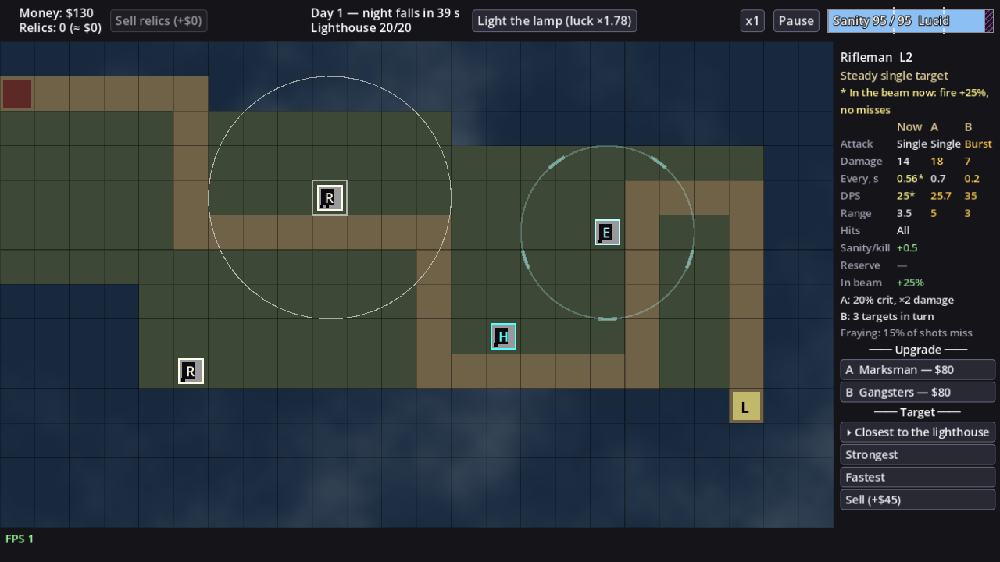
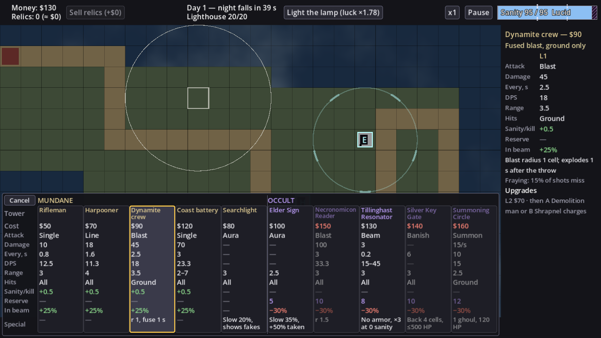
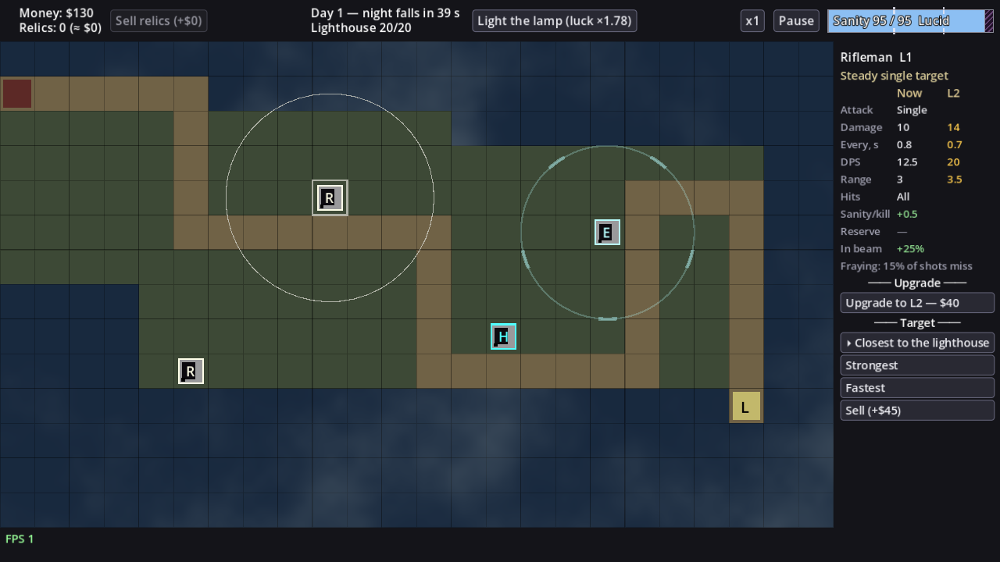

# LT-43 — Unified tower stats table: picker and side panel (design note)

Status: draft for the owner's review · branch `docs/LT-43-stats-table`. Line numbers are
`release-0.3.0` at `594d24b`. Implementation: LT-53, after every LT-46 tower exists.

Source: owner, playtest 0.2.1: "Можно еще короче, возможно сделать унифицированную таблицу
так чтобы у всех башен было одинакого: дамаг/тип дамага/санити при убийстве/санити
требуемое и тп". 0.3 planning: "сейчас когда мы выбираем башни из списка - это делать
неудобно, там слишком много информации. Нужно это тоже как-то таблицеизировать".

Inputs: LT-46 roster (§1, §2 numbers, §3 sanity/beam), LT-30 beam addendum (§2, §3.1:
lit mundane `fire_interval × 0.8` and no misses = +25 % fire rate; lit occult −30 % power),
LT-37 short texts, LT-28 UI polish.

---

## 0. Today

- **Picker** (`ui/tower_picker.gd`): inside the 192-unit-wide side panel, one button per
  tower ("Rifleman — $50") and under it a free-text block (role + `TowerInfo.lines()`:
  "Damage 10 every 0.8 s (12.5 DPS)", "Range 3 cells", effect lines, kind lines). With 4
  towers that is already ~30 lines; with 10 it is ~75 lines of scrolling, and no two towers
  can be compared without scrolling (LT-46 P15 predicted the overflow).
- **Tower panel** (`ui/tower_panel.gd`): the same free text for the current level, then per
  upgrade a "Stat a → b · …" delta line plus effect lines (`TowerInfo.delta_lines`). Each
  tower prints different lines in a different order (a support tower has "Aura radius"
  instead of "Range", only occult towers print a reserve, only mundane ones the kill regen).
- Geometry (base viewport 1152×648, `canvas_items` stretch; ×1.11 at 1280×720): board
  960×600 at (0, 48); side panel 192×600 at (960, 48), 176 units of content.

## 1. Shared row set (every tower, same rows, same order)

| Row | Shows | Not applicable → | Source (nothing hand-written) |
|---|---|---|---|
| **Attack** | Single / Line / Blast / Burst / Beam / Aura / Banish / Summon | — | derived from the level, first match: `summon_max` → Summon; `banish_cells` → Banish; `damage ≤ 0` → Aura; `sanity_scaling` → Beam; `burst_targets` → Burst; `pierce` → Line; `aoe_radius` → Blast; else Single |
| **Damage** | per hit; Summon: unit DPS "15/s" | — (Aura, Banish without damage) | `damage`, `summon_dps` |
| **Every, s** | time between actions (shot, cast, summon) | — (Aura) | `fire_interval` |
| **DPS** | damage ÷ interval × targets per shot, 1 decimal; Summon: `summon_dps × summon_max`; Beam: picker "15–45" (sanity 100 → 0), panel the live value at current sanity (Q3) | — | `_dps` extended (§6) |
| **Range** | cells; "2–7" with a dead zone | never empty | `range`, `min_range` |
| **Hits** | All / Ground | never empty | tower `targets`; Summon: `summon_flying` |
| **Sanity/kill** | "+0.5" | — (occult, support) | `config.sanity.regen_mundane_kill` for a mundane tower with damage |
| **Reserve** | "10" (sanity cap taken) | — (mundane) | `sanity_reserve` |
| **In beam** | mundane "+25%" (green), occult "−30%" (red) | — (Searchlight: support) | `config.economy.beam.mundane.fire_interval_mult` / `occult.power_mult` (LT-30) |
| **Special** | what the rows above cannot say: "r 1, fuse 1 s", "Slow 35%, +50% taken", "No armor, ×3 at 0 sanity", "Back 4 cells, ≤500 HP" | — | effect keys not consumed by a row (§6 `special_short`) |

Empty / not applicable: one em dash "—" in the dim colour, never "0" and never a hidden row.
So every tower shows the same 10 rows (the owner's "у всех башен одинаково").

Kind-level rules (the same for all towers of a kind) are one line under the table, not a row:
mundane "Fraying: 15% of shots miss", occult "Madness: ×2 damage, astray" (or "Unaffected by
madness"); both come from `TowerInfo.kind_lines` (124-144) minus the kill line, which is now
the Sanity/kill row.

Colours: mundane names/headers warm (`COLOR_ROLE`), occult violet; gain green, loss red,
reserve violet, a value that changes with an upgrade gold, dash dim grey.

## 2. Branch deltas

The panel table has one column per state: **Now | L2** at L1, **Now | A | B** at L2, **Now**
only at L3 (plus "Max level", as today).
- A cell that differs from Now is gold; equal cells keep their normal colour.
- A row whose values are equal in every column is printed once, across all columns
  ("Hits All", "In beam +25%"): the eye goes to what changes. (Decided here, not asked:
  the alternative, repeating it, only adds noise.)
- Special lines under the table, prefixed by column: "A: 20% crit, ×2 damage",
  "B: 3 targets in turn"; an effect the branch drops reads "B: Loses: …" (today's `REMOVED`).
- Upgrade buttons stay as today ("A  Marksman — $80", disabled with the reason, madness
  warning), with the branch role line under each button (LT-24 "role first").

Mockups are a throwaway Godot prototype over the real board, rendered at 1280×720; numbers are
LT-46 §2 placeholders, the board shows existing towers only (the Resonator mockup stands on a
Reader's "N" glyph), and the role line of the Searchlight is a placeholder.

Mockups: [L1 → L2](LT-43/panel-l1.png), [L2 → A/B, lit by the beam](LT-43/panel-l2-lit.png),
[occult L2 → Pure/Corrupted](LT-43/panel-occult-l2.png).

## 3. Picker: one table for all 10 towers

- **Towers are columns, the §1 rows are rows** (transposed). 10 columns × 88 units + the
  label column = 953 × 274 units: the full board width, under half the board height.
- **An overlay on the board**, not in the side panel: placed in the half of the board away
  from the clicked cell (cell in the upper half → overlay at the bottom, [lower half → top](LT-43/picker-top.png)),
  so the selected cell and its range ring stay visible. Mundane left, occult right, with a
  kind band ("MUNDANE" / "OCCULT") and a divider; order inside a kind = `towers.json` order.
- **Each column is one button** (`picker.buttons[def_id]` keeps its meaning for the tests):
  one click builds, as today. Unaffordable: the column dims and the cost turns red; other
  refusals put the reason in the cost cell ("$90 · only by day"); a reserve that would take
  the cap to 0 marks the Reserve cell red with "!" (today's `MADNESS_WARNING`).
- **Hover** a column: it gets a gold frame, the range ring on the clicked cell takes that
  tower's range, and the side panel shows the tower's L1 card (same table, one column, plus
  the special line, the kind line and its upgrade path "L2 $70 · then A Demolition man or B
  Shrapnel charges"). Without hover the side panel shows "Pick a tower to build".
- Cancel: the button at the top-left of the table, Esc, or a click elsewhere on the board
  (today's `outside_clicked`).
- Long names: the name font shrinks (13 → down to 10) until the longest word fits the
  column (mockup: "Necronomicon Reader" at 11); names wrap to at most 2 lines.
- Overflow guard: if a future roster has more than 10 towers, columns shrink to 76 units
  (12 towers) and beyond that the table scrolls horizontally; LT-53 pins the 10-tower size.

Alternative considered (Q1 B): [a one-line-per-tower list inside the side panel](LT-43/alt-picker-in-panel.png):
fits without covering the board, but only name, cost and DPS fit in 176 units; names are cut
("Dynamite cr…") and comparing anything else needs a hover per tower.

## 4. Side panel for a placed tower

Top to bottom: title "Rifleman  L2" (+ branch name at L3) · role · beam status line (only
while lit, §5) · the §1 table (Now | next columns, §2) · special lines · kind line ·
"── Upgrade ──" buttons with role lines · "── Target ──" priority switch (LT-31, unchanged)
· Sell · Cancel. Table: label column 62 units, value columns `(176 − 62 − gaps) / n`
(36 units at 3 columns): values use font 12; the longest shipped value ("Summon", "Ground",
"−30%") fits. The occult L2 case is the tallest (~640 units with every section): the panel
already scrolls (`side_panel_test` "long content scrolls"), so Sell stays reachable.

## 5. Beam buff/debuff display

- **Static** (what the beam would do): the "In beam" row in both picker and panel, from the
  LT-30 config: "+25%" (mundane, green) / "−30%" (occult, red) / "—" (support mundane).
- **Live** (the tower is lit now, `SimTower.lit` from LT-30): a pale-yellow line under the
  role "* In the beam now: fire +25%, no misses" (occult: "* In the beam now: −30% power"),
  and the Now cells it changes show the lit value with "*": mundane Every 0.7 → "0.56*",
  DPS 20 → "25*"; occult Damage/DPS × 0.7 (Elder Sign: the special line's slow/taken values).
  Upgrade columns stay unlit (they compare base numbers). While lit, the mundane kind line
  "Fraying: 15% of shots miss" reads "Fraying: no misses while lit". `refresh()` already
  runs every frame, so the marker follows the beam.

## 6. Edit map for LT-53

References were found with grep (GDScript is not indexed by g-mesh): `grep -rn
'TowerInfo\.\(lines\|delta_lines\|kind_lines\)'` → `ui/tower_picker.gd:33`,
`ui/tower_panel.gd:102`, `:141`; `grep -rln 'picker\.\|tower_panel\|TowerInfo'` → the tests
listed below and `ui/hud.gd` (only `money`/`num`/`MINUS`: untouched).

| File (lines) | Change |
|---|---|
| `ui/tower_info.gd` | new `const ROWS` (keys + labels, §1 order) and `static func row_values(def, s, cfg: GameConfig, sanity_now := -1.0) -> Dictionary` (one string per row, `DASH` for n/a); helpers `attack_text(s)`, `dps_text(def, s, cfg, sanity_now)` (from `_dps` 210-211, × targets, summon, beam range/live), `range_text(s)` (min_range), `beam_text(def, s, cfg)`, `special_short(s) -> String` (≤ 2 lines at 85 units, ~26 chars) and `special_lines(s)` (full, from `effect_lines` 102-121 minus keys a row consumes: `pierce`, `burst_targets`, `summon_dps/max`, `sanity_scaling` stays). `lines()` (74-87) and `_damage_text` (204-206) are removed; `kind_lines` (124-144) loses the kill line; `delta_lines` (147-194) loses the stat line and the reserve line (the table shows both) and keeps the effect/Loses/madness part, renamed `special_delta_lines`. New `lit_values(def, s, cfg) -> Dictionary` (Every/Damage/DPS under the beam). `EFFECT_GROUPS` (40-44) and `_effect_text` (219-242) stay (each tower task adds its keys). |
| new `ui/stats_table.gd` (`class_name StatsTable extends VBoxContainer`) | `set_columns(heads: Array[String], cols: Array[Dictionary], lit: Dictionary)`: header row, one HBox per row, spans equal rows, gold for changed cells, lit overrides with "*"; used by the panel and the picker's side card. Presentation only. |
| `ui/tower_picker.gd` (whole file, 1-76) | becomes `extends PanelContainer`, the overlay of §3: `_ready` (18-37) builds the label column and one column-button per tower grouped by `kind`; `open_for` (40-47) also places it (`_anchor(cell)`: top/bottom by the cell's half); `refresh` (58-71) sets disabled, cost colour and reason, Reserve "!" per column; `mouse_entered/exited` per column → `hovered_changed(def_id)` signal and `board.selected_range`; Esc closes. Keep `buttons`, `cell`, `close()`, `REASONS`. |
| `ui/side_panel.gd` `_ready` (55-90), `_update_idle` (92-95) | the picker is no longer a child of `views`; add a `picker_card` (title, role, `StatsTable`, special + kind + upgrade-path lines) shown while the picker is open; idle text "Pick a tower to build" while open with no hover. `panel_rect` (48-52) unchanged. |
| `scenes/game.gd` `_ready` (99-104) | create `TowerPicker` and add it to `ui` above `side_panel`; connect `hovered_changed` to `side_panel.show_card`; `close_panels` (225-227) and `_on_cell_clicked` (230-238) unchanged. |
| `ui/tower_panel.gd` | `_ready` (31-64): `stats_label` → `StatsTable` + `special_label` + `kind_label` + `lit_label`; `refresh` (88-124): columns `[s] + upgrade targets` (heads Now/L2 or Now/A/B), lit from `t.lit`; `_refresh_upgrade` (127-145): button text unchanged, `info` = role + `special_delta_lines`. |
| `scenes/board.gd` (84-85) | none: `selected_cell`/`selected_range` already exist; the picker writes the hovered range. |
| Tests | `tests/tower_info_test.gd` (29 tests; `lines`/`delta_lines` expectations → `row_values` per tower and level, one test per §1 row incl. the dash cases, `special_delta_lines`); `tests/side_panel_test.gd` picker tests 209-251, 386-411, 575-587 (texts move from button text to column cells) and panel tests 253-296, 413-463; `tests/scene_game_test.gd` 74-95 and `tests/window_scale_test.gd` 142-144 click `picker.buttons[...]` (still valid if columns stay buttons). New: overlay anchoring (cell upper/lower half), overlay inside the board rect at 10 towers, hover → card + ring, lit marker, equal-row spanning, a screenshot check at 1280×720 (LT-46 P15). |

Data: no new config. All values come from `TowerDef`/`TowerDef.Level` (LT-46 §2.3 fields),
`SanityConfig` (`regen_mundane_kill`, thresholds, `madness.damage_multiplier`, `max`) and
`EconomyConfig.beam` (LT-30). Order of work: LT-30 S2 (`SimTower.lit`, `beam` config) and
the tower tasks LT-47..LT-52 land first.

## 7. Questions for the owner

### Q1. Where the build table lives

**Today:** clicking an empty cell fills the narrow right panel with ~30 lines of text for 4
towers; with 10 towers it becomes ~75 lines and you scroll to compare.
**Change:** one compact table.
**Example:** you click a cell near the top of the map with $130; you want the best DPS you
can afford.
- **A. Wide table over the board, towers as columns (Recommended)** ([mockup](LT-43/picker-bottom.png)).
  All 10 towers and all rows at a glance, appears in the half of the map away from the cell,
  hover shows the full card on the right. − Covers half the map while open (by day only, the
  map is still).
- **B. Short list in the right panel** ([mockup](LT-43/alt-picker-in-panel.png)): name, cost,
  DPS per line, the rest on hover. + Never covers the map. − Only 3 values fit, long names
  are cut, comparing anything else needs hovering tower by tower.
- **C. Wide table, towers as rows** (classic orientation). + Reads like a spreadsheet.
  − 10 rows × ~30 units plus header ≈ 400 units: covers two-thirds of the map, the clicked
  cell is often hidden.

### Q2. What "damage type" means

**Today:** nothing shows it; the attack shape is buried in effect lines ("Pierce: 1-cell-wide
line", "Blast radius 1.5 cells").
**Change:** one row, the same for every tower.
**Example:** Harpooner vs Necronomicon Reader.
- **A. Attack shape: Single / Line / Blast / Burst / Beam / Aura / Banish / Summon; mundane
  vs occult shown by the column colour and the band (Recommended).** + Tells how it hits,
  which is what you choose by; kind is still visible. − "Mundane/occult" is a colour, not a word.
- **B. Kind: Mundane / Occult.** + Literal "type". − Two values for 10 towers; the shape stays
  hidden in Special.
- **C. Both rows.** + Nothing hidden. − One more row (picker 292 units tall, still under half
  the map).

### Q3. DPS of the Resonator (damage grows as sanity falls)

**Today:** DPS is damage ÷ interval, a fixed number.
**Change:** the Resonator's damage depends on current sanity (LT-46 Q2).
**Example:** Resonator L1, sanity 77: real DPS 22; at 100 it is 15, at 0 it is 45.
- **A. Picker shows the range "15–45", the panel the live value at current sanity with a
  line "DPS at sanity 77; grows as it falls" (Recommended).** + Before building you see the
  potential, after building what it does now. − Two formats for one row.
- **B. Range everywhere.** + One format. − The panel never says what it does right now.
- **C. Live value everywhere.** + Always exact. − In the picker at full sanity it looks like
  the weakest occult tower.

### Q4. Showing the beam on a lit tower

**Today:** nothing shows that a tower is in the beam (LT-30 adds the effect, no UI text).
**Change:** the "In beam" row says what the beam would do; this question is about the moment
it does it.
**Example:** a Rifleman L2 (0.7 s, 20 DPS) is swept by the beam.
- **A. Live values with "*" and a line "* In the beam now: fire +25%, no misses" (Recommended)**
  ([mockup](LT-43/panel-l2-lit.png)). + You see the real numbers and why. − The Now column
  flickers between 0.7 and 0.56 as the beam sweeps.
- **B. Base numbers always; only the status line appears.** + Calm table. − You do the math.
- **C. Nothing beyond the "In beam" row.** + Simplest. − The beam's value stays invisible.

### Q5. One click builds, or click then confirm

**Today:** one click on a tower button builds it.
**Change:** with hover you can read the card before clicking; on a touch screen (web on a
tablet) there is no hover.
**Example:** you want to read the Dynamite crew's card before paying $90.
- **A. One click builds; hover shows the card (Recommended).** + As fast as today. − On touch
  you cannot read the card before building (sell refund covers mistakes by day).
- **B. Click selects (card shows), a "Build $90" button builds.** + Works on touch, no
  accidental builds. − Two clicks for every tower, every game.
