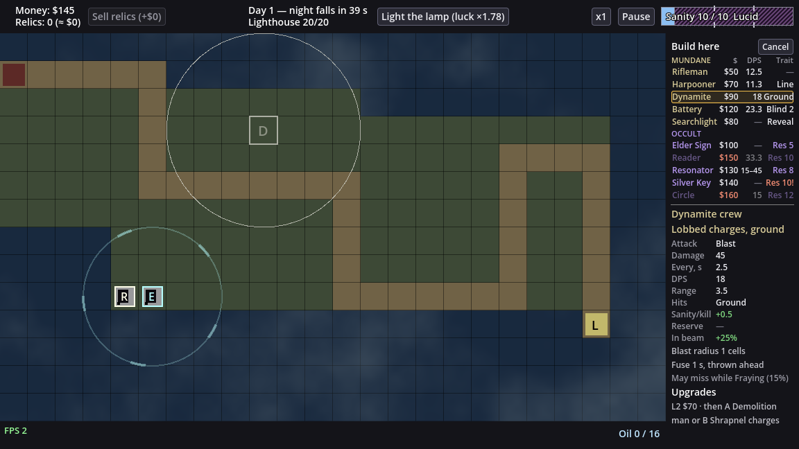
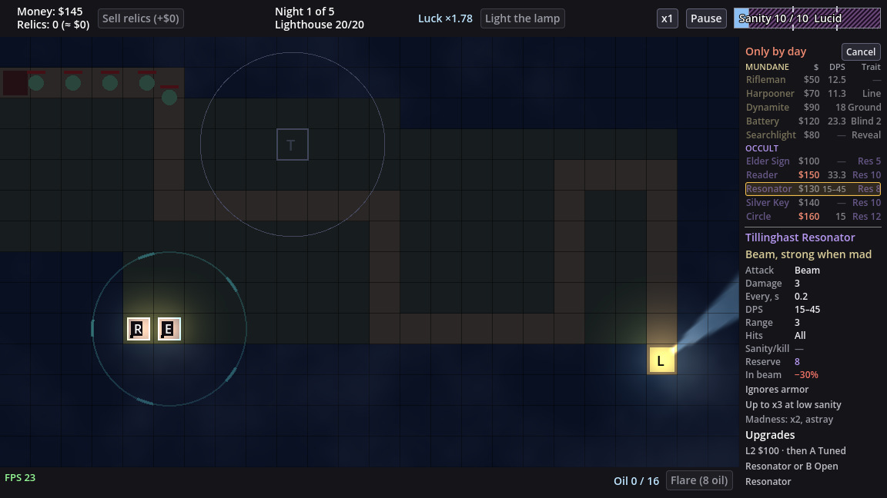
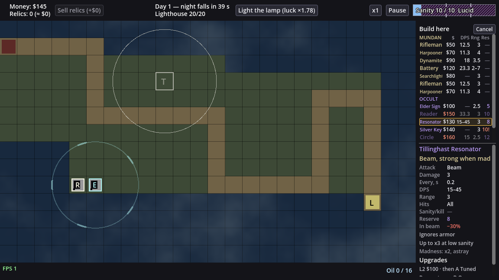

# LT-61 — Build list in the side panel (design note)

Owner after the LT-54 playtest: "Таблица башен снизу - вообще не удобная, лучше ее делать в
боковом меню. Надо наверное ввести аббревиатуры чтобы не растягивать панель". Chosen layout:
"Список + карточка (Recommended)". This note reuses LT-43 (§1 rows, §3 picker states, the
rejected Q1 B list, [mockup](LT-43/alt-picker-in-panel.png)), LT-37 (short texts) and LT-46
(roster, P15) instead of re-deriving them.

Prototype renders of the real game at 1152×648 (a throwaway script built the list from the
live sim and `TowerInfo.row_values`, then was deleted). Day: $145 (Reader $150 and Circle $160
unaffordable), sanity cap 10 (Silver Key's reserve 10 would drive you mad: "Res 10!"). Night:
the wave is running, so every row is refused. The first round's layout (Q1 C: $, DPS, Rng,
Res) is kept for comparison: [day](LT-61/panel-list-day.png),
[night](LT-61/panel-list-night.png). In all renders the card is shown for the hovered row.

## 0. Today

- `TowerPicker` (`ui/tower_picker.gd`) is a 944 × 274 px `PanelContainer` over the board: 10
  columns × 88 px + a 64 px label column, one `Button` per column, all 10 `TowerInfo.ROWS`.
  `_anchor` puts it in the board half away from the clicked cell; it still hides half the map.
- Hovering a column frames it gold, sets the range ring on the cell and emits
  `hovered_changed`; `SidePanel.show_card` then shows the L1 card (title "Name — $cost", role,
  one-column `StatsTable` with an "L1" head, special lines, kind lines, upgrade path).
  Leaving the column hides the card ("Pick a tower to build").
- Refusals: unaffordable → column dimmed, cost red; other refusals → "$50 · by day" in the
  cost cell (`CELL_REASONS`, `_cost_with_reason`); madness → Reserve cell red "10!".
- Close: Cancel (top-left of the table), Esc (`_input`), a click elsewhere
  (`Board.outside_clicked` → `Game.close_panels`).

## 1. Layout: list on top, card below (the 600 px split)

**Today:** the panel is one `ScrollContainer` (`SidePanel.scroll`) of views; while picking it
holds only the card. **Change:** while the build view is open the panel is a `VBoxContainer`:
the list (`TowerPicker`, now a panel child, not a board overlay) on top at its natural height,
then the existing `Scroll` (card, tower panel, lighthouse panel) filling the rest.
**Example (measured):** list 243 px = title line 22 + two group lines 2 × 16 + 10 rows × 18 +
separator 9. Card area 584 − 243 = 341 px (panel 600 − 2 × 8 margin). Card heights of all ten
towers: 277–336 px (Resonator and Summoning Circle 336), so every card fits without a
scrollbar.
**Consequence:** to fit, the card drops two lines: the title loses "— $cost" (the row shows
the cost; the title now gives the full name, so short names stay unambiguous) and the
one-column table loses its "L1" head row (nothing to compare against).
+ Board never covered; card always on screen next to the list. − 5 px of slack: one more
special line on a future tower makes its card scroll (the `Scroll` already handles it, so
nothing is cut).

## 2. Columns: $, DPS, Trait (owner's "колонка под особенности")

**Today:** all 10 rows per tower. **Owner (Q1, new option):** "Может сделать колонку под
особенности? у оккультных башен - там безумие, у динамита - только по земле?".
**Change (Q1 A, recommended):** one row per tower: short name, cost, **DPS** and a **Trait**
tag, the one property to know before building. Rng and Res leave the row: range shows as the
ring on the board on hover (and in the card), the reserve is the occult trait.
**Example:** `Dynamite  $90  18  Ground`; `Silver Key  $140  —  Res 10!`.

Trait per tower, derived from data by one rule (`TowerInfo.trait_text`, first match), so a new
tower gets a tag without a table:

| Rule (first match) | Tag | Towers | px at 12 |
|---|---|---|---|
| occult kind: `sanity_reserve` (the madness risk) | `Res 10`, red `Res 10!` when building drives you mad | Elder Sign 5, Reader 10, Resonator 8, Silver Key 10, Circle 12 | ≤ 41 |
| `targets: ground` | `Ground` | Dynamite crew | 44 |
| `min_range` > 0 | `Blind 2` (can't fire within 2 cells) | Coast battery | 40 |
| `pierce` effect | `Line` | Harpooner | 25 |
| `reveal_fakes` effect | `Reveal` | Searchlight | 39 |
| `aoe_radius` effect (mundane, not caught above) | `Blast` | none today | 29 |
| none | `—` | Rifleman | 12 |

Column widths (px, font 12): name 62, $ 30, gap 4, DPS 34, Trait 46 = 176 = the panel's
inner width, no horizontal scroll. (S3 review: with name 66 and no gap "$130" and "15–45"
touched and read as "$13015–45"; the name column gave 4 px to a gap after $.) Widest tag "Ground" 44. The madness "!" stays where it was: after the
reserve value, now inside the Trait cell ("Res 10!", red).
**Consequence:** the occult towers' own effects (slow, banish, summon, the Resonator's "strong
when mad") are not in the row; they are in the card's Attack row and special lines.
+ Answers the owner's two examples in the row; 46 px leaves room for a tag. − Range is no
longer comparable down the list (one hover per tower; the ring shows it on the board); "Blind 2"
is a new word. Variants in **Q1**.

### Variants considered

- **A. Trait replaces Rng and Res (Recommended)**, as above. Screenshots at the top.
- **B. Two-line rows:** keep `$ DPS Rng Res`, add a small (11 px) second line under each name
  with the trait of every tower, occult included ("Ground · blast", "Banish · −10 cap"). Rows
  18 → 30 px: list 243 → 363 px, card area 341 → 221 px, so every card (277–336 px) scrolls.
- **C. No trait column (first round):** `$ DPS Rng Res`; Ground, Blind and the rest only in the
  card. [day](LT-61/panel-list-day.png), [night](LT-61/panel-list-night.png).

Ruled out: a trait column next to Rng and Res. 176 − 66 − 30 − 34 − 24 − 22 = 0 px left;
shrinking the names to 11 px gives ~8 px more, still under "Line" (23 at 11 px). A one-letter
trait code (G, L, B) would fit 22 px but needs a legend.

## 3. Abbreviations

**Change:** list headers `$`, `DPS`, `Trait`, on the MUNDANE line (the OCCULT line repeats no
headers), grey at 11 px, each with a tooltip ("Cost", "Damage per second", "What sets it apart:
Ground = never hits flyers, Blind N = can't fire within N cells, Line = pierces, Reveal = shows
fakes, Res N = sanity reserve, ! = building it drives you mad"). Each row's tooltip names its
own trait in full. **StatsTable row labels stay as they are** ("Every, s", "Sanity/kill", "In
beam"): they fit 62 px today, and the card shows the full words.
+ No new vocabulary in the card. − "Res" and "Blind" are the least obvious tags; the header
and row tooltips explain them.

## 4. Short names

**Today:** full names wrap to two lines in an 88 px column. **Change:** an optional `short`
field per tower in `data/towers.json` (defaults to `name`), shown in the list; the card title
keeps the full name. **Example (width at 12 px, column 66):**

| Tower | Short (recommended) | px | Alternative | px |
|---|---|---|---|---|
| Rifleman | Rifleman | 52 | | |
| Harpooner | Harpooner | 64 | | |
| Dynamite crew | Dynamite | 57 | | |
| Coast battery | Battery | 43 | | |
| Searchlight | Searchlight | 65 | Lamp | 33 |
| Elder Sign | Elder Sign | 57 | | |
| Necronomicon Reader | Reader | 42 | Necronom. | 65 |
| Tillinghast Resonator | Resonator | 60 | Tillinghast | 60 |
| Silver Key Gate | Silver Key | 56 | Key Gate | 52 |
| Summoning Circle | Circle | 33 | Summoning | 70 (does not fit) |

"Necronomicon" (86) and "Summoning" (70) do not fit 66 px. Data, not a UI table, so a modder's
new tower gets its short name in the same place as its name. With the name column at 62 px
(§2, S3 review) "Searchlight" (65) and "Harpooner" (64) shrink to 11 px (`_fit_names`); a
test asserts every shipped short name fits 62 px at 10-12 px without an ellipsis.
+ No ellipses at 10 towers. − Two names change identity ("Reader", "Circle"): the board glyphs
are N and C, and the card title shows the full name on hover. Owner (Q2): "Reader, Circle и т.п. (Recommended)".

## 5. More than 10 towers

**Change:** the list grows with the roster up to `LIST_MAX_ROWS = 14` rows (list 315 px, card
area 269 px; taller cards scroll in `Scroll`). Past 14 the rows go into the list's own
`ScrollContainer` (mouse wheel), the header line pins above it, and the name column gives up
the scrollbar's width (14 px): names then shrink 12 → 10 px to fit (LT-43 `_fit_names` rule),
then end in an ellipsis.

(The 14-row render duplicates 4 shipped towers to fake a larger roster, and uses a 12-row
viewport to show the scroll.) + 10 shipped towers and up to 4 more never scroll. − Past 14 the
names shrink and the longest ("Searchlight") is cut; acceptable for a future roster. (The
14-row render predates the Q1 trait column; the scroll mechanics are the same.)

## 6. Row states (refusal, cost, madness)

**Today:** per-column reason text in the cost cell. **Change:**
- **Unaffordable** (`NOT_ENOUGH_GOLD`): as today: row disabled, name and stats dimmed
  (`DIM`), cost red (`STATUS_COLOR`), not dimmed. Example: "Reader $150" at $145.
- **Any other refusal** (`NOT_BUILD_PHASE`, `OUTCOME_REACHED`, and the defensive
  `NOT_BUILDABLE`/`OCCUPIED`): these are per cell or per phase, so they are the same for every
  row. The title line "Build here" becomes the reason in `STATUS_COLOR` ("Only by day", "Run
  over", from `TowerInfo.REASONS`), and the rows dim. No per-row reason text, so
  `CELL_REASONS` and `_cost_with_reason` go. At night an unaffordable row still shows a red
  cost (`can_build` checks gold before the phase), as today.
- **Madness**: the Trait cell turns red with "!" ("Res 10!"), row enabled, as today's
  Reserve cell; the tooltip keeps `MADNESS_WARNING`.
- Tooltip per row: full name — cost, plus "(reason)" or the madness warning, as today.

+ One reason line instead of ten identical ones; nothing is cut in a 30 px cost cell.
− A future per-tower refusal (e.g. a `NOT_AVAILABLE` unlock) would need a row marker; today
`can_build` never returns one.

## 7. Choosing: hover, the cell on the board

**Owner (Q3):** "Скрывается, как сейчас". **Change:** hover frames the row (1 px gold border,
faint gold fill) and shows its card; leaving the row clears the frame, the card hides and the
panel shows "Pick a tower to build", as today. One click on a row builds (LT-43 Q5 unchanged).
**On the board:** the clicked cell keeps its outline and the hovered tower's range ring (as
today; with Q1 A the ring is where range is read), plus a new **ghost glyph**: the tower's
board letter at 55 % alpha in the cell (the "D" and "T" in the screenshots).
**Example:** you hover "Dynamite": the cell shows "D" and a 3.5-cell ring, the card shows
Dynamite crew. **Consequence:** the card is read with the mouse on the row (it is not
interactive).
+ Same behaviour players know; the board is uncovered, so clicking another buildable cell
retargets the open list (today's `_on_cell_clicked` closes and reopens). − Moving the mouse
down onto the card leaves the row and hides the card (the owner's choice).

## 8. Keyboard, Esc, cancel

**Change:** Cancel button moves to the right of the title line ("Build here … [Cancel]"); Esc
and a click off the grid close as today; closing clears the ring, ghost glyph and card. No new
keys in LT-61. Owner (Q4): "Только Esc, как сейчас (Recommended)".
+ No new input to test or teach. − Mouse only, as today.

## 9. Owner questions

Answered:
- Q1 (round 2): "A: $ · DPS · Trait (Recommended)"
- Q2: "Reader, Circle и т.п. (Recommended)"
- Q3: "Скрывается, как сейчас"
- Q4: "Только Esc, как сейчас (Recommended)"

Open:

1. **Q1. The trait column** (the owner's own option: "Может сделать колонку под особенности?
   у оккультных башен - там безумие, у динамита - только по земле?"). Example: Silver Key at
   sanity cap 10.
   - **A. `$ DPS Trait`, Trait replaces Rng and Res (Recommended):** "Silver Key $140 — Res 10!",
     "Dynamite $90 18 Ground"; one line per tower, every card fits without scrolling.
     − Range only on hover (ring + card); occult effects (banish, summon) only in the card.
   - B. Two-line rows, `$ DPS Rng Res` + a trait line for every tower: "Silver Key $140 — 3
     10!" / "Banish · −10 cap". Nothing leaves the row. − List 363 px, every card scrolls in
     the remaining 221 px.
   - C. `$ DPS Rng Res`, no trait column (first round): range comparable down the list.
     − Ground and Blind only in the card; the owner's Dynamite example is not answered.

## 10. Edit map for the code slice

Change:

| File | Lines | Change |
|---|---|---|
| `ui/tower_picker.gd` | 1-14 doc, 16-45 consts, 47-58 vars | `extends VBoxContainer` (in the panel, not over the board). Drop `COL_W*`, `LABEL_W`, `DIVIDER_W`, `NAME_H`, `SPECIAL_H`, `WRAP_SPACING`, `BAND_H`, `MARGIN`, `CELL_REASONS`, `col_w`. Add `NAME_W 62` (S3: was 66), `COST_W 30`, `COST_GAP 4`, `DPS_W 34`, `TRAIT_W 46`, `ROW_H 18`, `GROUP_H 16`, `LIST_MAX_ROWS 14`, `scrollbar_w()` (the real v-scrollbar width, S3: was a fixed 14), `HEADS` (text + tooltip), `title_label`. Keep `buttons`, `costs`, `names`, `cells` (keys now `dps`, `trait`), `hovered`, `cancel_button`, `cell`, `REASONS`, `STATUS_COLOR`, `DIM`, `MAD_MARK`, `GROUP_TITLES`, `COLOR_FRAME`, signal. |
| `ui/tower_picker.gd` | 61-135 `_ready` | Title line (title label + Cancel), MUNDANE line with heads, rows, OCCULT line, rows; rows in a `ScrollContainer` with min height capped at `LIST_MAX_ROWS` (§5). No board-width maths. |
| `ui/tower_picker.gd` | 138-148 `_label_column`, 151-191 `_column` | Replace by `_head_line(kind, with_heads)` and `_row(id, def)`: a flat `Button` (transparent normal/disabled box) holding an HBox of 4 labels (name, cost, DPS, trait); short name from `def.short_name`; trait from `TowerInfo.trait_text`. |
| `ui/tower_picker.gd` | 194-208 `_fit_names` | Fit to `NAME_W` (minus `scrollbar_w()` when scrolling; the pinned heads get a spacer of that width), 12 → 10, then ellipsis. |
| `ui/tower_picker.gd` | 211-230 `open_for`, `_anchor` | Drop `_anchor`; `open_for` also sets `board.selected_glyph`. |
| `ui/tower_picker.gd` | 233-241 `close` | Also clear `board.selected_glyph`. |
| `ui/tower_picker.gd` | 244-290 `refresh`, `_cost_with_reason` | §6: title reason from the first non-gold refusal; when every row is refused for gold, "Only by day" at night, else "Not enough money" (S3 review); drop `_cost_with_reason`; madness "!" on `cells[id]["trait"]` (was `["reserve"]`). |
| `ui/tower_picker.gd` | 304-336 `_on_hover`, `_set_hovered`, `_frame` | §7: hover/exit as today (exit clears, card hides); frame = 1 px gold + faint fill; set/clear `board.selected_glyph`. |
| `ui/side_panel.gd` | 19-33 vars, 68-104 `_ready` | Build a `Layout` VBox: picker (created here, like `tower_panel`) above `scroll`, `scroll` expand-fill. |
| `ui/side_panel.gd` | 107-112 `attach_picker` | Gone or reduced to connecting signals of the panel's own picker. |
| `ui/side_panel.gd` | 115-132 `show_card` | Title = `def.name` (no cost); `set_columns` with heads `[""]` (no head row). |
| `ui/stats_table.gd` | 66-112 `set_columns` | Skip the `Head` row when every head is "" (tower panel unchanged). |
| `scenes/game.gd` | 35, 104-109 `_ready` | `picker = side_panel.picker`; no overlay added to `ui`. |
| `scenes/board.gd` | 166-167 vars, 531-540 in `_draw` | `selected_glyph := ""`, drawn at 55 % alpha in `selected_cell` like `_draw_tower` (598) draws a glyph. |
| `sim/defs/tower_def.gd` | 5 `FIELDS`, 30-45 `parse` | Optional `short` → `short_name` (default `name`; strip, non-empty). |
| `data/towers.json` | 10 tower entries | `short` per Q2 A: Reader, Circle, Battery, Dynamite, Resonator, Silver Key; the other four keep their names. |
| `ui/tower_info.gd` | new, next to `range_text` 277-281 | `trait_text(def, s) -> String`, the §2 rule table (occult "Res N" via `num`; else Ground, Blind N, Line, Reveal, Blast, `CELL_DASH`). |

Read for context: `ui/tower_info.gd` `ROWS` 191-195, `row_values` 203-216, `dps_text`
264-274, `range_text` 277-281, `cost_text` 62, `REASONS` 19-34; `ui/stats_table.gd`
`color_for` 46-57, `kind_color` 60-62; `ui/ui_style.gd` `theme` (button boxes);
`scenes/game.gd` `close_panels` 283-287, `_on_cell_clicked` 289-298, `_consume_events` 274;
`sim/core/simulation.gd` `can_build` 207-219, `would_drive_mad_build` 354-358.

Tests to change (they use `picker.buttons/costs/cells/names/hovered/cancel_button/col_w/
get_global_rect`): `tests/picker_overlay_test.gd` (all 9: overlay anchoring and board-rect
tests become "picker inside `SidePanel.panel_rect`, board uncovered"; "by day in a cost cell"
becomes "title shows Only by day"; hover test keeps exit-hides), `tests/tower_picker_groups_test.gd`
(10; "fit the board" becomes "fit 176 px, no horizontal scroll"; cost-cell reason test goes),
`tests/side_panel_test.gd` 211, 251, 414, 606, `tests/scene_game_test.gd` 77-105,
`tests/stats_panel_test.gd` 177, `tests/window_scale_test.gd` 137, `tests/relic_ui_test.gd`,
`tests/lighthouse_ui_test.gd` (one `picker` reference each). New: short names fit `NAME_W` at
12 px; 10 rows + every card fit 584 px with no list scroll; a 15-tower config scrolls the list
and keeps the header; `trait_text` for all 10 towers + the Blast and dash fallbacks; madness
"!" in the trait cell; ghost glyph set/cleared; `short` parse (default, wrong type).
