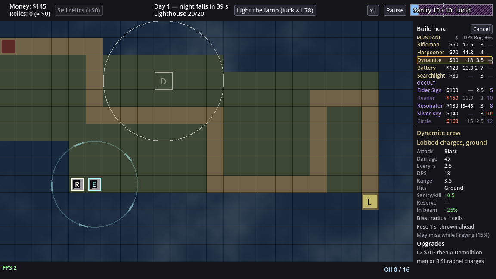
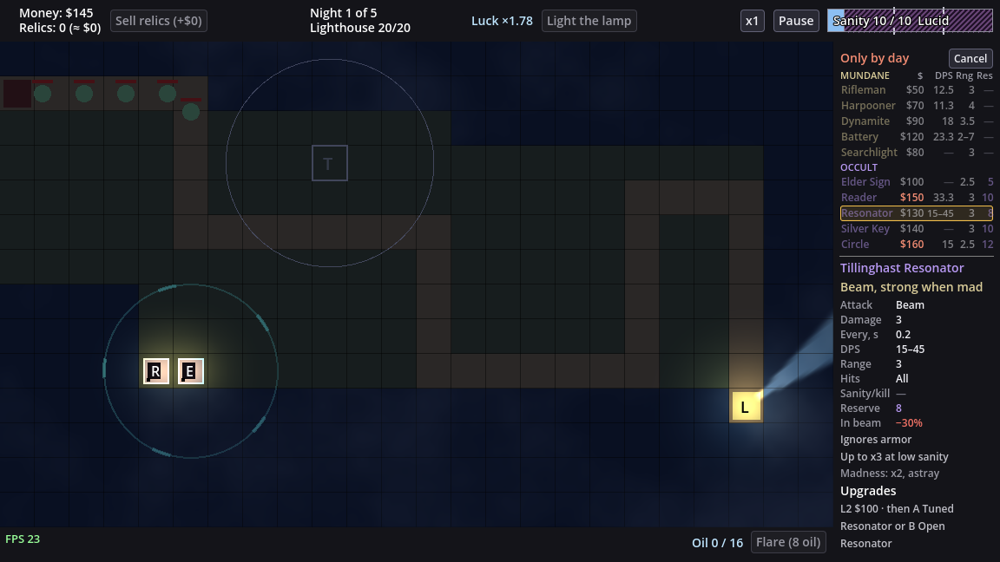

# LT-61 — Build list in the side panel (design note)

Owner after the LT-54 playtest: "Таблица башен снизу - вообще не удобная, лучше ее делать в
боковом меню. Надо наверное ввести аббревиатуры чтобы не растягивать панель". Chosen layout:
"Список + карточка (Recommended)". This note reuses LT-43 (§1 rows, §3 picker states, the
rejected Q1 B list, [mockup](LT-43/alt-picker-in-panel.png)), LT-37 (short texts) and LT-46
(roster, P15) instead of re-deriving them.

Prototype renders of the real game at 1152×648 (a throwaway script built the list from the
live sim and `TowerInfo.row_values`, then was deleted). Day: $145 (Reader $150 and Circle $160
unaffordable), sanity cap 10 (Silver Key's reserve 10 would drive you mad: "10!"). Night: the
wave is running, so every row is refused.

## 0. Today

- `TowerPicker` (`ui/tower_picker.gd`) is a 944 × 274 px `PanelContainer` over the board: 10
  columns × 88 px + a 64 px label column, one `Button` per column, all 10 `TowerInfo.ROWS`.
  `_anchor` puts it in the board half away from the clicked cell; it still hides half the map.
- Hovering a column frames it gold, sets the range ring on the cell and emits
  `hovered_changed`; `SidePanel.show_card` then shows the L1 card (title "Name — $cost", role,
  one-column `StatsTable` with an "L1" head, special lines, kind lines, upgrade path).
  Leaving the column hides the card ("Pick a tower to build").
- Refusals: unaffordable → column dimmed, cost red; other refusals → "$50 · by day" in the
  cost cell (`CELL_REASONS`, `_cost_with_reason`); madness → Reserve cell red "10!".
- Close: Cancel (top-left of the table), Esc (`_input`), a click elsewhere
  (`Board.outside_clicked` → `Game.close_panels`).

## 1. Layout: list on top, card below (the 600 px split)

**Today:** the panel is one `ScrollContainer` (`SidePanel.scroll`) of views; while picking it
holds only the card. **Change:** while the build view is open the panel is a `VBoxContainer`:
the list (`TowerPicker`, now a panel child, not a board overlay) on top at its natural height,
then the existing `Scroll` (card, tower panel, lighthouse panel) filling the rest.
**Example (measured):** list 243 px = title line 22 + two group lines 2 × 16 + 10 rows × 18 +
separator 9. Card area 584 − 243 = 341 px (panel 600 − 2 × 8 margin). Card heights of all ten
towers: 277–336 px (Resonator and Summoning Circle 336), so every card fits without a
scrollbar.
**Consequence:** to fit, the card drops two lines: the title loses "— $cost" (the row shows
the cost; the title now gives the full name, so short names stay unambiguous) and the
one-column table loses its "L1" head row (nothing to compare against).
+ Board never covered; card always on screen next to the list. − 5 px of slack: one more
special line on a future tower makes its card scroll (the `Scroll` already handles it, so
nothing is cut).

## 2. Columns: $, DPS, Rng, Res

**Today:** all 10 rows per tower. **Change:** one row per tower: short name, cost and three
stats: **DPS**, **Rng** (range in cells, "2–7" with a dead zone), **Res** (sanity reserve).
**Example:** `Battery  $120  23.3  2–7  —`; `Silver Key  $140  —  3  10!`.
**Why these three:** DPS and range are what you compare to pick a damage tower (LT-43 Q1 B
already took DPS); Res is the occult tower's second price and the cell where the madness "!"
lives today, so the madness warning keeps its place. Attack shape, Hits (only Dynamite crew is
ground-only), Sanity/kill and In beam stay in the card.
+ Both prices (gold, sanity) and the two main stats at a glance. − Res is "—" for all five
mundane towers (22 px of dashes); Hits (ground only) is visible only in the card.
→ **Q1** (owner).

Column widths (px, font 12, measured with the game font): name 66, $ 30, DPS 34, Rng 24,
Res 22 = 176 = the panel's inner width. Widest values: "$120" 28, "15–45" 31 (drawn at 11),
"2–7" 20, "10!" 18. Numbers right-aligned, so the gaps sit between columns.

## 3. Abbreviations

**Change:** list headers `$`, `DPS`, `Rng`, `Res`, on the MUNDANE line (the OCCULT line repeats
no headers), grey at 11 px, each with a tooltip of the full word ("Cost", "Damage per second",
"Range, cells", "Sanity reserve"). **StatsTable row labels stay as they are** ("Every, s",
"Sanity/kill", "In beam"): they fit 62 px today, and the card is where a player learns what
the abbreviations mean ("Range 3.5" next to "Rng 3.5").
+ No new vocabulary in the card. − "Res" is the least obvious of the four; the tooltip and the
card's "Reserve" row explain it.

## 4. Short names

**Today:** full names wrap to two lines in an 88 px column. **Change:** an optional `short`
field per tower in `data/towers.json` (defaults to `name`), shown in the list; the card title
keeps the full name. **Example (width at 12 px, column 66):**

| Tower | Short (recommended) | px | Alternative | px |
|---|---|---|---|---|
| Rifleman | Rifleman | 52 | | |
| Harpooner | Harpooner | 64 | | |
| Dynamite crew | Dynamite | 57 | | |
| Coast battery | Battery | 43 | | |
| Searchlight | Searchlight | 65 | Lamp | 33 |
| Elder Sign | Elder Sign | 57 | | |
| Necronomicon Reader | Reader | 42 | Necronom. | 65 |
| Tillinghast Resonator | Resonator | 60 | Tillinghast | 60 |
| Silver Key Gate | Silver Key | 56 | Key Gate | 52 |
| Summoning Circle | Circle | 33 | Summoning | 70 (does not fit) |

"Necronomicon" (86) and "Summoning" (70) do not fit 66 px. Data, not a UI table, so a modder's
new tower gets its short name in the same place as its name; a test asserts every shipped
short name fits the column at 12 px.
+ No ellipses at 10 towers. − Two names change identity ("Reader", "Circle"): the board glyphs
are N and C, and the card title shows the full name on hover. → **Q2** (owner).

## 5. More than 10 towers

**Change:** the list grows with the roster up to `LIST_MAX_ROWS = 14` rows (list 315 px, card
area 269 px; taller cards scroll in `Scroll`). Past 14 the rows go into the list's own
`ScrollContainer` (mouse wheel), the header line pins above it, and the name column gives up
the scrollbar's width (14 px): names then shrink 12 → 10 px to fit (LT-43 `_fit_names` rule),
then end in an ellipsis.

(The 14-row render duplicates 4 shipped towers to fake a larger roster, and uses a 12-row
viewport to show the scroll.) + 10 shipped towers and up to 4 more never scroll. − Past 14 the
names shrink and the longest ("Searchlight") is cut; acceptable for a future roster, and Q2's
"Lamp" would avoid it.

## 6. Row states (refusal, cost, madness)

**Today:** per-column reason text in the cost cell. **Change:**
- **Unaffordable** (`NOT_ENOUGH_GOLD`): as today: row disabled, name and stats dimmed
  (`DIM`), cost red (`STATUS_COLOR`), not dimmed. Example: "Reader $150" at $145.
- **Any other refusal** (`NOT_BUILD_PHASE`, `OUTCOME_REACHED`, and the defensive
  `NOT_BUILDABLE`/`OCCUPIED`): these are per cell or per phase, so they are the same for every
  row. The title line "Build here" becomes the reason in `STATUS_COLOR` ("Only by day", "Run
  over", from `TowerInfo.REASONS`), and the rows dim. No per-row reason text, so
  `CELL_REASONS` and `_cost_with_reason` go. At night an unaffordable row still shows a red
  cost (`can_build` checks gold before the phase), as today.
- **Madness**: Res cell red with "!" ("10!"), row enabled, as today; the tooltip keeps
  `MADNESS_WARNING`.
- Tooltip per row: full name — cost, plus "(reason)" or the madness warning, as today.

+ One reason line instead of ten identical ones; nothing is cut in a 30 px cost cell.
− A future per-tower refusal (e.g. a `NOT_AVAILABLE` unlock) would need a row marker; today
`can_build` never returns one.

## 7. Choosing: hover, selection, the cell on the board

**Today:** hover frames the column, card hides when the mouse leaves. **Change:** hover frames
the row (1 px gold border, faint gold fill) and shows its card; **the card and the frame stay
on the last hovered row** after the mouse leaves the list, until another row is hovered or the
view closes. One click on a row builds (LT-43 Q5 unchanged).
**On the board:** the clicked cell keeps its outline and the hovered tower's range ring (as
today), plus a new **ghost glyph**: the tower's board letter at 55 % alpha in the cell (the
"D" and "T" in the screenshots), so the eye can check list ↔ board without reading the card.
**Example:** you hover "Dynamite", move the mouse down to the card to point at "Ground": the
card stays on Dynamite instead of switching through Battery, Searchlight, Elder Sign on the
way. **Consequence:** reading the card never needs a careful mouse path. → **Q3** (owner).
+ The board is uncovered, so clicking another buildable cell simply retargets the open list
(today's `_on_cell_clicked` closes and reopens). − Sticky means the card can show a tower the
mouse is no longer on; the gold frame on its row says which one.

## 8. Keyboard, Esc, cancel

**Change:** Cancel button moves to the right of the title line ("Build here … [Cancel]"); Esc
and a click off the grid close as today; closing clears the ring, ghost glyph and card. No new
keys in LT-61. → **Q4** (owner) for digit / arrow keys.
+ No new input to test or teach. − Mouse only, as today.

## 9. Owner questions

1. **Q1. Third stat column.** Example: Silver Key "$140 — 3 10!".
   - **A. Res, sanity reserve (Recommended):** both prices visible, madness "!" keeps its
     cell. − 5 mundane rows read "—".
   - B. Hits (All / Ground): flags Dynamite crew as ground-only. − The madness "!" moves after
     the name; reserve only in the card.
   - C. Two stats only (DPS, Rng): wider names (88 px, "Necronomicon" fits). − Neither
     reserve nor madness in the row.
2. **Q2. Short names.**
   - **A. Reader, Circle, Battery, Dynamite, Resonator, Silver Key, rest unchanged
     (Recommended):** nothing shrinks or is cut at 10 towers. − "Reader"/"Circle" are new names.
   - B. Necronom., Tillinghast, Key Gate (Circle still forced): closer to the full names.
     − An abbreviation dot, and "Tillinghast" hides what the tower is.
   - C. Full names, shrunk 12 → 10 px, ellipsis past that: no data field. − Five names
     (Necronomicon Reader 130 px, Tillinghast Resonator 123, Summoning Circle 106, Dynamite
     crew 88, Silver Key Gate 87, all at 12 px) are cut even at 10 px.
3. **Q3. Card when the mouse leaves the list.**
   - **A. Stays on the last hovered tower (Recommended):** the mouse can move to the card.
     − The card can lag what the mouse points at.
   - B. Hides, "Pick a tower to build" (today). − Moving to the card changes it on the way.
   - C. Click selects (card stays), second click or a Build button builds. − Two clicks per
     build, reverses LT-43 Q5.
4. **Q4. Keyboard.**
   - **A. Esc only, as today (Recommended):** no scope growth. − Mouse only.
   - B. Up/Down move the frame, Enter builds. − New focus handling in the panel and tests.
   - C. Digit keys 1–0 build the row with that number. − Breaks past 10 towers; a number
     column costs 10 px.

## 10. Edit map for the code slice

Change:

| File | Lines | Change |
|---|---|---|
| `ui/tower_picker.gd` | 1-14 doc, 16-45 consts, 47-58 vars | `extends VBoxContainer` (in the panel, not over the board). Drop `COL_W*`, `LABEL_W`, `DIVIDER_W`, `NAME_H`, `SPECIAL_H`, `WRAP_SPACING`, `BAND_H`, `MARGIN`, `CELL_REASONS`, `col_w`. Add `NAME_W 66`, `COST_W 30`, `DPS_W 34`, `RNG_W 24`, `RES_W 22`, `ROW_H 18`, `GROUP_H 16`, `LIST_MAX_ROWS 14`, `SCROLLBAR_W 14`, `HEADS` (text + tooltip), `title_label`. Keep `buttons`, `costs`, `names`, `cells` (keys now `dps`, `range`, `reserve`), `hovered`, `cancel_button`, `cell`, `REASONS`, `STATUS_COLOR`, `DIM`, `MAD_MARK`, `GROUP_TITLES`, `COLOR_FRAME`, signal. |
| `ui/tower_picker.gd` | 61-135 `_ready` | Title line (title label + Cancel), MUNDANE line with heads, rows, OCCULT line, rows; rows in a `ScrollContainer` with min height capped at `LIST_MAX_ROWS` (§5). No board-width maths. |
| `ui/tower_picker.gd` | 138-148 `_label_column`, 151-191 `_column` | Replace by `_head_line(kind, with_heads)` and `_row(id, def)`: a flat `Button` (transparent normal/disabled box) holding an HBox of 5 labels; short name from `def.short_name`. |
| `ui/tower_picker.gd` | 194-208 `_fit_names` | Fit to `NAME_W` (minus `SCROLLBAR_W` when scrolling), 12 → 10, then ellipsis. |
| `ui/tower_picker.gd` | 211-230 `open_for`, `_anchor` | Drop `_anchor`; `open_for` also sets `board.selected_glyph`. |
| `ui/tower_picker.gd` | 233-241 `close` | Also clear `board.selected_glyph`. |
| `ui/tower_picker.gd` | 244-290 `refresh`, `_cost_with_reason` | §6: title reason from the first non-gold refusal; drop `_cost_with_reason`. |
| `ui/tower_picker.gd` | 304-336 `_on_hover`, `_set_hovered`, `_frame` | §7 sticky: mouse exit no longer clears; frame = 1 px gold + faint fill; set `board.selected_glyph` to the def's glyph. |
| `ui/side_panel.gd` | 19-33 vars, 68-104 `_ready` | Build a `Layout` VBox: picker (created here, like `tower_panel`) above `scroll`, `scroll` expand-fill. |
| `ui/side_panel.gd` | 107-112 `attach_picker` | Gone or reduced to connecting signals of the panel's own picker. |
| `ui/side_panel.gd` | 115-132 `show_card` | Title = `def.name` (no cost); `set_columns` with heads `[""]` (no head row). |
| `ui/side_panel.gd` | 164-170 `_update_idle` | `PICK_TEXT` only before the first hover. |
| `ui/stats_table.gd` | 66-112 `set_columns` | Skip the `Head` row when every head is "" (tower panel unchanged). |
| `scenes/game.gd` | 35, 104-109 `_ready` | `picker = side_panel.picker`; no overlay added to `ui`. |
| `scenes/board.gd` | 166-167 vars, 531-540 in `_draw` | `selected_glyph := ""`, drawn at 55 % alpha in `selected_cell` like `_draw_tower` (598) draws a glyph. |
| `sim/defs/tower_def.gd` | 5 `FIELDS`, 30-45 `parse` | Optional `short` → `short_name` (default `name`; strip, non-empty). |
| `data/towers.json` | 10 tower entries | `short` per Q2. |

Read for context: `ui/tower_info.gd` `ROWS` 191-195, `row_values` 203-216, `dps_text`
264-274, `range_text` 277-281, `cost_text` 62, `REASONS` 19-34; `ui/stats_table.gd`
`color_for` 46-57, `kind_color` 60-62; `ui/ui_style.gd` `theme` (button boxes);
`scenes/game.gd` `close_panels` 283-287, `_on_cell_clicked` 289-298, `_consume_events` 274;
`sim/core/simulation.gd` `can_build` 207-219, `would_drive_mad_build` 354-358.

Tests to change (they use `picker.buttons/costs/cells/names/hovered/cancel_button/col_w/
get_global_rect`): `tests/picker_overlay_test.gd` (all 9: overlay anchoring and board-rect
tests become "picker inside `SidePanel.panel_rect`, board uncovered"; "by day in a cost cell"
becomes "title shows Only by day"; hover test becomes sticky), `tests/tower_picker_groups_test.gd`
(10; "fit the board" becomes "fit 176 px, no horizontal scroll"; cost-cell reason test goes),
`tests/side_panel_test.gd` 211, 251, 414, 606, `tests/scene_game_test.gd` 77-105,
`tests/stats_panel_test.gd` 177, `tests/window_scale_test.gd` 137, `tests/relic_ui_test.gd`,
`tests/lighthouse_ui_test.gd` (one `picker` reference each). New: short names fit `NAME_W` at
12 px; 10 rows + every card fit 584 px with no list scroll; a 15-tower config scrolls the list
and keeps the header; card stays after mouse exit; ghost glyph set/cleared; `short` parse
(default, wrong type).
