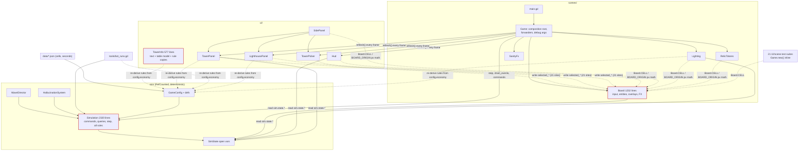
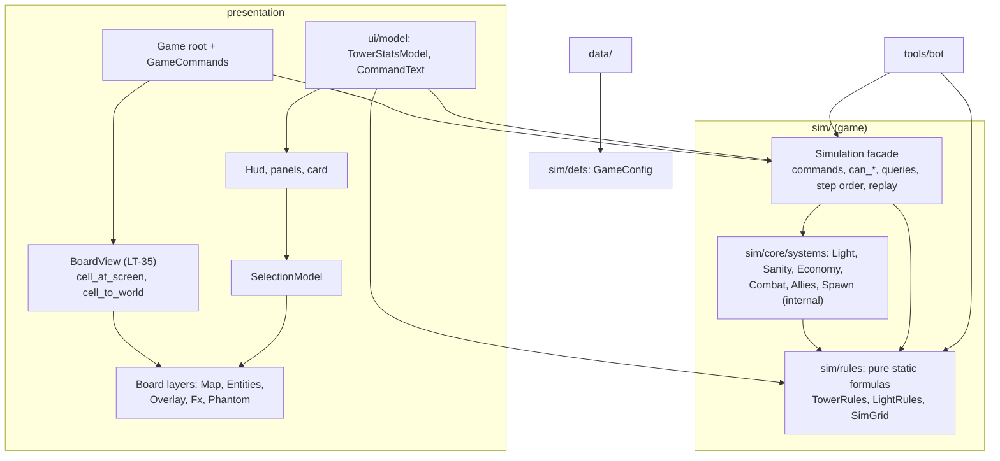

# LT-65: architecture review, layers and contracts

Scope: `release-0.5.0` at `81ed722`. Inputs: the LT-65/S1 recon map, LT-33 boundary audit
(`docs/design/LT-33-sim-presentation-boundary.md`) and its guard `tests/sim_boundary_test.gd`.
Design only, no code changed. Line numbers are at `81ed722`.

Owner's goal: find logic smeared across files and cut the code into layers/blocks that are
independent and talk through agreed APIs/contracts.

**Verdict.** The sim/presentation wall from LT-33/LT-34 holds. No `sim._*` calls, no state
writes from outside, and the sim runs without a SceneTree. The smearing is in three other places:
1. **Rules re-derived outside the sim.** UI, bot and lighting each recompute light/shadow
   multipliers, the miss rule, DPS, beam coverage, flare oil and flare timing.
2. **Pixels everywhere.** `Board.CELL` and `Game.BOARD_ORIGIN` are read by HUD, side panel,
   lighting, relic tokens and 9 test suites. The cell centre `+ 0.5` is hand-written about 10 times.
3. **Two monoliths.** `simulation.gd` (2320 lines) holds every rule. `board.gd` (1232) mixes
   input, entities, overlays and about 12 FX renderers. UI panels also write the board's
   selection fields directly.

Nothing here needs a rules change. Every block below is a behaviour-preserving refactor that a
pinned replay can prove.

## 1. Dependency map (current)

Dotted edges are the worst cross-links. Commands, events and queries (solid) are the agreed
LT-33 contract. The dotted edges bypass it.

## 2. Smeared logic (evidence)

The recon listed 11 duplicated rules. Spot-checked: 1, 2, 4, 5, 6, 7 and 8 confirmed. 9 is
downgraded. 12 to 15 are new.

| # | Rule | Source of truth | Copies | Verdict |
|---|------|-----------------|--------|---------|
| 1 | Lit/shadow multipliers | `simulation.gd` `_power_mult` :1335, `_interval_mult` :1348, `_summon` :1752 | `ui/tower_info.gd` `state_mults` :330, `beam_percent` :351, `lit_values` :368, `lit_effects` :398 | **confirmed**, worst: LT-70 already had to change both |
| 2 | No miss while lit, shadow miss add | `_fire_towers` :1647 | `ui/tower_panel.gd` refresh :207-209, `tower_info.gd` `kind_lines` :429 | confirmed |
| 3 | Effective DPS (sanity factor x power x interval in ticks) | `_fire_towers` :1603-1605, :1685 | `tower_info.gd` `dps_value` :259, `dps_text` :274, `lit_values` :376 (seconds, not ticks: LT-33 #18) | confirmed |
| 4 | Beam coverage | `_lit_by` :1426 (half-width) | `ui/lighthouse_panel.gd` `coverage_percent` :56 | confirmed |
| 5 | "Is this cell / tower lit or shadowed" | `_casters` :1303, `_in_cast` :1314 | `tools/bot_runs.gd` `_in_shadow_radius` :528, `_beam_lit` :541 (the comment admits there is "no public beam-only source") | confirmed |
| 6 | Dead zone of a tower | `_outside_dead_zone` :1799 | `scenes/board.gd` `selected_dead_zone` :572 rescans `state.towers` by cell | confirmed, low |
| 7 | Flare oil to buy | none in sim | `scenes/game.gd` `flare_oil_to_buy` :252, bot `_bot_oil_target` :417 | confirmed: rule lives in a Node |
| 8 | Flare burn progress | `fire_flare`, `flare_seconds` :1252 | `scenes/lighting.gd` `flare_strength` :188 rebuilds the total from `SimTime.ticks(flare_seconds())` | confirmed |
| 9 | Sanity state names, levels | `SanityConfig.STATES` :9 | `ui/sanity_bar.gd` `STATE_NAMES` :11 (display labels), `sanity_fx.gd` `target_level` :96 | **downgraded**: a label table and a visual curve, not rules. Pin the index order only. |
| 10 | CommandResult -> text | none | `TowerInfo.REASONS` :20 (+ `TowerPicker.REASONS` alias :20), `LighthousePanel.REASONS` :9. HUD buttons use neither. | confirmed |
| 11 | Cell centre `+0.5` | `SimTower.centre`, `SimRoute._centre`, `simulation.gd` :942, :1428 | `board.gd` :278, :562, :679; `lighting.gd` :85, :141, :176, :209; `bot_runs.gd` :506, :529 | confirmed |
| 12 | Selection overlay state | `Board.selected_cell/range/glyph/cast` | written from `tower_picker.gd` :211-226, :333-335; `tower_panel.gd` :88-98, :139-141; `lighthouse_panel.gd` :41-51 (21 assignments) | **new**: UI drives board internals |
| 13 | UI refresh | none | `game.gd` `advance` :166-169 and :285-288 call 4 `refresh()` every frame. 10 event types have no consumer (SPAWNED, TOWER_BUILT/SOLD, BUILD_STARTED, WAVE_STARTED, TARGET_PRIORITY_SET, LIGHTHOUSE_UPGRADED, TOWER_LIT, ALLY_*). | **new**: no policy |
| 14 | Game as composition root + rule host | none | `game.gd` mixes tree building, debug flag parsing, command forwarders with logic (#7) and event fan-out | **new**, medium |
| 15 | Game test fixture | none | 21 suites repeat `load_from_dir` + `SubViewport(1200x675)` + `Game.new().setup()` (e.g. `lighting_test.gd` :13-20) | **new**: blocks LT-35, because every suite does its own px math |

Not smeared: hit/miss/credit timing (LT-33 #14), relic credit by tick, the `is_fake` guard.

## 3. Target layers and contracts

The dependency direction is one way: `presentation -> sim facade / sim rules -> defs`.
Nothing in `sim/` names a presentation type, which LT-34's guard already enforces.

### 3.1 Simulation facade + internal systems (split of `simulation.gd`)

**Facade.** `Simulation` keeps its whole public API unchanged: commands, `can_*`, queries,
`step`, `replay_command`, `drain_events` and `CommandResult`. It shrinks to about 600 lines:
public methods that validate and log, then delegate. `step()` stays the only place that orders
the slots.

**Systems.** These are internal, live in `sim/core/systems/`, extend `RefCounted`, and each is
built once in `_init`.

| System | Takes from `simulation.gd` | Approx lines | Owns writes to |
|--------|----------------------------|--------------|----------------|
| `LightSystem` | beam :1236-1460 (`_update_beam`, `_casters`, `_in_cast`, `_power_mult`, `_interval_mult`, `_turn_beam`, `_lit_by`, flare slow/count-down), lighthouse level, oil, flare commands' bodies | 350 | `beam_*`, `flare_*`, `oil`, `lighthouse_level`, `t.lit/shadowed`, `e.lit` |
| `SanitySystem` | `_add_sanity`, `_change_reserve`, `_reserve_drives_mad`, `_horror_drain`, `_apply_madness_buff`, `_madness_buff_blocked`, buyout, auto restore, `reserve_*`, `sanity_state_for`, `threshold` | 300 | `sanity`, `sanity_cap`, `sanity_state` |
| `EconomySystem` | `_add_gold`, relics and tokens (`_roll_drop`, `_drop_token`, `_settle_tokens`, `settle_all_tokens`, `_vanish_token`, `_add_relics`), `relic_price`, `sell_refund`, wave bonus, early luck | 250 | `gold`, `relics`, `relic_tokens`, `next_token_id`, `night_luck` (read) |
| `CombatSystem` | `_fire_towers`, `_cast_banish`, `_summon`, `_candidates`, `_ranked_targets`, `_line_*`, blasts, on-hit, bleed, `_tick_statuses`, `_roll_*`, `apply_damage` body | 750 | `e.hp/status/dead`, `t.cooldown_ticks/burst_index/locked_id`, `blasts` |
| `AllySystem` | `spawn_ally`, `_tick_allies`, `_move_allies`, `_ally_combat`, `_ally_gone`, `_dismiss_allies` | 200 | `allies` |
| `SpawnSystem` | `spawn_enemy`, `_enter`, pack queue, `_move`, `_push_back`, `_leak`, `dissolve_fakes`, `_hallucinations` link | 200 | `enemies` (add, move, compact), `_pack_queue` |

**Context.** Systems share one `SimContext`: `state`, `config`, `rng(stream)`, `emit(type, id, data)`
and the other systems' **public** methods. A system never holds a reference to `Simulation`.
Cross-system calls are plain calls in the existing order. For example, a kill in Combat calls
`economy.on_enemy_killed(e, source)`, then `sanity.on_kill(...)`, in the order `_on_enemy_killed`
does today.

**Determinism invariants.** These are what keeps replay byte-identical:
1. The step slot order is written only in `Simulation.step()`, and each slot is one system call.
2. RNG draws go through `SimRng` streams only, in the same call order. No system creates an RNG.
3. Events go through the single `_emit` buffer. Moving code never reorders two `emit` calls.
4. Iteration stays over `state` Arrays in id order. Never swap an Array for a Dictionary.
5. Float expressions are moved verbatim. `a * b * c` stays in that order and is not regrouped
   or hoisted into a helper with another association.
6. The `command_log` format and `REPLAY_ARGS` are unchanged, so old logs replay.

**Callers.** Only `Simulation` creates or calls the systems. `WaveDirector` and
`HallucinationSystem` keep calling facade methods.

### 3.2 Rule queries (one source for sim, UI and bot)

There are two kinds, by input:

**Config-derived, pure static**, in `sim/rules/`. These work for a tower that is not built yet
(picker card, stats table) and need no `Simulation`.
- `TowerRules.light_effect(def, cfg, lit, shadowed) -> {power_mult, interval_mult, ignore_miss, miss_add}`
  replaces rule copies #1 and #2. `Simulation._power_mult`/`_interval_mult` call it, so it is
  the only copy.
- `TowerRules.effective(level, def, cfg, lit, shadowed, sanity) -> {damage, interval_ticks, dps, unit_dps}`
  replaces #3, from ticks (closes LT-33 #18). The sim's fire path uses the same function only
  if the float order matches exactly (invariant 5). Otherwise the sim keeps its inline formula
  and a test pins the two equal over every level.
- `LightRules.beam_coverage(cfg, level) -> float` replaces #4.
- `SimGrid.centre(cell) -> Vector2` replaces #11 inside sim and bot. Square grid only; see Q4.

**State-derived, on the facade**, read-only and changing nothing:
- `light_at(p: Vector2) -> {beam, light_casters, shadow_casters, lit, shadowed}` replaces #5 (bot).
- `tower_mults(tower_id)` replaces the UI's own reading of `t.lit` together with config.
- `oil_for_flare() -> int` replaces #7. `Game.flare_oil_to_buy` and the bot call it.
- `flare_burn() -> {left_ticks, total_ticks}` replaces #8.
- `tower_at_cell(cell) -> SimTower` replaces #6's rescan.

Contract: presentation and bot may compute **display** (percent, rounding, text). They may not
compute a **rule value** (multiplier, chance, time, cost) from `config.economy` fields.

### 3.3 Coordinate / view layer (LT-35)

`BoardView` is a script owned by the board. It is the only holder of `CELL` and the board origin.
- `cell_at_screen(screen_pos) -> Vector2i`: `(-1,-1)` when off the board. This is the only
  input path to a cell.
- `cell_to_world(p_cells: Vector2) -> Vector2`: cell units in (centre already applied by the
  caller via `SimGrid.centre`), canvas position out.
- `cells_to_px(len_cells) -> float` gives radii in 2D. LT-64 replaces it with world units.
- `world_rect() -> Rect2` gives the board's screen rect, which HUD and relic tokens use for
  anchoring.

The UI lays itself out from the viewport (anchors and containers). Nothing in `ui/` names
`Board.CELL` or `BOARD_ORIGIN` (LT-33 #2). The read-only view snapshot (LT-33 #6) is deferred
to LT-64 (block B12).

Invariant: grid geometry lives in sim cell units. Pixel or world math lives only in `BoardView`
and in the board layers that call it. LT-66 (overlay panel, scrollable map) changes only
`BoardView` and the layout.

### 3.4 Board rendering split (`board.gd` 1232 lines)

`Board` stays the Node2D root. It handles input through `BoardView`, emits `cell_clicked` and
`outside_clicked`, and forwards `on_event`. It owns these children, each a Node2D with its own
`_draw`:

| Layer | From board.gd | Reads | Writes |
|-------|---------------|-------|--------|
| `MapLayer` (exists :1201) | static map | `state.map` | none |
| `EntityLayer` | `_draw_tower`, `_draw_auras`, `_draw_searchlight`, `_draw_enemies`, `_draw_allies`, HP bars, `enemy_markers`, `plate_color` | facade queries, `enemy_position(alpha)` | none |
| `OverlayLayer` | `_draw` selection, range, dead zone, `preview_cast` | `SelectionModel`, `tower_at_cell` | none |
| `FxLayer` | `_shot_fx`, `_add_attack_fx`, `tick_effects`, the 12 `_draw_<kind>` renderers | events only (`on_event`), own `_fx_rng` | own FX list |
| `PhantomLayer` | `_tick_phantom`, `_new_phantom`, `_draw_phantom`, flicker | `sanity_fx` level | own state |

`SelectionModel` is a RefCounted owned by `Game`. It holds `cell, range, glyph, cast` and emits
a `changed` signal. Panels call `selection.show_tower(id)` / `show_preview(def_id, cell)` /
`clear()`, which ends the 21 direct writes (#12). `OverlayLayer` redraws on `changed`.

Coordination with LT-62: `fix/LT-62-fps-fixes` adds 15 lines to `board.gd` (warm-up draw). The
split starts after LT-62 merges and keeps the warm-up in `Board._ready`.

### 3.5 Event vs polling policy

- **One-shot happenings** (SHOT, BLAST, DIED, LEAKED, FAKE_DISSOLVED, RELIC_*, FLARE_FIRED,
  SANITY_STATE_CHANGED for audio, OUTCOME) go through events only. `Game._consume_events` is the
  only drain in the game. The bot has its own sim and its own drain.
- **State displays** (HUD numbers, panels, buttons) poll queries, but only in
  `Game.refresh_ui()`, called once per frame **only if** the tick changed, events were drained,
  or a command ran. Each panel refreshes only while visible. This keeps the simple and robust
  polling model and drops idle-frame work (useful for LT-62).
- Event types with no game consumer stay. They serve the bot, tests and replays. A table in
  the guard lists them (G6).

### 3.6 Tower text / table model (`ui/tower_info.gd` 577 lines)

- `ui/model/tower_stats_model.gd`: numbers only, `row_values`, `lit_values` and `lit_effects`
  as data, built from `TowerRules` (3.2). Has no rule formula of its own.
- `ui/text/tower_text.gd`: formatting (`num`, `money`, `cost_text`, `effect_lines`,
  `upgrade_path_text`, ...). Pure strings from model values.
- `ui/text/command_text.gd`: the one `CommandResult -> text` table (#10), used by picker, tower
  panel, lighthouse panel and HUD tooltips.

`TowerInfo` is removed with no facade; every caller migrated at once (owner Q6, LT-79): numbers in
`ui/model/tower_stats_model.gd` (`TowerStatsModel`), strings in `ui/text/tower_text.gd` (`TowerText`).

### 3.7 Test helpers

`tests/support/game_fixture.gd` (`GameFixture`): `make(seed := 1, data := "res://data", size := Vector2i(1200, 675)) -> Game`
inside an owned SubViewport, plus `free_all()`, `click_cell(cell)` and `cell_screen_pos(cell)`.
The last two go through `BoardView`, so tests stop doing their own px math. All 21 suites
migrate to it.

### 3.8 Game root

`Game` keeps composition (building the tree, wiring signals) and the frame driver.
- Command forwarders move to `GameCommands`, a thin RefCounted: `build`, `sell`, ... with no
  rule logic (#7 moves to the sim).
- Debug args move to `DebugArgs.parse(args)`.

This is size S. Do it with B11, not as a separate block.

## 4. Guard extension (`tests/sim_boundary_test.gd` + new `tests/architecture_guard_test.gd`)

Each guard is a static scan, reusing the existing `_code_lines` (comments and strings blanked)
and `_gd_files`. Each has one control that reverts code (never a test), listed per block in §5.

| # | Contract | Check | Fails today on |
|---|----------|-------|----------------|
| G1 | No rule copies outside sim | `ui/`, `scenes/` and `tools/` contain no `\.(occult_power_mult\|mundane_fire_interval_mult\|mundane_ignore_miss\|mundane_miss_chance_add\|enemy_speed_mult)\b`, `flare\.cost_oil`, `oil\.cap\b`, `sanity_factor\(` or `in_cast_radius\(`. The denylist is pinned. | #1, #2, #5, #7 sites |
| G2 | Pixels only in the view | `Board.CELL`, `\bCELL\b` and `BOARD_ORIGIN` appear only in `scenes/board/board_view.gd` (and tests/support). The `* CELL` count in the other board layers is 0. | hud, side_panel, lighting, relic_tokens, 9 tests |
| G3 | One cell centre | `\.(x\|y)\s*\+\s*0\.5` appears only in `sim/rules/sim_grid.gd` and `board_view.gd` | #11 sites |
| G4a | Systems are internal | under `sim/core/systems/`: no `\bSimulation\b` name, and no `\w+\._\w+` call on another object | n/a (new) |
| G4b | One writer per state field | extend `_state_writes` to `sim/`. For each `SimState` field, the set of files that assign or mutate it equals a pinned `OWNERS` map, e.g. `gold -> economy_system.gd`. | n/a (new) |
| G5 | Behaviour unchanged | golden replay (B0): pinned digest of the full event stream and final state for the fixture runs on frozen data | n/a |
| G6 | Event policy | `drain_events(` is called only in `scenes/game.gd`, `tools/` and tests. Every `SimEvent.Type` appears either in a consumer `match` in `scenes/` or `ui/`, or in a pinned `UNCONSUMED_OK` list. | n/a (pins today) |
| G7 | Selection via the model | `\bselected_(cell\|range\|glyph\|cast)\s*=` appears only in `selection_model.gd` | 21 UI writes |
| G8 | Shared fixture | `Game.new()` appears in `tests/` only in `tests/support/` | 21 suites |
| G9 | One reasons table | `REASONS` is declared only in `command_text.gd`. Every `CommandResult` key has a text (enumerate the enum). | 2 tables |

Each guard lands in the same block that makes it pass, never earlier.

## 5. Ordered refactor plan

Rules for every block: one block = one follow-up task. Each block is behaviour-preserving,
green between steps, and proven by G5 plus the named suites. "Golden" means the B0 test is
unchanged and passing.

| Block | What | Size | Risk | Depends | Proof of no behaviour change | When |
|-------|------|------|------|---------|-------------------------------|------|
| **B0** | Golden replay fixture. Freeze `tests/fixtures/golden_data/` (copy of `data/`). Record a digest of every event (type, tick, id, sorted data) and of the final `_state_digest`, for each bot strategy x 3 seeds, plus `SimNoTreeLoop` and the frame-path run. Pin them in `tests/golden_replay_test.gd`. | S | low | none | itself: it is the proof. Control: change one `_emit` order in `simulation.gd`, and the test must fail. | 0.5.0 |
| **B1** | `GameFixture` + migrate 21 suites (G8) | M | low | none | the same suites, same test count, all green. Control: break `GameFixture.make` seed passing, and `scene_game_test` fails. | 0.5.0 |
| **B2** | Rule queries (3.2): `TowerRules.light_effect`, `beam_coverage`, `light_at`, `oil_for_flare`, `flare_burn`, `tower_at_cell`, `SimGrid.centre` in sim/bot. Sim internals call the same functions. Switch the UI, bot and lighting callers. Adds G1, and G3 for the sim/bot part. | M | med (float order) | B0 | golden; `tower_info_test`, `stats_panel_test`, `lighthouse_ui_test`, `lighting_test`, `bot_upgrade_test` (incl. :1084); balance lab `baseline` RUN lines identical on 20 seeds | 0.5.0 |
| **B3** | `CommandText` single table (G9) | S | low | none | `tower_picker*_test`, `lighthouse_ui_test`, `side_panel_test` | 0.5.0 |
| **B4** | LT-35 `BoardView` + UI layout from viewport + G2, G3 complete. This is the existing LT-35 task, now with this contract. | M | med (layout) | B1, B2 | golden (sim untouched); `window_scale_test`, `side_panel_test`, `picker_overlay_test`, `ui_polish_test`, `scene_game_test`; screenshot at 1200x675 and 1920x1080 | 0.5.0 |
| **B5** | Sim split 1: `SimContext` + `LightSystem` + `SanitySystem` | L | high | B0, B2 | golden byte-identical; `beam_test`, `sanity_test`, `madness_test`, `sim_boundary*`; G4a/G4b for the two systems. Tick-cost check: `bot_runs` wall time within 5 % (record `uptime`, `time -p`). | 0.6.0 |
| **B6** | Sim split 2: `EconomySystem` (gold, relics, tokens) | M | med | B5 | golden; `relic_test`, `economy*`, `wave*` | 0.6.0 |
| **B7** | Sim split 3: `CombatSystem` + `AllySystem` | L | high | B5 | golden; `tower*`, `branch_effects_test`, `allies_test`, `sim_damage_test`, `hallucination_test` | 0.6.0 |
| **B8** | Sim split 4: `SpawnSystem`; the facade is then about 600 lines; G4b `OWNERS` complete | M | med | B6, B7 | golden; `sim_movement_test`, `sim_outcome_test`, `sim_determinism_test` | 0.6.0 |
| **B9** | Board split into layers + `SelectionModel` (G7) | L | med | B4, LT-62 merged | golden; `tower_attack_visuals_test`, `render_isolation_test`, `picker_overlay_test`, `lighting_test`; frame time median/p90 via `frame_stats` not worse | 0.6.0 |
| **B10** | Tower model/text split (3.6) | M | low | B2, B3 | `tower_info_test`, `stats_panel_test`, `side_panel_test`, `tower_picker_groups_test`: identical strings | 0.5.0 if time, else 0.6.0 |
| **B11** | UI refresh policy + `GameCommands` + `DebugArgs` + G6 | S/M | low | B1; after LT-62 (both touch `game.gd`) | golden frame-path test; `scene_game_test`, `hud*`; a test that a panel does not refresh on an idle frame | 0.5.0 |
| **B12** | Read-only view snapshot (LT-33 #6) | M | med | B4, B9 | golden; `render_isolation_test` | with LT-64 |
| **B13** | `bot_runs.gd` split: harness vs strategies vs placement scoring | M | low | B2 | balance `baseline` RUN lines identical | later |

Order for 0.5.0: B0 -> (B1, B3 in parallel) -> B2 -> B4 -> B11 -> B10. B0 must land first,
because every later block uses it as proof. The sim split (B5-B8) goes before LT-72 and LT-32,
which add rules to `simulation.gd`. LT-18 (changing path) then lands in `SpawnSystem` and
`SimRoute` only.

How the backlog fits:
- LT-64 angled view, hex/Voronoi: `BoardView` + `SimGrid` (B4, Q4).
- LT-66 overlay panel and scrollable map: `BoardView.world_rect` + layout (B4).
- LT-18 path generator: `SpawnSystem` + `MapDef` (B8).
- LT-72 waves: `WaveDirector`, untouched.
- LT-32 crew units: a new system next to `AllySystem` (B7 pattern).

## 6. Owner questions

1. **When to split `simulation.gd`** (B5-B8).
   - (a) 0.6.0, right after the 0.5.0 blocks and before LT-72/LT-32 **(recommended)**. Benefit:
     0.5.0 stays low-risk, and the split lands before new rules pile in. Risk: one more release
     with the 2320-line file.
   - (b) Start B5 in 0.5.0. Benefit: sooner. Risk: the high-risk block overlaps LT-71 balance
     work and LT-62.
   - (c) Do not split; only the rule queries. Benefit: cheapest. Risk: LT-32/LT-72 grow the
     monolith further.
2. **Golden replay data source** (B0).
   - (a) A frozen copy `tests/fixtures/golden_data/` **(recommended)**. Benefit: balance tuning
     in `data/` never breaks it. Risk: it does not cover the live numbers (the bot tests and
     balance lab do).
   - (b) Live `data/`. Benefit: proves the shipped config. Risk: every LT-71-style tweak needs
     a re-pin, and a re-pin can hide a real change.
   - (c) Balance lab RUN lines only. Benefit: no new test. Risk: summary metrics, not
     byte-identical events.
3. **UI update policy.**
   - (a) Throttled polling (3.5) **(recommended)**. Benefit: small change, robust, fewer
     refreshes. Risk: panels still read state rather than react.
   - (b) Fully event-driven panels. Benefit: no polling at all. Risk: needs new events (timers),
     with missed-event bugs.
   - (c) Leave as is. Benefit: zero work. Risk: per-frame cost and no policy for new UI (LT-66
     monster card).
4. **Grid abstraction for hex/Voronoi (LT-64) now.**
   - (a) Only `SimGrid.centre` + `BoardView` now; topology later **(recommended)**. Benefit:
     small and does not guess LT-64's design. Risk: neighbours and distance still assume squares.
   - (b) A full `GridTopology` interface now (centre, neighbours, distance, cell polygon).
     Benefit: LT-64 plugs in. Risk: designing hex rules before LT-64 is decided.
   - (c) Nothing until LT-64. Benefit: zero work. Risk: `+0.5` copies keep spreading.
5. **Where config-derived rule formulas live.**
   - (a) Static `sim/rules/` modules, called by the sim, UI and bot alike **(recommended)**.
     Benefit: works for unbuilt towers (picker card) and keeps one source. Risk: the UI imports
     sim code, though read-only and allowed by LT-33.
   - (b) Only facade queries on `Simulation`. Benefit: one entry point. Risk: the card and
     picker need a sim instance, and previews need fake towers.
6. **Keep `TowerInfo` as a forwarding facade during migration** (B10).
   - (a) Yes, for one release, then delete **(recommended)**. Benefit: small diffs. Risk: two
     names for a while.
   - (b) Migrate all callers in one go. Benefit: clean at once. Risk: a large diff over 6 UI
     files and their tests.

## 7. Owner decisions (2026-11-18)

Quoted verbatim (option labels chosen in the form):

- Q1 sim split: "0.6.0, до волн и экипажа (Recommended)". B5-B8 go to 0.6.0, before LT-72/LT-32.
- Q2 golden data: "Замороженная копия data/ (Recommended)". B0 uses `tests/fixtures/golden_data/`.
- Q3 UI update policy: "Полностью на событиях". Panels become fully event-driven, not throttled
  polling: B11 needs a design slice for the missing events (timers, phase countdown, flare,
  cooldowns) and a rule for missed events, before any code.
- Q4 grid: "Полный интерфейс GridTopology" (centre, neighbours, distance, cell polygon), then
  "Отдельный блок до B4, с дизайном (Recommended)": a new block between B2 and B4, design note
  reviewed by the owner, square implementation first; BoardView (LT-35) builds on it.
- Q5 rule formulas: "Статические модули sim/rules/ (Recommended)".
- Q6 TowerInfo: "Перевести всех сразу". No forwarding facade; B10 migrates every caller in one go.
- Note and 0.5.0 scope: "Утверждаю (Recommended)". 0.5.0 order:
  B0 -> (B1 ∥ B3) -> B2 -> GridTopology -> B4 = LT-35 -> B11 -> B10 (if time); B5-B9 in 0.6.0.
