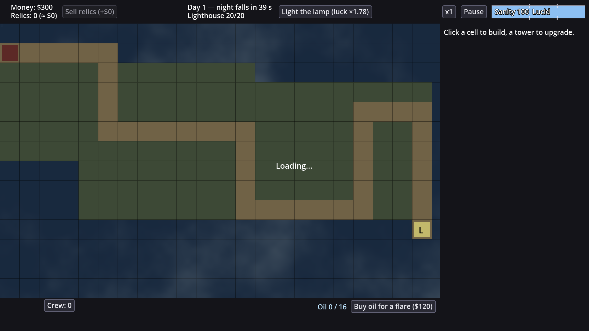

# LT-92: the heavy frames before and at the first wave (diagnosis, slices S1 and S5)

Status: diagnosis only. No production code changed. S1 diagnosed frames A and B with a throwaway
probe (`probe92.gd`); S5 diagnosed frame C with its extension `probe92c.gd` (source in the
appendix, a superset of S1's). Both were removed at the end of their slice.

Build: branch `fix/LT-92-startup-frames` at 0c6f17b (0.13.0), Godot 4.7.2, GL Compatibility,
"OpenGL API 4.1 INTEL-24.5.8, Intel Iris Plus Graphics" (MacBookPro16,2, 8 threads), Retina
scale 2.0, boot-fit window 2402x1352 px, `--audio-driver Dummy`, `-- --seed=4242 --frame-stats
--mute`. Every window was launched with `--mute`.

## Owner decisions (2026-11-25)

- Frame A: "Кадр «Загрузка…» уже сейчас" — show a loading frame now, not only once a menu exists (A2 brought forward).
- Frame B: "Прогреть свет во время кадра A (Recommended)" — B1.
- Frame C: "Расширить LT-92 на кадр C" — frame C is diagnosed and fixed within LT-92.

## Verdict

LT-90 named the two frames "window creation" and "window coming to the front". Neither is right.
Both frames are **first-use GL shader compilation in the draw step**. The window costs almost
nothing in either one.

| frame | when (LT-62 spike log) | cause | fast runs | slow runs / LT-90 load 20-40 |
|---|---|---|---|---|
| A | first frame, sim tick 4 | the first draw of the game scene: the GL driver compiles the canvas shader variants (and the sea-fog shader) that the board, entities and UI use | 287-339 ms, 96-99% in `draw` | 513-978 ms (LT-90: 0.66-1.15 s) |
| B | the first frame of the first night, sim tick 15-16 in LT-90 | `call_wave` starts the night fade, so the lighthouse glow and beam `PointLight2D`s turn visible for the first time. The driver then compiles the lit variants of every canvas shader that draws under them | 424-473 ms, 96-97% in `draw` | 946-1425 ms (LT-90: 1.2-2.2 s) |

1. **Frame A is load time.** It cannot be removed on this machine, only moved. macOS OpenGL
   offers no program-binary formats. Godot's GL shader cache folder
   (`user://shader_cache/CanvasShaderGLES3/...`) exists but holds 0 files after hundreds of
   runs. So every launch compiles again.
2. **Frame B can be avoided. It is not load time.** In the probe it showed up 0.5 s into the run
   only because the LT-90 bot called the first wave then. In real play it lands on the player's
   first "light the lamp / call wave". That is a 0.4-1.4 s freeze as the first enemy spawns.
   Lighting the lamps for the first frames moved the whole cost into frame A and left the
   wave-call frame clean in 3/3 runs (see `botwarm`).
3. **The window is not the cause of either frame.** The engine creates the window before the
   first frame: `_initialize` runs at 1.45-1.6 s from process start, against 1.09 s headless.
   An empty window's first frame takes 4-11 ms (`nomain`), and a Label-only one 44-73 ms
   (`label`). Calling `window_move_to_foreground` adds no frame (`fg` matches `base`). The
   boot-fit resize changes nothing either (`nofit` matches `base`). The window takes focus
   right after frame A is presented (`focus_in` 2.08-2.43 s in fast runs), which is why LT-90
   linked the two.
4. **Frame C (S5): the board's own first-use warm-up, lit for the first time.** 146-569 ms,
   95-99% in `draw`, ~1.0-1.3 s after the wave call. The FxLayer warm-up draws in the board
   corner unlit from the first frame. The turning beam's light rect reaches that corner at
   rotation ≈ -2.69, and the lit variants of the warm-up's primitive kinds compile then. A
   small light over that corner in the first 3 frames removes C **and B** (one mechanism);
   a board-wide warm light does not work (see Frame C).

## How it was measured

- Probe `probe92.gd` is a SceneTree script (appendix). It loads `main.tscn` as LT-90's probe
  did. For every frame it prints one `F` line with the interval and a split, using the LT-90
  method: `proc` (probe `_process` -> a tail node with priority 100000), `gap` (tail ->
  `frame_pre_draw`, mainly `_draw` callbacks), `draw` (`frame_pre_draw` -> `frame_post_draw`,
  including swap), `wait` (post draw -> next physics/process, i.e. OS events and pacing). The
  line also carries draw calls, focus, window size, `lighting.night`, enemies, towers and the
  sim events consumed. The game's own `--frame-stats` spike log (`scenes/frame_stats.gd`,
  `Game.advance`) runs as well.
- Arms (user args after `--`, nothing in the game changed):

| arm | what differs | cheap observation that tells it apart (control) |
|---|---|---|
| plain | no probe, `--quit-after 360`, game spike log only | no `F` lines, spike log only |
| base | probe, no input | - |
| fg | `window_move_to_foreground()` at 0.5 s | `fg_call@` event in the log |
| bot | LT-90 bot: at 0.5 s of summed delta, build 3 towers, call wave | `bot3` event, `tw=3`, `night>0` afterwards |
| fgbot | bot + fg (the LT-90 conditions) | both events |
| build | bot builds, no wave | `tw=3`, `night` stays 0.000 |
| wave | wave called, nothing built | `tw=0`, `night>0` |
| botwarm | bot + `lighting.night = 0.01` for the first 3 frames (lights drawn at ~0 energy) | `warm` events, F1 `night=0.010` |
| nomain | no main scene, empty window | `draws=0` |
| label | `--config-dir=/nonexistent_lt92`: main refuses, draws only its error Label | `draws=1`, config error in log |
| menu | a Label "menu" for 1.5 s, then `main.tscn` (a stand-in for a future menu) | `menu_to_game` event, F1 `draws=1` |
| noui | UI CanvasLayer hidden | (frame A unchanged, see results) |
| nofx | Lighting and SanityFx hidden | (frame A unchanged) |
| nofit | engine `--resolution 1600x900` turns the boot fit off | `win=1600x900` instead of 2402x1352 |
| headless | `--headless` + bot | `ds=headless`, no draw |
| bot_L | bot with 16 `yes` CPU burners running | load rises 7-10 -> 12-13 |

- One background script ran 3 rounds, round robin over all 16 arms (48 runs, 6 s each). Each
  run waited for a 1-min load < 10 (180 s cap). Scratchpad: `lt92/run.sh`, `summarize.py`,
  `summary.txt`, and one log per run.
- Machine state: `uptime` load 3.4-7.1 before the batch. Per-run 1-min load before/after was
  4.1-10.0 / 4.1-18.2 (39.7 after one headless run). `/usr/bin/time -p` real/user/sys
  8.0-19.2 / 1.9-8.5 / 0.4-2.6 s. user + sys is about 0.7 of real in the game runs, so the
  process was busy, not waiting. The runs fall into two speed classes. In "fast" runs
  `_initialize` comes at 1.45-1.66 s after process start. In "slow" runs it comes at
  2.5-12.2 s, and every frame in them is about 2x longer, so contention came from outside
  (other agents, thermal). Compare frames within a class.

## Evidence

### Frame A: first draw of the game scene (fast runs, `F1` = the first frame interval)

| arm | F1 ms (draw / proc / wait) | draw calls |
|---|---|---|
| plain (game spike log, tick 4) | 320, 304 (406 in a slower run) | - |
| base | 312 (288/0.4/23), 328 (319/0.5/8) | 1881 |
| fg | 308 (282/0.4/25), 307 (299/0.6/6) | 1881 |
| build | 313 (287), 328 (320) | 1881 |
| bot / fgbot | 322 (297), 326 (299), 311 (284) | 1881 |
| noui | 313 (289), 303 (277), 316 (273) | 1881 |
| nofx | 302 (277), 339 (331), 287 (286) | 1881 |
| nofit (1600x900 window) | 311 (307) | 1881 |
| label (error Label only) | 73 (30), 63 (38), 44 (44) | 1 |
| nomain (empty window) | 11 (11), 6 (5), 8 (7) | 0 |
| menu: first frame of the "menu" | 32 (31), 39 (38), 38 (37) | 1 |
| menu: the menu -> game frame | 467 (draw 238, proc 223), 488 (246/237), 491 (258/228) | 1905 |
| headless + bot | 0.7-2.7 (no draw) | 0 |

- The time is spent in `draw`: 288-331 ms of a 302-339 ms frame. Scripts take < 1 ms. Main
  scene setup (config load, `Game._ready`, UI build) runs before the first frame: `first_proc`
  is 254-325 ms after `_initialize` in fast runs, against 27-48 ms for `nomain`. That time does
  not count as a frame interval in the spike log.
- (S5: S1's `noui`/`nofx` arms were no-ops, see Frame C. Re-run properly in S5 they confirm
  this bullet.) Hiding the UI layer or Lighting/SanityFx (fog shader, lights) leaves frame A where it is. The
  cost belongs to the board and entity canvas items as a group, not to one node. No single node
  can be cut to remove it.
- A window that draws (almost) nothing has a 4-73 ms first frame. So the window and its first
  present are not frame A.
- In `menu`, the menu's own first frame costs 32-39 ms. The cost moves to the menu -> game frame
  (467-491 ms): 223-237 ms of scene load (`proc`, the `main.tscn` instance plus `_ready`, done
  in the probe's `_process`) plus 238-258 ms of first draw. That frame also runs the boot fit,
  since main does it.

### Frame B: the first night (the frame right after the trigger)

| arm | frame after trigger, ms (draw) | night in that frame | verdict |
|---|---|---|---|
| bot (fast) | 473 (453) | 0.034 | frame B |
| fgbot (fast) | 447 (436), 424 (414) | 0.036 | frame B |
| bot / fgbot / wave (slow) | 1109, 1113, 1294, 946, 1425, 1395 (all 93-99% draw) | 0.04-0.16 | frame B |
| bot_L (16 burners) | 1008, 1306, 967 | 0.04-0.08 | frame B, scales with load |
| build (3 towers, no wave) | 23 (13), 57 (33), 25 (14) | 0.000 | **no frame**: building is not the cause |
| wave (no towers) | 946, 1425, 1395 (slow class) | 0.05-0.16 | frame B: towers are not needed |
| fg (foreground call, no bot) | no frame > 100 ms after F1 | 0.000 | **no frame**: the window is not the cause |
| botwarm (lights on at ~0 energy in frames 1-3) | 151 (draw 48, proc 56), 55 (29), 63 (33) | 0.07-0.21 | **frame B gone** |

- Control for `botwarm`: its F1 grows to 1786-3246 ms (slow class, with `night=0.010` in F1).
  In the slow class, `bot` F1 + frame B = 686 + 1109 = 1795 ms, and `botwarm` r2 F1 = 1786 ms.
  The cost moved; it did not go away. The `warm` events and the `night` column show that the
  lights really drew in frames 1-3, and that `night` is still 0.000 in base F1.
- The one `botwarm` wave-call frame over 100 ms (r1, 151 ms) is not a render stall. Its `draw`
  is 48 ms and the rest is script (`proc` 56 ms). That run was the slowest of the batch
  (`_initialize` at 5.9 s).
- Why lights: Godot's GL Compatibility canvas renderer draws a lit item with a different shader
  variant from an unlit one. By day `Lighting._apply_night()` sets every light
  `visible = night > 0.0` (`scenes/lighting.gd` 124-134), so no lit variant is compiled until
  the first night. All lights are `PointLight2D`s with a texture, `BLEND_MODE_ADD` and no
  shadows (`_light`, 224-235).

### Frame C: the beam's light rect reaches the FxLayer warm-up corner (slice S5)

**Cause.** The LT-62/LT-90 warm-up in `FxLayer._draw_warmup()` (`scenes/board/fx_layer.gd`
313-321) draws a width-2 line, a width-3 polyline and a coloured polygon at alpha 0.01 in the
board's top-left corner, at board-local (2,2)-(6,8). This runs on every frame until a shot
has drawn each of those kinds. That corner sits under the HUD bar and outside every light,
so those draws only ever compile the **unlit** variants. Godot's GL canvas renderer marks an
item as lit when the item's rect meets a light's bounding rect (the AABB of the rotated
light texture), not where the light is bright. The first beam is a 1280 px texture
(`beam_half=640`) on the lighthouse at (860,420), so its AABB spans 640·(|cos r|+|sin r|)
each way. That reaches x ≤ 8 for the first time at beam rotation r ≈ -2.69/-2.70. In that
frame FxLayer is drawn lit for the first time, and the driver compiles the lit variants of
the warm-up's primitive kinds. The frame is ~1.0-1.3 s after the wave call. `night` is
~0.81 then only because both the night fade and the beam's turn follow the same clock.

So frame C does not come from the enemy, the night level or the UI. It comes from the
warm-up itself: the corner meant to pay a first-use cost early pays the lit half of it late,
once the turning beam's rect reaches it.

**Evidence** (S5 batch: 13 arms × 3 rounds, round-robin, all `--wave` unless noted,
`--probe-secs=7`, every window `--mute`; C = a > 100 ms frame at beam rotation -2.72..-2.66;
"after B" = the worst frame after the wave-call frame):

| arm | what differs (control: cheap observation) | F1 ms | B ms | C ms (night) | worst after B | verdict |
|---|---|---|---|---|---|---|
| wave | baseline | 287, 681, 555 | 535, 986, 1245 | 146, 351, 273 (0.815-0.816) | = C | C present 3/3 |
| bot | LT-90 bot (3 towers) | 396, 504, 439 | 614, 821, 718 | 238, 308, 238 (0.811-0.818) | = C | C present 3/3 |
| hideent | EntityLayer hidden (`ent_vis=false`) | 1005, 609, 499 | 1269, 1083, 763 | 383, 346, 229 | = C | **not the enemy draw** |
| nolitent | EntityLayer `light_mask=0` (`ent_mask=0`) | 820, 425, 664 | 1447, 767, 1028 | 436, 569, 294 | = C | **not the enemy being lit** |
| night1 | `night` jumps to 1.0 at the call (`n=1.000` in B) | 1058*, 540, 579 | 1736*, 761, 831 | 559*, 333, 292 (night 1.000) | = C | **not a night threshold**; same rotation |
| noui | UI CanvasLayer hidden (`ui_vis=false`) | 409, 385, 302 | 997, 812, 923 | 300, 247, 227 | = C | not the UI |
| nofx | Lighting + SanityFx layers hidden (`light_vis=false`) | 459, 385, 358 | 26, 18, 21 | - | 45, 35, 27 | no lights: no B, no C |
| **nowarmup** | FxLayer warm-up off (`_*_drawn = true`, `fxwarm=false`) | 346, 375, 557 | 877, 782, 1057 | **-** | 77, 36, 41 | **C gone 3/3, B stays** |
| **cornerlight** | a 25 px PointLight2D over the warm-up corner, frames 1-3 (`wl=true`) | 865, 2009, 3155 | **28, 36, 27** | **-** | 29, 49, 171** | **B and C gone 3/3**, F1 grows |
| warmlight | a board-covering PointLight2D, frames 1-3 | 1299, 1528, 2053 | 27, 26, 40 | - | 28, 34, 75 | B and C gone, **but a new 129-215 ms frame #4** right after the light is freed (3/3) |
| botwl | bot + board-covering light | 1251, 1450, 2003 | 30, 35, 38 | - | 25, 50, 47 | same; frame #4 119-146 ms (3/3) |
| warmkit | `night=0.01` frames 1-3 (glow + beam lit) + a node at the lighthouse drawing circle, arcs, line, polyline, polygon, rect, string | 1134, 1374, 1621 | 29, 29, 25 | - | 24, 34, 34 | B and C gone 3/3, no post-warm frame |
| kitunlit | the same node, lights not warmed | 431, 450, 516 | 658, 699, 874 | 209, 279, 337 | = C | the kit drawn **unlit** fixes nothing: it is the lit variant |

\* night1 r1 ran at load 194 (another agent's burst) and is excluded from comparisons.
\*\* cornerlight r2 ran slow (`F1` 3155 ms, 55 frames in 7 s) with 100-170 ms frames spread
over the whole run at every beam angle (12 of them), not one frame at -2.69: load, not C.

- Every C frame across the 21 runs that have one is at beam rotation -2.68..-2.70, where the beam AABB's left
  edge (`bxmin` in the summary) is 2-8 px, at the warm-up corner. 95-99% of it is in `draw`,
  and it does not depend on night, enemies, towers or the UI.
- **Control that tells the arms apart:** `nowarmup` and `cornerlight` both remove C. They
  touch only the corner, from opposite sides: no corner draws, or corner draws lit early.
  `kitunlit` draws the same kinds unlit and keeps C. So the cost is the lit variant of the
  warm-up's kinds, compiled the first time a light's rect meets them.
- **Frame B is mostly the same lit variants.** A light over just the corner in frames 1-3
  also removes B (27-36 ms in the wave-call frame against 535-1245 ms), and F1 grows by about
  B's size. B1 and the C fix are one warm-up: one small light over the warm-up corner.
- **Do not light the whole board.** A board-covering warm light leaves nothing unlit in
  frames 1-3, so the unlit variants then compile on the first frame without it (#4,
  119-215 ms, 6/6 runs). The corner light and `warmkit` light only a small part of the
  board, so both variant sets compile inside frame A (no such frame in the 5 runs at normal
  load).
- Correction to S1: its `noui` and `nofx` arms never applied. `main.game` is still null
  inside the probe's `_initialize` (`P92_MAIN game=false` in all six logs), and
  `sanity_fx.visible` does not exist on a Node. S5 applies those options on the first
  `_process`, before the first draw (`ui_vis=false`, `light_vis=false` in `P92_LIGHTS`).
  S1's conclusion still holds: frame A is 302-409 ms with no UI and 358-459 ms with no
  lights/fog, against 287-681 ms in `wave` in the same batch.
- Machine state: `uptime` 8.81 / 6.66 / 4.54 at the start and 5.51 / 14.29 / 25.85 at the
  end (another agent's headless tests ran in between). Per-run 1-min load before/after was
  5.9-10 in 30 of 39 runs. The others: 15-46 (marked by their slower F1) and one 194
  (excluded). `/usr/bin/time -p` real/user/sys 9.4-21.1 / 4.7-10.8 / 1.7-3.3 s; user+sys is
  0.6-0.85 of real, so the process was busy. The verdicts above hold in every run, in both
  speed classes. The B/C sizes vary with load; their presence does not. Scratchpad:
  `lt92c/run.sh`, `summarize.py`, `summary.txt`, `runs.txt`, one log per run.
- Not measured: the first tower shot. No bot run fired within 7 s (0 `SHOT` events). The
  measure slice runs long enough to cover the first shot and the first kill at night.

## Effect on a future menu or intro

- **Frame A follows the first scene that draws the board.** A menu that draws only text and
  simple controls would get a 30-75 ms first frame (`label`, `menu`). The board's ~300 ms
  (0.5-1 s under load), plus ~230 ms of scene setup, would then land on the "New game"
  transition. As a single frame that looks like the game freezing on the click, unless the menu
  first shows a loading frame. A menu does not hide frame A; it only moves it to a moment the
  player sees as loading.
- **Frame B does not move with a menu.** It belongs to the first night of the run, so a menu
  does not change it. A menu that uses `Light2D` itself would compile part of the lit set early.
- On other platforms the picture may differ (not measured). Desktop GL drivers with program
  binaries would fill Godot's shader cache and pay A and B only on the first launch. WebGL has
  no such cache.

## Options for the owner

**Frame A**

- **A1: accept as load time (recommended).** Benefit: nothing to build, and it already falls in
  the startup window, before any input. Risk: nothing today. Revisit once a menu exists (see
  A2).
- **A2: when a menu or intro is added, draw one "Loading..." frame before the game scene is
  instanced and added.** Benefit: the 0.5-1 s on "New game" reads as loading, not as a freeze.
  Risk: almost none. It belongs to the menu task, not here.
- Not offered: a shader cache (macOS GL has no binaries to store), cutting draw calls to lower
  the compile cost (the cost is per variant, not per call: hiding the UI or Lighting does not
  move it).

**Frame B**

- **B1: warm the lit variants during frame A (recommended).** For the first 2-3 frames of a run,
  draw a light while the scene is still loading, at ~0 energy so nothing shows. Benefit: removes
  a 0.4-1.4 s freeze at the player's first wave call. That happens during play, when the first
  enemy spawns, so it is the one of the two that a player notices. Risk: frame A grows by about
  the same amount (fast class ~300 -> ~700 ms), so total startup is unchanged. A one- or
  two-frame tint is possible if the warm uses `night` (0.01 is invisible). The warm must cover
  the variants the night really uses. The probe warmed the glow and the beam; tower lights are
  the same light type. S5 refines this: the warm light should sit over the FxLayer warm-up
  corner, not the lighthouse. That removes B and C together (Frame C, edit map).
- **B2: accept.** Benefit: no code. Risk: a visible stall on every run's first wave call, on
  this hardware.

## Edit map (one code slice: loading frame for A, warm light for B and C)

**1. Loading frame (A).** `scenes/main.gd`:
- `_ready()` (24-50): config loading and the three refusal checks stay synchronous, so a
  refusal never shows "Loading" and `main_boot_test` is unchanged. After
  `config = result.config` and the print, show the loading frame and start the game one frame
  later, instead of calling `start_game()` directly:
  - new `_show_loading()`: a `CanvasLayer` (layer above the game's UI layer) named
    `Loading`, holding a centred `Label` "Loading..." (plain theme font, no custom
    material, so its own first frame stays at the 30-75 ms of the `label`/`menu` arms).
  - then `await get_tree().process_frame` **twice**. The first one fires before frame 1's
    draw and the second after it, so the label is drawn and presented once. Do not await
    `RenderingServer.frame_post_draw`: headless test runs must not depend on a draw signal.
  - then `start_game()`, and free the loading layer in the same call. The window keeps
    showing the presented "Loading..." frame while the heavy first game frame draws, and the
    game frame replaces it.
- `start_game()` (54-64) stays as is: restart calls it directly, with no loading frame (the
  shaders are compiled by then).
- `tests/scene_game_test.gd` `test_restart_button_creates_a_fresh_game` (317-) awaits one
  `process_frame` after adding `main.tscn` and then reads `_main.game`. It must await until
  the game exists (two more frames). This is the only test that instances `main.tscn`.

**2. Warm light (B and C, one mechanism).** `scenes/lighting.gd`:
- Constants near line 44: `const WARM_FRAMES := 3`. `const WARM_ENERGY := 0.01` (the code
  slice checks whether 0.0 still selects the lit variant; if it does, use 0.0). Also a
  constant for the rect the light must cover, taken from FxLayer (below), not repeated.
- `_ready()` (83-104): add one dedicated `WarmLight` = `_light("WarmLight", _glow_texture(),
  BEAM_COLOR, WARM_ENERGY, <scale>)`. Position and scale it so its rect covers
  `FxLayer.WARMUP_RECT` and stays far smaller than the board. The probe used centre (4,5) and
  `texture_scale` 0.1 (25.6 px). Visible from the first frame and **independent of
  `night`**: `_apply_night()` must not touch it.
- `_process()` (107-112): count `_warm_left` down once per processed frame and
  `queue_free()` the light at 0 (`warm_light = null`).
- Do not reuse beam/glow visibility or `night`. That keeps every day/night rule and
  `tests/lighting_test.gd:93` (`beam.visible == false` by day) unchanged. Do not cover the
  board: see `warmlight` (a 119-215 ms frame when the light goes away).

`scenes/board/fx_layer.gd`:
- Name the warm-up area: `const WARMUP_RECT := Rect2(0, 0, 10, 10)` (board-local, holds every
  `_draw_warmup` draw incl. widths). `_draw_warmup()` (313-321) draws only inside it, and
  `Lighting` sizes the warm light from it. A later move of the warm-up then moves the light
  with it.
- Doc comment on `_draw_warmup` and at the top of the file: the warm-up runs lit in the first
  `Lighting.WARM_FRAMES` frames and unlit afterwards, so both variant sets compile inside
  frame A. Without the light, the beam's rect reaching this corner ~1 s into the first night
  was LT-92 frame C.
- Optional, judged in the slice: add `draw_rect`, a filled `draw_circle` and `draw_string`
  to the warm-up kinds while warm frames run. These are the kinds drawn under tower lights at
  night (plates, glyphs, enemies, HP bars). `warmkit` shows they cost nothing extra; whether
  they are needed is for the measure slice's first-shot/first-kill window to say. If added,
  gate them to `Lighting.WARM_FRAMES` (draw-once kinds, no `_*_drawn` flag), not to the
  per-shot flags.

**3. Before/after measure (measure slice).** Recreate `probe92c.gd` from the appendix in the
base worktree (0c6f17b/8a97f00) and in the fix worktree. Arms, interleaved base/fix,
4 runs each, load gate < 10, `uptime` and `/usr/bin/time -p` per run, every window
`--mute`:
- `--bot --probe-secs=25` (LT-90 conditions; long enough for the first shot and kill at
  night: check `SHOT` in the frame `sim` column).
- `--wave --probe-secs=8`.
- `plain` (no probe, `--quit-after 900 -- --seed=4242 --frame-stats --mute`): the game's own
  spike log.

Pass, in 4/4 fix runs: no frame over 150 ms after the loading frame and the first game frame
(the wave-call frame and the rotation -2.69 frame both under 100 ms of draw). The first probe
frame is the loading frame (30-75 ms, `draws` ~1). The next frame is the heavy one.
Controls: base shows B and C in 4/4. The fix's heavy first game frame grows by about B+C (the
warm light did draw). A `Loading` node is present in the first probe frame and gone after
the game starts (log it from the probe).

**4. Behaviours the tests must pin, with suggested control reverts (6-8).**

| # | behaviour (test file) | control revert (code, never the test) |
|---|---|---|
| 1 | The WarmLight exists and is visible on the first frame, with `night` 0 and beam/glow invisible (`lighting_test.gd`) | do not create the light |
| 2 | The WarmLight's rect (global AABB of texture size × scale) contains `FxLayer.WARMUP_RECT` (`lighting_test.gd`) | position it at the lighthouse centre, as `botwarm` did |
| 3 | The WarmLight's rect is much smaller than the board world rect (e.g. < 1/16 of its area), so unlit variants still compile in frame A (`lighting_test.gd`) | scale it to cover the board (the `warmlight` arm) |
| 4 | The WarmLight is gone after `WARM_FRAMES` processed frames and the scene has no other warm node (`lighting_test.gd`) | never `queue_free` it |
| 5 | Day/night rules are unchanged during warm frames: `night` 0, beam/glow/tower lights invisible, `night` not changed by the warm-up (`lighting_test.gd`) | warm via `night = 0.01` instead of a dedicated light |
| 6 | Every `_draw_warmup` draw lies inside `FxLayer.WARMUP_RECT` (spy layer recording draw positions, `lt62_fps_test.gd`) | move one warm-up draw out of the rect, e.g. to (20, 20) |
| 7 | Boot draws a `Loading` layer before the game: right after `_ready`, `main.game` is null and the `Loading` layer exists; after two frames `main.game` exists and `Loading` is gone (new test in `main_boot_test.gd` or `scene_game_test.gd`) | call `start_game()` synchronously in `_ready` |
| 8 | Restart creates the fresh game with no `Loading` layer (`scene_game_test.gd` restart test) | route the restart through the loading path |

Controls 1-5 are in one test binary (`lighting_test.gd`) and 7-8 in the boot/scene tests, so
group them by file in the tests slice's single control script.

## Before/after (S9)

Measured with the S5 probe (appendix) plus a `ctl=` field in each `F` line (`L<n>` = `Loading`
node present, `W<n>` = `Lighting.warm_light` present). Arms: BEFORE = `0c6f17b` (release-0.13.0, throwaway
detached worktree), AFTER = `bf67f2a`. Command per run: `--probe-secs=9 --wave --seed=4242 --frame-stats --mute`,
5 runs per arm, interleaved before/after. Columns are ms of the frame interval (`F` line `ms`):
A = first game frame (BEFORE F1, AFTER F2), loading = AFTER F1, B = the frame right after the wave call,
C = the worst frame at beam rotation -2.74..-2.64, post = worst frame after B, iter5 = F5 (the first frame
after the warm light is freed in AFTER; a plain frame in BEFORE). Every run reached the C rotation.

| arm | run | load at start (waited s) | A | loading | B | C window | post-wave max | iter5 | real / user / sys s |
|---|---|---|---|---|---|---|---|---|---|
| before | 1 | 5.3 (20) | 432 | - | 707 | 178 | 178 | 36 | 11.78 / 4.18 / 1.36 |
| after | 1 | 8.6 (310) | 3116 | 163 | 50 | 138 | 288 | 223 | 15.15 / 7.98 / 2.64 |
| before | 2 | 14.4 (310) | 424 | - | 677 | 191 | 191 | 24 | 12.10 / 6.33 / 2.82 |
| after | 2 | 5.9 (90) | 1029 | 75 | 23 | 27 | 33 | 95 | 11.36 / 5.48 / 2.70 |
| before | 3 | 10.1 (310) | 563 | - | 1130 | 301 | 301 | 50 | 13.92 / 8.11 / 3.04 |
| after | 3 | 9.9 (310) | 1420 | 83 | 22 | 30 | 90 | 174 | 12.34 / 6.31 / 2.80 |
| before | 4 | 5.9 (170) | 346 | - | 526 | 181 | 181 | 20 | 11.56 / 5.79 / 2.87 |
| after | 4 | 30.0 (310) | 2399 | 114 | 118 | 90 | 164 | 118 | 15.90 / 7.84 / 2.49 |
| before | 5 | 52.9 (310) | 2176 | - | 2117 | 871 | 871 | 2117 | 26.81 / 9.77 / 2.39 |
| after | 5 | 6.0 (310) | 4022 | 75 | 288 | 81 | 181 | 288 | 13.59 / 6.79 / 2.34 |

Medians (min-max):

| arm | A | loading | B | C window | post-wave max | iter5 |
|---|---|---|---|---|---|---|
| before | 432 (346-2176) | - | 707 (526-2117) | 191 (178-871) | 191 (178-871) | 36 (20-2117) |
| after | 2399 (1029-4022) | 83 (75-163) | 50 (22-288) | 81 (27-138) | 164 (33-288) | 174 (95-288) |

**Controls.** The loading frame exists only in AFTER (`L1` at F1, 75-163 ms, 5/5; BEFORE `L0` throughout).
`W1` (warm light) shows at F2-F4 in AFTER 5/5 and never in BEFORE; it is gone at F5 (5/5).

**Verdict.**
- B (wave-call frame): BEFORE 526-2117 ms (median 707), AFTER 22-288 ms (median 50). B is gone in 3 of 5 AFTER runs
  (22-50 ms; run 1's call came at F3, still under the warm light). In runs 4 and 5 (118, 288 ms) the machine was slow enough that the wave was called before the warm
  light was freed, so the frame after the call is iteration 5, the unlit stall below, not frame B.
- C (beam at the warm-up corner): BEFORE a single spike in 5/5 (178-871 ms, median 191). AFTER no spike at -2.69 in 5/5;
  the window max is 27-138 ms, and where it is over 100 ms (run 1) the frames around it are all 60-140 ms under load
  (load 8.6-30 at start), not a one-frame spike.
- A: moves, as designed. The heavy first game frame is 1029-4022 ms (median 2399) in AFTER against 346-2176 (median 432)
  in BEFORE, after a 44-163 ms loading frame. It grew by about B+C, but these runs were mostly at load 6-30, so the sizes are noisy;
  one run (AFTER 2) had load 5.9: A 1029 ms.
- New finding: iteration 5 (the first frame after the light is freed) is a 95-288 ms frame in AFTER 5/5 (median 174), 20-50 ms in
  BEFORE in 4/5 (the fifth, 2117 ms, is B at load 53). This is the unlit-variant stall that the Lighting comment says is
  compiled in frame A; it is not, at least not for all kinds. It is less than B (707) but over the 150 ms pass bar in 3/5.
  Not run: a `--warmlight` style fix, and the first-shot window (no `--bot`).
- Machine state: the load gate (< 6, 1-min) was met in only 3 of 10 runs (before 1, after 2, before 4); the others waited the 310 s cap and ran at load 8.6-53
  (another agent's headless runs). `real` 11.4-26.8 s with user+sys 0.5-0.8 of real in all but the load-53 run. Compare with care: BEFORE 5 is
  a 2.1 s B at load 53. The presence of B/C in BEFORE and their absence in AFTER hold in every run, in both
  speed classes. Scratchpad: `lt92s9/run.sh`, `summarize.py`, `runs/`.

## Quiet re-measure (LT-123/S1)

Same probe (appendix, `probe92c.gd`, untracked) and command as S9 on release-0.15.0 `d735f00`:
`--seed=4242 --frame-stats --mute --probe-secs=9 --wave`, `--audio-driver Dummy`, under `caffeinate -d -i`.
Before each run the script waited for 1-min load < 6 (cap 45 min; longest wait 260 s, never timed out). Frame A = F2,
loading = F1, iter5 = F5, in ms. 10 valid runs: runs 1-8 and 10 of the batch, plus one extra run in place of run 9.
Run 9 is excluded: an outside process pushed load to 21.9 during it (A 9610 ms, 3 frames, load before 5.6).

| run | load before | A | loading | iter5 | real / user / sys s | load after |
|---|---|---|---|---|---|---|
| 1 | 5.65 | 2441 | 73 | 252 | 15.78 / 10.03 / 3.55 | 5.82 |
| 2 | 5.82 | 1475 | 52 | 117 | 13.05 / 7.88 / 3.42 | 5.73 |
| 3 | 5.73 | 2042 | 63 | 130 | 14.57 / 9.00 / 3.56 | 6.36 |
| 4 | 5.80 | 1596 | 52 | 124 | 13.10 / 7.38 / 3.09 | 6.06 |
| 5 | 5.66 | 1166 | 39 | 101 | 12.18 / 6.05 / 2.70 | 5.40 |
| 6 | 5.40 | 1655 | 54 | 129 | 12.23 / 7.61 / 3.39 | 6.80 |
| 7 | 5.99 | 1110 | 38 | 128 | 12.46 / 6.59 / 3.03 | 6.15 |
| 8 | 5.70 | 852 | 29 | 80 | 11.08 / 5.68 / 2.85 | 5.60 |
| 10 | 5.60 | 1140 | 35 | 113 | 11.80 / 6.56 / 3.23 | 5.54 |
| extra | 5.23 | 1082 | 38 | 96 | 11.80 / 5.94 / 2.65 | 5.11 |

Medians (min-max): **A 1321 (852-2441)**, **loading 46 (29-73)**, **iter5 120 (80-252)**.
Gate (load1 < 6 at start): held 10/10 (S9: 3/10). Load rose above 6 during 3 runs (to 6.1-6.8), so the
machine was quiet but not idle. user+sys is 0.8-0.9 of real, the process was busy.

Compared with S9 AFTER (A 2399, loading 83, iter5 174): the loading frame and the iteration-5
stall are still there on a quiet machine (iter5 80-252 ms, over the 100 ms mark in 8/10 and over
150 ms in 1/10); A is about 1.3 s, not 2.4 s, so S9's A was inflated by load. No cause analysis here (S2).
Scratchpad: `LT-123/run.sh`, `runs_full/`, `runs_extra/`.

## LT-123 diagnosis

**Causes, in one line each.**
- **Frame A (~1.3-1.6 s):** it now holds three things. (1) The main-scene setup: since the
  loading frame, `start_game()` runs inside iteration 2, so 190-430 ms of `proc` counts in
  frame A. Before LT-92 it ran before the first frame (`proc` 0.5 ms). (2) The unlit compile
  (~350-490 ms, as before). (3) The lit variants that B and C used to compile, +700-900 ms of
  `draw`. Nothing else is hidden in it. LT-92's "300 -> 700" estimate used fast-class B
  (~430 ms) and left the setup out. On this machine at load 4-6, B + C alone is 0.8-1.3 s.
- **Iteration 5 (~120-160 ms):** the unlit variants of the canvas items that the WarmLight
  lit. Every item whose rect meets the corner draws **lit** in all three warm frames:
  terrain, FxLayer, SeaFog and others. Their unlit variants are therefore first needed in the
  frame after the light is freed. The comment in `scenes/lighting.gd` 47-54 and in
  `fx_layer.gd` says unlit items compile them in frame A. That is wrong for the SeaFog
  shader (only SeaFog uses it) and for part of the default-shader set. The stall follows the
  free, whenever it happens.
- **Why LT-92/S5 missed it:** the probe's `--cornerlight` arm was not a freed corner light.
  `_setup_c` sets `warmlight = 3` for it, so the next `if warmlight > 0` block also adds a
  board-covering `ProbeWarmLight` and reassigns `wl`. The probe then freed only the board
  light; the corner light stayed on for the whole run. A corner light that is never freed
  leaves no unlit transition (see `keep` below). That is why S5 saw no post-warm frame.

### How it was measured

The probe is `probe92c.gd` (appendix) in the throwaway worktree `../lovecraft-td-wt-LT-123-probe`
(release-0.15.0 code). It adds one field to every `F` line, `wl=` (V = WarmLight visible,
H = present but hidden, N = none), and `fog=` (SeaFog visible). The A/B switches were a throwaway
patch to `scenes/lighting.gd` in that worktree, selected by the env var `LT123`. The patch was reverted
after the batch (`git status` clean except the probe). Arms:

| arm | switch | control (cheap observation) |
|---|---|---|
| base | none | `wl=V` F2-F4, `N` from F5 |
| nowarm | no WarmLight | `wl=N` from F2; B and C come back |
| keep | WarmLight never freed | `wl=V` to the end |
| late | freed after 30 frames, no wave | `wl=V` to F31, `N` from F32 |
| nofog | SeaFog hidden from the start | `fog=0` |
| delay | WarmLight hidden in the first game frame, then lit 3 frames | `wl=H` F2, `V` F3-F5, `N` from F6 |
| corner | nowarm + the probe's `--cornerlight=3` (the S5 arm as it really ran) | `wl=N`, `P92_LIGHTS wl=true` |

All arms used `--seed=4242 --frame-stats --mute --audio-driver Dummy --wave --probe-secs=7`, except
`late` (`--probe-secs=6`, no wave, so the night lights cannot hide the transition). One background
script ran 4 rounds, round robin, 28 runs, under `caffeinate -d -i`. Before each run it waited for 1-min
load < 6 (only the first run waited: 630 s). Load before the runs was 4.0-5.96. `uptime` was 12.17 at the
start (before the gate) and 4.08 at the end. `/usr/bin/time -p` real 8.5-12.8 s, (user+sys)/real
0.72-0.90 in every run, so the process was busy, not waiting. Scratchpad: `LT-123/diag/run.sh`,
`summarize.py`, `summary.txt`, `ab_switches.patch`, `runs/`.

### Results (ms, 4 runs per arm; frame A = F2, its `proc`/`draw` split in brackets)

| arm | frame A | F3 | frame after the free | B (wave-call frame) | C window max | worst other frame |
|---|---|---|---|---|---|---|
| base | 1354, 1453, 1664, 1775 (proc 250-310, draw 1098-1457) | 22-30 | **F5: 153, 162, 155, 125** | 24-36 | 24-27 | = F5 |
| nowarm | 815, 779, 598, 581 (proc 212-317, draw 356-489) | 18-23 | - | **1003, 848, 607, 658** | **330, 310, 204, 198** | = C |
| keep | 2138, 1619, 1077, 1270 (draw 883-1818) | 19-25 | - (never freed) | 28-31 | 24-32 | 30-41 |
| late | 1034, 1157, 1005, 1223 | 17-19 | **F32: 119, 100, 85, 95** (F31: 17-23) | - | - | = F32 |
| nofog | 1354, 823, 827, 1069 | 15-25 | **F5: 90, 66, 57, 64** | 22-30 | 25-28 | = F5 |
| delay | **F2: 1301, 505, 569, 585** (proc 189-579, draw 310-708) | **F3: 1425, 630, 840, 867** (draw only) | F6: 43, 37, 31, 29 | 29-51 | 24-33 | 29-51 |
| corner | F2: 481, 672, 1103, 547 (unlit) | F3: 568, 1063, 1379, 802 (lit) | - | 37-44 | 25-32 | 22-42 |

Medians: base A 1558, iter5 154. nowarm A 688, B 753, C 257. delay F2 577, F3 853, no
frame over 51 ms after F3. keep A 1445, no frame over 41 ms after A. late post-free 98. nofog
post-free 65.

- **The stall is caused by freeing the light.** It is at F5 in `base` and moves to F32 in `late`
  (F31 17-23 ms, F32 85-119 ms, 4/4 each). In `keep` it is gone (4/4; no frame over 41 ms in
  7 s, wave and C included). `nowarm` has no such frame (F5 22-26 ms).
- **SeaFog is about half of it.** With the fog hidden, the post-free frame drops from 125-162 to
  57-90 ms (4/4). The rest comes from default-shader items lit in the corner (terrain,
  FxLayer warm-up kinds) whose unlit variants no unlit item drew in frame A.
- **Frame A's growth is the lit set, as designed, plus the setup.** Without the light, frame A
  is 581-815 ms: setup `proc` 212-317 + unlit `draw` 356-489. That is the pre-LT-92 432 ms plus the
  setup that now falls inside the frame. With the light, `draw` grows by ~700-900 ms. That is
  about B + C of `nowarm` (607-1003 + 198-330), i.e. the cost moved, as S5 found. `proc` does not
  change between arms.
- **`delay` removes the stall and halves the peak.** One unlit game frame first (F2: setup +
  unlit compile, 505-585 ms, 1301 in the slow first run), then three lit frames: the first of
  them (F3, 630-867 ms, 1425 in the slow run) compiles the lit set. Freeing the light at F6 costs
  nothing (29-43 ms), because every item drew unlit in F2. B and C stay gone (wave frame 29-51,
  C window 24-33 ms). The total is about the same as `base` (F2 + F3 ≈ base A + iter5); the worst
  single frame drops from a 1558 ms median to 853 ms.
- `corner` behaves like `delay`: in today's code the probe adds its light one frame after the
  game's first draw (F2 `draw` 303-663 unlit, F3 lit). This confirms that an unlit first frame
  plus a light that is never freed leave no later stall.

### Fix options

| option | change | effect (measured) | benefit | risk |
|---|---|---|---|---|
| **D1: unlit first game frame (recommended)** | `Lighting`: create the WarmLight hidden, show it from the second processed frame, keep it `WARM_FRAMES` frames, then free it | `delay`: iter5 gone 4/4; worst frame 630-867 (median 853) against base A 1354-1775; B, C gone | removes the stall and lowers the peak, with no permanent node. Change is ~10 lines in one function pair; Main is untouched | the startup cost is now two long frames (F2 ~0.6 s, F3 ~0.85 s), and the board is visible and frozen during F3. The player cannot act in it, but it is a visible freeze of the game screen, not of "Loading...". Depends on Lighting's first `_process` running before the first game frame draws (true today: `wl=H` in F2 4/4); if that ever changes, the hidden frame simply lasts two frames (harmless) |
| D2: never free the WarmLight | drop the free in `_tick_warm_light` | `keep`: iter5 gone 4/4; A unchanged (1077-2138) | smallest diff; the transition never happens | a zero-energy light lives for the whole run: every item touching the corner always draws lit (extra per-pixel light work for terrain/fog, not measured beyond 7 s of 22-35 ms frames) and takes one of the per-item light slots at night next to the beams, glow, flare and tower lights. Frame A stays at ~1.5 s |
| D3: D1 + keep "Loading..." over F2 and F3 | D1, and `Main` removes its layer two frames after `start_game()` instead of in the same call | as D1; both long frames show "Loading..." over the board | no frame where the game screen is frozen without a hint | Main must know how many warm frames there are (coupling to `Lighting`), and the boot test changes. The label has no backdrop, so the board is still visible under it. Not measured |

Recommended: **D1**. It meets the target (iteration-5 stall gone, frame A not worse: its worst
frame is lower), touches one file of production code plus comments, and keeps the LT-92 shape
(one small light, freed after the warm frames). D3 is a one-function add-on the owner can ask
for if the frozen F3 reads badly; it is a judgement on looks, not on timing.

### Edit map (code slice, D1)

`scenes/lighting.gd`:
- Constants block 47-57: add `const UNLIT_FRAMES := 1` (game frames drawn with the WarmLight
  hidden first). Rewrite the doc comment: the first game frame draws every item unlit (unlit
  set compiles), the next `WARM_FRAMES` frames draw corner items lit (lit set compiles), and the
  light is then freed with both sets compiled. State that a light lit from the first frame
  left the unlit variants of the lit items (SeaFog's shader among them) to the frame after
  the free (LT-123: 125-162 ms).
- Vars 72-73: add `var _unlit_left := UNLIT_FRAMES`.
- `_add_warm_light()` (129-137): create the light with `visible = false` and reset
  `_unlit_left`. Do not use `night`/`_apply_night()`.
- `_tick_warm_light()` (140-151): while `_unlit_left > 0`, decrement it and return (still
  hidden). On the next tick, set `visible = true` and run the existing `WARM_FRAMES` countdown.
  Free as now. Update its doc comment: boot iteration 2 is unlit, 3-5 lit, the light is freed in iteration
  6's `_process`.
- Read for context only: `_ready()` (96-118), `_process()` (121-126), `_apply_night()` (164-),
  `_light()` (265-276).

`scenes/board/fx_layer.gd` (comments only): the header lines 10-17 and the `_draw_warmup()` doc
(325-329) say this layer's unlit variants were compiled by other items in frame A. Replace with: the
warm-up draws unlit in the first game frame and lit in the next `Lighting.WARM_FRAMES`.

`scenes/main.gd`: no change for D1. Its doc at 13-15 still holds.

**Behaviours the tests must pin** (`tests/lighting_test.gd`, 208-320; all controls in one
binary):

| # | behaviour | test change | control revert (code) |
|---|---|---|---|
| 1 | On creation the WarmLight exists, is hidden, has `WARM_ENERGY`; night 0, beam/glow hidden | `test_warm_light_exists_on_the_first_frame_and_gives_no_light`: `visible` false instead of true | create it visible (today's code) |
| 2 | It stays hidden for exactly `UNLIT_FRAMES` processed frames, then is visible for exactly `WARM_FRAMES`, then is freed and leaves no node | `test_warm_light_is_freed_after_exactly_warm_frames_frames`: add the unlit leg and count both legs | show it on the first tick (skip the unlit leg) |
| 3 | It is visible in at least one processed frame (the lit set is warmed at all) | same test, assert `visible` in each warm frame | never set `visible = true` |
| 4 | Real frames free it: after `UNLIT_FRAMES + WARM_FRAMES + 2` `process_frame`s it is gone | `test_warm_light_is_freed_by_real_frames`: frame count | never free it (D2) |
| 5 | Night never shows or hides it: `_apply_night()` leaves a hidden WarmLight hidden and a visible one visible | `test_night_does_not_touch_the_warm_light`: check both states | let `_apply_night()` set its `visible` like the other lights |
| 6 | An early wave call does not change the schedule | `test_a_wave_called_in_the_first_frames_still_frees_the_warm_light`: frame count | (covered by 2) |

Rect tests (222-235) and `test_the_game_freed_in_the_first_frames_takes_the_warm_light_with_it` stay
as they are. `main_loading_test.gd` does not change for D1.

**Measure slice pass bar (D1):** same command as LT-123/S1, 5+ runs at load < 6. Controls: `wl=H`
in F2 and `V` in F3-F5 (the probe's `wl=` field), and `N` from F6. Pass: no frame over 100 ms from F4
on, the wave-call frame and the C window included. max(F2, F3) at most S1's frame A (median 1321).

## After (LT-123/S9)

Same probe and command as "Quiet re-measure (LT-123/S1)" on the fix branch (code `422db98`, tests `c67f147`),
in a throwaway detached worktree (`lovecraft-td-wt-LT-123-s9`, probe untracked, never committed):
`--seed=4242 --frame-stats --mute --probe-secs=9 --wave`, `--audio-driver Dummy`, under `caffeinate -d -i`.
The probe copy gained one field, `ld=` (1 = the `Main.loading` layer exists), and a `--shot=<png>` switch
(run 1 only) that saves the viewport at the head of frame 3. Before each run the script waited for 1-min
load < 6. Columns are ms of the frame interval: F1 = the loading frame, F2, F3 = the two warm frames,
worst = the largest frame from F4 on. `wl` F2-F7 and `ld` F1-F7 are identical in every run (below).

| run | load before | F1 (loading) | F2 | F3 | worst from F4 | F5 | real / user / sys s | note |
|---|---|---|---|---|---|---|---|---|
| 1 | 3.02 | 29.8 | 430 | 528 | 42.5 (F5) | 42.5 | 11.35 / 5.59 / 2.80 | screenshot run: F4 = 192.6 ms (`proc` 175) is the probe's own PNG save, excluded |
| 2 | 5.64 | 30.4 | 379 | 514 | 32.5 (F133) | 22.3 | 11.07 / 5.40 / 2.71 | |
| 3 | 5.33 | 29.9 | 423 | 539 | 25.7 (F8) | 23.0 | 11.09 / 5.29 / 2.63 | |
| 5 | 5.99 | 35.8 | 425 | 574 | 29.5 (F6) | 29.4 | 11.52 / 5.89 / 2.95 | |
| 6 | 5.63 | 44.9 | 594 | 767 | 43.9 (F93) | 27.9 | 11.98 / 7.25 / 3.45 | |
| 7 (extra) | 5.00 | 30.4 | 416 | 580 | 33.6 (F6) | 29.6 | 11.21 / 5.40 / 2.69 | |
| 8 (extra) | 4.61 | 42.2 | 552 | 788 | **116.4 (F194)** | 19.8 | 11.84 / 7.22 / 3.51 | one isolated frame, see below |

Run 4 is excluded: load before 4.89 but 8.19 after, and 10 frames of 60-110 ms between F230 and F288
(draw 57-108 ms, `proc` < 2 ms), i.e. an outside load spike, not the game. Runs 7 and 8 replace it and the
extra one covers run 1's screenshot artifact; 7 valid runs. Gate held 7/7 (3.0-6.0 before). user+sys is
0.74-0.93 of real in every run, the process was busy. `/usr/bin/time -p` and `uptime` per run:
scratchpad `LT-123s9/runs*/`.

Medians (min-max), ms:

| | before (S1, release-0.15.0, 10 runs) | after (S9, 7 runs) |
|---|---|---|
| frame A (before) / F2 (after) | 1321 (852-2441) | **425 (379-594)** |
| F3 | - | **574 (514-788)** |
| max(F2, F3) | 1321 | 574 (514-788) |
| loading frame | 46 (29-73) | **30.4 (29.8-44.9)** |
| iter5 / F5 | 120 (80-252) | **29.4 (19.8-42.5)** |
| worst frame from F4 on | iter5 above, 80-252 | **33.6 (25.7-116.4)**; 6/7 under 44 |

**Pass bar.**
- `wl` = H in F2, V in F3-F5, N from F6: holds 7/7 (`H,V,V,V,N,N` for F2-F7 in every run).
- `ld` (Loading layer) = 1 over F1-F5, 0 from F6, 7/7: "Loading..." covers both warm frames and goes
  away the frame after the light is freed.
- max(F2, F3) <= 1321: holds 7/7 (max 788); medians 425 and 574. F2 + F3 is about 1.0 s against 1.3 s for the old frame A.
- No frame > 100 ms from F4 on: holds 6/7. Run 8 has one 116 ms frame at F194 (t = 7.2 s, night 0.998, 3-4
  enemies, beam at -1.5, not the -2.7 window; `proc` 0.5, all in `draw`, neighbours 19 ms; load before 4.61, after 4.22,
  no other spike in the run). Not startup, not repeated in the other 6 runs; not diagnosed here (a one-off OS hiccup or a first-use
  compile after wave start are both possible). Report it to the owner as an open item if it recurs.
- Iteration-5 stall: gone (F5 19.8-42.5 ms against 80-252 before).

Screenshot, "Loading..." over F3 (run 1, viewport at the head of frame 3, `ld=1`, `wl=V`):



## Appendix: probe92c.gd (throwaway, removed)

Copy it into the worktree root. Run:
`/Applications/Godot.app/Contents/MacOS/Godot --path . --audio-driver Dummy -s probe92c.gd --
--seed=4242 --frame-stats --mute --probe-secs=7 [--bot|--build|--wave] [--fg=0.5] [--warm=3]
[--nomain|--menu=1.5] [--noui] [--nofx] [--night1] [--nolitent] [--hideent] [--nowarmup]
[--warmlight=3] [--cornerlight=3] [--warmkit=3]`. `P92_LIGHTS` (first frame) prints the light
geometry and which options applied. Each `F` line also carries `ep=` (enemy board positions)
and `br=` (first beam's rotation).

```gdscript
extends SceneTree
## Throwaway LT-92 startup-frame probe (never committed). Logs every frame of the first
## seconds with a split: phys (post_draw -> first physics tick or head), proc (head -> tail
## node), gap (tail -> frame_pre_draw), draw (pre -> post draw, incl. swap) and wait (time
## after post_draw not spent in physics, i.e. OS event processing and frame pacing).
## Args (after `--`): --probe-secs=<s> --fg=<s> (window_move_to_foreground at wall s)
## --nofx (hide lighting + sanity_fx layers) --noui (hide the UI CanvasLayer) --nomain (no main scene)
## S5 (frame C): --night1 --nolitent --hideent --nowarmup --warmlight=<n> --cornerlight=<n>
## --warmkit=<n>; game options apply on the first _process (main.game is null in _initialize).
var main: Node
var t0 := 0
var init_us := 0
var head_us := 0
var tail_prev := 0
var pre_us := 0
var post_us := 0
var phys_us := 0
var last_head := 0
var frame := 0
var secs := 6.0
var fg := -1.0
var fg_done := false
var events: PackedStringArray = []
var max_ms := 0.0
var bot := false
var bot_done := false
var sum_t := 0.0
var menu_s := -1.0
var menu_node: Node
var do_build := false
var do_wave := false
var warm := 0  ## frames during which lighting.night is set to 0.01 (lights drawn, ~invisible)
var night1 := false  ## C: night jumps to 1.0 at the wave call
var nolitent := false  ## C: EntityLayer.light_mask = 0 (enemies never lit)
var warmlight := 0  ## C: frames a board-covering PointLight2D stays on (B1 candidate)
var warmkit := 0  ## C: frames a Node2D drawing enemy-like primitives sits at the lighthouse
var wl: PointLight2D
var kit: Node2D
var lights_logged := false
const ORDER := ["rifleman", "necronomicon_reader", "rifleman", "resonator", "harpooner", "elder_sign"]


func _arg(name: String, def: String) -> String:
	for a in OS.get_cmdline_user_args():
		if a == name:
			return "1"
		if a.begins_with(name + "="):
			return a.split("=")[1]
	return def


func _ms(us: int) -> float:
	return us / 1000.0


func _initialize() -> void:
	init_us = Time.get_ticks_usec()
	secs = float(_arg("--probe-secs", "6"))
	fg = float(_arg("--fg", "-1"))
	bot = _arg("--bot", "") != "" or _arg("--build", "") != "" or _arg("--wave", "") != ""
	do_build = _arg("--bot", "") != "" or _arg("--build", "") != ""
	do_wave = _arg("--bot", "") != "" or _arg("--wave", "") != ""
	warm = int(_arg("--warm", "0"))
	night1 = _arg("--night1", "") != ""
	nolitent = _arg("--nolitent", "") != ""
	warmlight = int(_arg("--warmlight", "0"))
	warmkit = int(_arg("--warmkit", "0"))
	print("P92_INIT t=%.3f ds=%s win=%s pos=%s focus=%s screen_scale=%.1f" % [
		init_us / 1e6, DisplayServer.get_name(), DisplayServer.window_get_size(),
		DisplayServer.window_get_position(), DisplayServer.window_is_focused(),
		DisplayServer.screen_get_scale()])
	RenderingServer.frame_pre_draw.connect(func() -> void: pre_us = Time.get_ticks_usec())
	RenderingServer.frame_post_draw.connect(func() -> void: post_us = Time.get_ticks_usec())
	root.focus_entered.connect(func() -> void: events.append("focus_in@%.3f" % (Time.get_ticks_usec() / 1e6)))
	root.focus_exited.connect(func() -> void: events.append("focus_out@%.3f" % (Time.get_ticks_usec() / 1e6)))
	root.size_changed.connect(func() -> void: events.append("size%s@%.3f" % [root.size, Time.get_ticks_usec() / 1e6]))
	var a := Time.get_ticks_usec()
	menu_s = float(_arg("--menu", "-1"))
	if menu_s >= 0.0:
		var m := Label.new()
		m.text = "LOVECRAFT TD\n\nNew game\nOptions\nQuit"
		m.position = Vector2(400, 200)
		m.add_theme_font_size_override("font_size", 32)
		root.add_child(m)
		menu_node = m
	elif _arg("--nomain", "") == "":
		main = load("res://scenes/main.tscn").instantiate()
		root.add_child(main)
		var g: Game = main.game
		if g != null:
			pass
	var b := Time.get_ticks_usec()
	print("P92_MAIN ready_ms=%.1f game=%s win=%s pos=%s" % [_ms(b - a),
		main != null and main.get("game") != null, DisplayServer.window_get_size(),
		DisplayServer.window_get_position()])
	var tail := Tail.new()
	tail.process_priority = 100000
	root.add_child.call_deferred(tail)


func _setup_c(g: Game) -> void:
	var view := g.board.view
	var r := view.world_rect()
	if _arg("--nofx", "") != "":
		g.lighting.visible = false
		for c in g.sanity_fx.get_children():
			if c is CanvasLayer:
				c.visible = false
	if _arg("--noui", "") != "":
		(g.get_node("UI") as CanvasLayer).visible = false
	if _arg("--hideent", "") != "":
		g.board.entity_layer.visible = false
	if nolitent:
		g.board.entity_layer.light_mask = 0
	if _arg("--nowarmup", "") != "":
		g.board.fx_layer._line_drawn = true
		g.board.fx_layer._polyline_drawn = true
		g.board.fx_layer._polygon_drawn = true
	if int(_arg("--cornerlight", "0")) > 0:
		warmlight = int(_arg("--cornerlight", "0"))
		wl = PointLight2D.new()
		wl.name = "ProbeCornerLight"
		wl.texture = Lighting._glow_texture()
		wl.energy = 0.01
		wl.blend_mode = Light2D.BLEND_MODE_ADD
		wl.position = Vector2(4, 5)
		wl.texture_scale = 0.1
		g.lighting.add_child(wl)
	if warmlight > 0:
		wl = PointLight2D.new()
		wl.name = "ProbeWarmLight"
		wl.texture = Lighting._glow_texture()
		wl.energy = 0.01
		wl.blend_mode = Light2D.BLEND_MODE_ADD
		wl.position = r.get_center()
		wl.texture_scale = maxf(r.size.x, r.size.y) * 1.5 / 256.0
		g.lighting.add_child(wl)
	if warmkit > 0:
		var m := g.sim.state.map
		kit = Kit.new()
		kit.name = "ProbeWarmKit"
		kit.position = view.cell_to_world(m.grid.centre(m.lighthouse))
		g.board.add_child(kit)


class Kit extends Node2D:
	func _draw() -> void:
		var c := Color(1, 1, 1, 0.01)
		draw_circle(Vector2.ZERO, 8.0, c)
		draw_arc(Vector2.ZERO, 8.0, 0, TAU, 24, c, 2.0)
		draw_arc(Vector2.ZERO, 9.0, 0, TAU, 24, c, 3.0)
		draw_line(Vector2(-6, 0), Vector2(6, 0), c, 3.0)
		draw_rect(Rect2(-6, 10, 12, 2), c)
		draw_colored_polygon(PackedVector2Array([Vector2(0, -4), Vector2(4, 4), Vector2(-4, 4)]), c)
		draw_polyline(PackedVector2Array([Vector2(-4, -6), Vector2(0, -8), Vector2(4, -6)]), c, 3.0)
		draw_string(ThemeDB.fallback_font, Vector2(-4, -10), "R", HORIZONTAL_ALIGNMENT_LEFT, -1, 12, c)


class Tail extends Node:
	func _process(_d: float) -> void:
		Engine.set_meta("tail_us", Time.get_ticks_usec())


func _physics_process(_d: float) -> bool:
	if phys_us <= post_us:
		phys_us = Time.get_ticks_usec()
	return false


func _process(delta: float) -> bool:
	var now := Time.get_ticks_usec()
	if fg >= 0.0 and not fg_done and now - init_us > int(fg * 1e6):
		DisplayServer.window_move_to_foreground()
		fg_done = true
		events.append("fg_call@%.3f" % (now / 1e6))
	sum_t += delta
	if menu_node != null and now - init_us > int(menu_s * 1e6):
		menu_node.queue_free()
		menu_node = null
		var a := Time.get_ticks_usec()
		main = load("res://scenes/main.tscn").instantiate()
		root.add_child(main)
		events.append("menu_to_game_ms%.1f@%.3f" % [_ms(Time.get_ticks_usec() - a), now / 1e6])
	var g0: Game = main.get("game") if main != null else null
	if warm > 0 and g0 != null:
		warm -= 1
		g0.lighting.night = 0.01
		events.append("warm")
	if g0 != null and not lights_logged:
		lights_logged = true
		_setup_c(g0)
		var v := g0.board.view
		var mm := g0.sim.state.map
		print("P92_LIGHTS lh=%s glow_half=%.1f beam_half=%.1f world=%s ent_mask=%d ent_vis=%s ui_vis=%s light_vis=%s wl=%s kit=%s fxwarm=%s" % [
			v.cell_to_world(mm.grid.centre(mm.lighthouse)),
			g0.lighting.glow.texture_scale * 128.0, g0.lighting.beam.texture_scale * 128.0,
			v.world_rect(), g0.board.entity_layer.light_mask, g0.board.entity_layer.visible, (g0.get_node("UI") as CanvasLayer).visible, g0.lighting.visible, wl != null, kit != null, not g0.board.fx_layer._line_drawn])
	if wl != null:
		warmlight -= 1
		events.append("wl")
		if warmlight < 0:
			wl.queue_free()
			wl = null
			events.append("wl_free")
	if kit != null:
		warmkit -= 1
		events.append("kit")
		if warmkit < 0:
			kit.queue_free()
			kit = null
			events.append("kit_free")
	if bot and not bot_done and sum_t > 0.5 and main != null and main.get("game") != null:
		bot_done = true
		var b0 := Time.get_ticks_usec()
		var n := _bot(main.game)
		events.append("bot%d_ms%.1f@%.3f" % [n, _ms(Time.get_ticks_usec() - b0), now / 1e6])
		if night1 and g0 != null:
			g0.lighting.night = 1.0
			events.append("night1")
	if last_head > 0:
		var ms := _ms(now - last_head)
		var tl := int(Engine.get_meta("tail_us", last_head))
		var after := now - post_us
		var phys := 0
		if phys_us > post_us:
			phys = now - phys_us
		max_ms = maxf(max_ms, ms)
		print("F %d t=%.3f ms=%.1f proc=%.1f gap=%.1f draw=%.1f wait=%.1f phys=%.1f d=%.3f draws=%d foc=%s win=%s night=%.3f en=%d tw=%d sim=%s ep=%s br=%.2f ev=%s" % [
			frame, last_head / 1e6, ms, _ms(tl - last_head), _ms(pre_us - tl), _ms(post_us - pre_us),
			_ms(after - phys), _ms(phys), delta,
			int(Performance.get_monitor(Performance.RENDER_TOTAL_DRAW_CALLS_IN_FRAME)),
			DisplayServer.window_is_focused(), DisplayServer.window_get_size(),
			g0.lighting.night if g0 != null else -1.0, g0.sim.state.enemies.size() if g0 != null else -1,
			g0.sim.state.towers.size() if g0 != null else -1,
			str(g0._frame_events).replace(" ", "") if g0 != null else "", _ep(g0),
			g0.lighting.beam.rotation if g0 != null else 0.0, ",".join(events)])
	else:
		print("P92_FIRST_PROC t=%.3f since_init_ms=%.1f ev=%s" % [now / 1e6, _ms(now - init_us), ",".join(events)])
	events.clear()
	frame += 1
	last_head = now
	if now - init_us > int(secs * 1e6):
		print("P92_END frames=%d max_ms=%.1f t=%.3f focus=%s" % [frame, max_ms, now / 1e6,
			DisplayServer.window_is_focused()])
		return true
	return false


func _ep(g: Game) -> String:
	if g == null:
		return "-"
	var out := PackedStringArray()
	for e in g.sim.state.enemies:
		if e.is_live():
			var p := g.board.view.cell_to_world(g.sim.enemy_position(e, 0.0))
			out.append("%d,%d" % [int(p.x), int(p.y)])
	return ";".join(out) if out.size() > 0 else "-"


## LT-90 occult bot, one shot: builds what it can on the best cells, then calls the wave.
func _bot(g: Game) -> int:
	var built := 0
	for id: String in (ORDER if do_build else []):
		var cfg := g.sim.config
		var rng_cells: float = cfg.towers[id].levels[0].range_cells
		var min_cells: float = cfg.towers[id].levels[0].min_range
		var m: MapDef = g.sim.state.map
		var best := Vector2i(-1, -1)
		var best_s := 0
		for y in m.height:
			for x in m.width:
				var c := Vector2i(x, y)
				if not m.is_buildable(c) or g.sim.state.tower_at.has(c):
					continue
				var score := 0
				for p in m.path:
					var d := Vector2(c - p).length()
					if d <= rng_cells and d >= min_cells:
						score += 1
				if score > best_s:
					best_s = score
					best = c
		if best.x < 0 or g.commands.build(id, best) != SimCommand.CommandResult.OK:
			break
		built += 1
	if do_wave:
		g.commands.call_wave()
	return built
```
