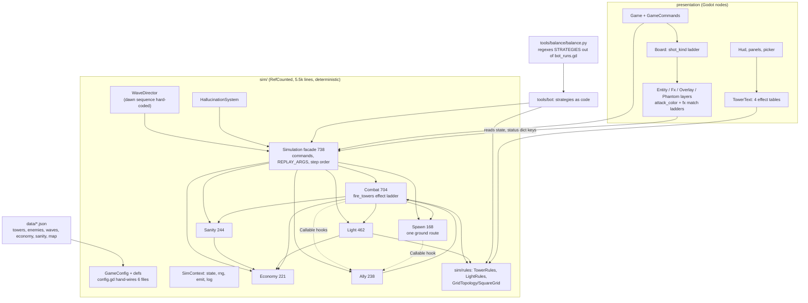
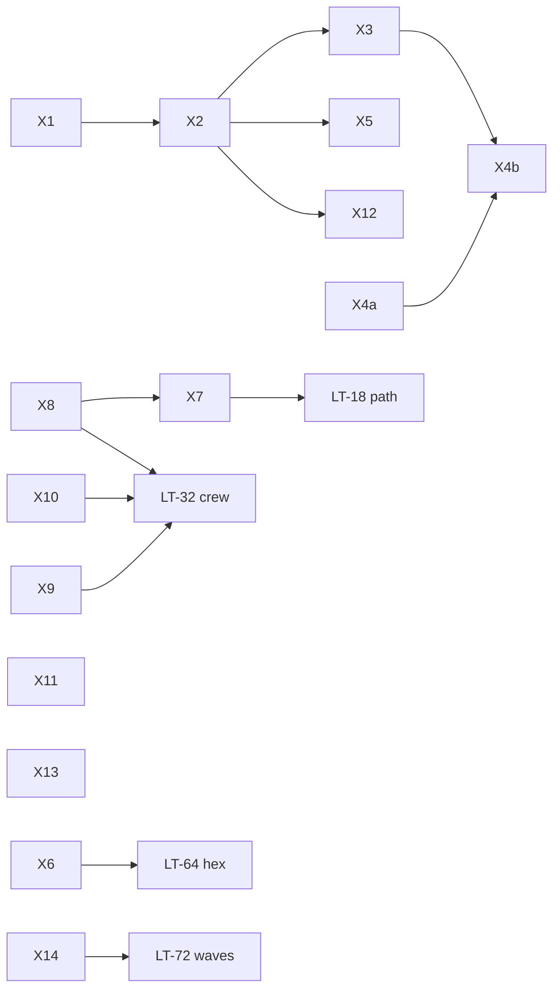

# LT-94: extensibility review (opus)

Scope: `release-0.7.0` at `01492e1` (0.7.0 bump, after the LT-65 refactor B0-B11 and B13 in
0.5.0-0.6.0). Docs only, no code changed. Line numbers are at `01492e1`.

Inputs: `docs/design/LT-65-architecture-review.md` (blocks B0-B13, guards G1-G9, owner decisions
§7), `docs/design/LT-80-sim-split.md` (SimContext, systems, determinism invariants),
`docs/design/LT-77-grid-topology.md`, `docs/design/LT-27-day-night-relics.md` §7 (crew sketch),
and the code under `sim/`, `scenes/`, `ui/`, `tools/`, `tests/`, `data/`.

Question: how cheaply and how safely can gameplay change or grow? This note does not repeat the
LT-65 work. It starts where that work stopped.

**Verdict.** LT-65 fixed the *layering*: one facade, internal systems, rule queries, BoardView,
event-driven UI and guards. It did not touch *content extension*. The code still grows by
**editing ladders**: one `if key present` chain per concern, repeated in the sim, the board, the
text layer and the bot. A new tower effect today means ~11 production files and ~6 test files
(the Silver Key and Dynamite merges are the evidence, §2.4). The split moved those edits into
smaller files but did not reduce how many files a feature touches. Waves are already cheap and
data-only. Enemy traits are the weakest point: 3 of the 4 traits in `data/enemies.json` are
parsed and then silently ignored. The sim is GDScript-only but well contained. A hard boundary
costs little now and keeps a later port mechanical.

## 1. What LT-65 already delivered (not re-proposed)

| LT-65 block | State at `01492e1` | Evidence |
|---|---|---|
| B0 golden replay | done | `tests/golden_replay_test.gd`, `tests/golden_runs.gd`, `tests/fixtures/golden_data/` |
| B1 GameFixture, B3 CommandText, B10 model/text | done | `tests/support/game_fixture.gd`, `ui/text/command_text.gd`, `ui/model/tower_stats_model.gd`, `ui/text/tower_text.gd` |
| B2 rule queries | done | `sim/rules/tower_rules.gd`, `sim/rules/light_rules.gd`; guard G1 `tests/architecture_guard_test.gd:37-43` |
| GridTopology (LT-77), B4 BoardView | done | `sim/rules/grid_topology.gd:14-56`, `scenes/board/board_view.gd` |
| B5-B8 sim split | done | `sim/core/systems/*.gd`; facade `sim/core/simulation.gd` (738 lines); G4a/G4b `architecture_guard_test.gd:496-719` |
| B9 board layers + SelectionModel | done | `scenes/board/*_layer.gd`, `scenes/board/selection_model.gd` |
| B11 event-driven UI | done | `REFRESH_ON` tables `ui/hud.gd:61`, `ui/tower_panel.gd:29`, `ui/lighthouse_panel.gd:17`; G6 `architecture_guard_test.gd:331-424` |
| B13 bot split | done | `tools/bot/bot_strategies.gd`, `tools/bot/bot_placement.gd` |
| B12 view snapshot | deferred to LT-64 | none |

## 2. Current state

### 2.1 Module map (after 0.6.0)

Dependencies point one way, `presentation/tools -> facade/rules -> defs`, and the guards hold
this. The system DAG is `Light, Sanity -> Economy`; `Combat -> Light, Sanity, Economy, Spawn`;
`Ally -> Combat`. Two back edges are hidden behind `Callable` hooks: `Combat -> Ally`
(`combat_system.gd:24-25`, `:41`) and `Spawn -> Ally` (`spawn_system.gd:16`, `:31`), wired in
`simulation.gd:44-50`. They work, but each new cross-system effect (crew, traits) will be
tempted to add another hook.

### 2.2 What lives in code that should live in config (or in one table)

Two kinds of finding. **Config**: a balance or content value lives in code. **One table**:
metadata about a content key is spread over several files that must agree.

| # | Item | Where today | Kind | Proposal |
|---|---|---|---|---|
| C1 | Effect key metadata: bounds (`EFFECTS`), flags, exclusivity (`NOT_WITH_BANISH`, `NOT_WITH_SUMMON`, `BANISH_KEYS`, `SUMMON_KEYS`), power scaling, neutral value, display group, display text, table-row keys | `sim/defs/tower_def.gd:140-183`; `sim/rules/tower_rules.gd:152`; `ui/model/tower_stats_model.gd:10-16` (neutral inferred from the `_multiplier` suffix); `ui/text/tower_text.gd:28-37` (`EFFECT_GROUPS`), `:172` (`ROW_EFFECT_KEYS`), `:302-352` (`special_short`), `:412-467` (`_effect_text`) | one table | X2 EffectCatalog |
| C2 | Attack mode precedence (which key wins: beam, pierce, fuse, dead zone, aoe, banish, summon, aura) | three different ladders: `combat_system.gd:207-262` (banish > summon > burst/beam > fuse > pierce > aoe); `scenes/board.gd:145-164` (`shot_kind`: aura > banish > summon > beam > pierce > fuse > min_range > aoe); `ui/text/tower_text.gd:237-251` (`trait_text`: reserve > ground > blind > line > reveal > blast) | one table | X2 `Level.mode` |
| C3 | Tower visual: look per attack mode, colour per look, fx builder per look, renderer per look | `scenes/board.gd:47-67` (colours), `:145`; `scenes/board/entity_layer.gd:108-133` (`attack_color` match); `scenes/board/fx_layer.gd:93-131`, `:146-215`, `:300-332` (three match ladders) | presentation table | X5 LookCatalog |
| C4 | Enemy traits: 4 declared, 1 implemented. `tower_harass` (cultist), `tower_lift` (night_gaunt), `regen` (shoggoth) parse and do nothing; there is no `PENDING` marker like towers have (`tower_def.gd:183`). `HallucinationSystem.BOSS_TRAIT := "boss"` (`hallucination_system.gd:18`) is a key the parser rejects (`enemy_def.gd:23-30` has no `boss`). | `sim/defs/enemy_def.gd:23-34`; only `pack` is read (`spawn_system.gd:50`) | config honesty | X4 (S part now) |
| C5 | Bot strategies: build orders, branch picks, cap floors | `tools/bot/bot_strategies.gd:13-32`, `:44-72` (one `match` arm per tower id); `tools/bot_runs.gd:76` (`STRATEGIES`); `tools/balance/balance.py:48-53` reads that const with a regex | config | X11 |
| C6 | Tower kind semantics: only mundane can miss, only mundane kills regen sanity, only occult reserves, light/shadow multipliers per kind | `combat_system.gd:126`, `:284-285`; `tower_rules.gd:15-55`; `tower_def.gd:275-286`; `tower_stats_model.gd:79`, `:103`, `:125`, `:147`; `tower_text.gd:92`, `:238`, `:285`; `tower_picker.gd:19`; `bot_placement.gd:55`, `:65` (24 sites under `sim/`, 66 `kind` references in total) | config (only if a 3rd kind) | X12, owner Q4 |
| C7 | Level structure fixed in code: exactly L1, L2 and branches `a`/`b` | `tower_def.gd:11-12` | schema | keep; owner Q3 (crew posts have no upgrades) |
| C8 | Ally contact radius `0.4` cells | `sim/core/systems/ally_system.gd:11` | config | fold into X2 (`summon_contact` effect) or leave |
| C9 | Dawn sequence: dissolve fakes, settle tokens, wage, sanity regen, auto-restore, event, luck reset | `sim/core/wave_director.gd:140-154` (wave flow code writes economy and sanity order) | one place | X8 |
| C10 | Bot run cap `MAX_TICKS := 30 * 60 * 30` (30 min of sim time) | `tools/bot_runs.gd:85`, loop `:198` | config | with LT-72: 10 waves come near the cap, so derive it from `waves.json` |
| C11 | One spawn, one lighthouse, one ground route built once | `map_def.gd:64-70`; `spawn_system.gd:27`, `:104-106` | config/state | X7 (LT-18) |
| C12 | Grid kind hard-wired | `map_def.gd:28-31` (`SquareGrid.new`) | factory | X6/X7 |

Things that are rightly code, not config: the step slot order (`simulation.gd:65-123`, LT-65
invariant 1), the RNG streams (`sim_rng.gd:9`), `SimTime` resolutions (`sim_time.gd:6-8`),
target priority modes (`sim_tower.gd:9`), command result codes. No balance number sits in code
(the GDD rule "no balance constant in code" holds), except C8 and C10.

### 2.3 Extension points

| Exists | Where | Quality |
|---|---|---|
| Grid topology | `GridTopology` abstract (`sim/rules/grid_topology.gd:14-56`), `SquareGrid` | good. The factory is hard-wired (C12), and 6 presentation files still draw tiles with `draw_rect(view.cell_rect(..))`: `scenes/board.gd:235-241`, `scenes/lighting.gd:304`, `scenes/board/entity_layer.gd:165-188`, `scenes/board/phantom_layer.gd:31`, `scenes/board/overlay_layer.gd:18-20`, `scenes/board/fx_layer.gd:327` (`- Vector2(0.5, 0.5)`, square only) |
| Spawner | `SimSpawner` (`sim/core/sim_spawner.gd`): `WaveDirector`, `ScriptedSpawner` | good for wave flow, but `WaveDirector` also owns the dawn rules (C9) |
| Systems + context | `SimContext`, one system per domain, `step()` the only order | good. Adding a system is cheap: one file, two lines in `simulation.gd` (`_init`, `step`) and G4b owners |
| Optional feature blocks | `economy.oil` / `economy.flare` are `null` when absent and the commands return `NO_FLARE` (`economy_config.gd:31-32`) | good pattern, used once; it should be the rule for crew |
| Pending effect keys | `TowerDef.Level.PENDING` (`tower_def.gd:183`), shown as "(coming soon)" (`tower_text.gd:10`), skipped by bots | good, towers only (C4) |
| Rule queries | `TowerRules`, `LightRules` | good |
| UI refresh | `REFRESH_ON` per panel + G6 | good |
| Commands | facade method + `REPLAY_ARGS` (`simulation.gd:455-468`) + replay `match` (`:476-498`) + `GameCommands` forwarder (`scenes/game_commands.gd`) + `CommandText` | 5 sites per command; works, low value to change alone |

| Missing | Effect today |
|---|---|
| Effect catalog / attack mode (C1, C2) | a new effect key edits 4 tables in 4 files that must agree, guarded only by tests that pin strings |
| Shot pipeline stages | `fire_towers` (`combat_system.gd:207-335`) is one 130-line function. A new shot shape or on-hit effect is an edit in its middle, between RNG draws (astray `:250-262`, miss `:285`, crit `:293`) whose order golden replay pins |
| Trait hooks (C4) | no place to hang per-tick, on-hit, on-spawn or near-tower enemy behaviour; `pack` is special-cased in `SpawnSystem` |
| Status registry | enemy `status` is an untyped Dictionary (`sim_enemy.gd:33-37`). Keys are spelled in combat (`combat_system.gd:14`, `:367`, `:403`, `:621-625`, `:658-680`) and again in presentation (`entity_layer.gd:81-90` reads `"bleed_ticks"`, `"banish_immune_ticks"`). A new status edits both sides with no guard |
| Look catalog (C3) | a new attack look edits 4 ladders in 3 presentation files |
| Route provider (C11) | one ground route; flyers' straight route built per spawn |
| Config section registry | `GameConfig.load_from_dir` (`sim/config.gd:25-94`) hand-wires each file; a 7th file is ~8 lines plus a field |
| Content-agnostic tests | 46 test files load live `res://data`; `tests/config_valid_test.gd:16-29`, `:245` pin roster counts (10 towers, 5 enemies, 5 waves) and id lists; `tests/dynamite_config_test.gd` pins every glyph. Every content addition edits tests that are not about it |

### 2.4 Evidence: what a new tower touched

Pre-split merges (monolith file names), mapped to today's files:

| Merge | Production files then | Same change today |
|---|---|---|
| LT-51 Silver Key `2a303b7` (14 files, 837+) | towers.json, tower_def.gd, simulation.gd, board.gd, tower_info.gd, bot_runs.gd | towers.json, tower_def.gd, combat_system.gd, tower_rules.gd, board.gd, entity_layer.gd, fx_layer.gd, tower_text.gd, bot_strategies.gd, bot_runs.gd (10) |
| LT-47 Dynamite `2f34dc6` (19 files, 913+) | + config.gd, sim_blast.gd, sim_event.gd, sim_state.gd | the above + sim_blast.gd, sim_event.gd, sim_state.gd, config.gd, architecture_guard_test.gd (G4b owner, G6) (14) |

Tests touched by both: `config_valid_test.gd` (roster pin), `bot_upgrade_test.gd`,
`dynamite_config_test.gd` (glyph pin), `tower_info_test.gd` (now `tower_text_test.gd`), plus the
tower's own two suites. Four of the six are churn: they are not about the new tower.

## 3. Probes: files touched today vs after

Assumptions, one line each:
1. **New tower with a new effect**: a "chain" shot that jumps to N nearby enemies, a new look,
   L1/L2/branches like the others, in the balance lab. No new state field.
2. **New enemy trait**: implement `regen` (HP % per second, shown as a marker). No new event.
3. **More waves (LT-72)**: 5 -> 10 hand-authored waves; owner verbatim (playtest-0.4): "волн стоит
   делать побольше". Dagon (GDD §3, wave 10 boss) is separate content and not counted.
4. **Crew (LT-32)**: LT-27 §7 model: hire crew by day into a reserve, towers need crew, night
   deployment of weaker posts, dawn rule post -> tower or back to reserve. Optional block (off
   when absent).
5. **Map v2 / hex (LT-64, LT-18)**: hex logic grid with a jittered look (LT-77 §3) plus a
   per-wave path telegraphed by day from a seeded generator. Angled view (LT-64) is BoardView-only
   and not counted.

"After" assumes the blocks named in the last column (§4). Tests are listed separately; a
behaviour suite for the feature itself is always needed and is counted.

| Probe | Today: production files | Today: test files | After: production files | After: test files | Blocks |
|---|---|---|---|---|---|
| 1 New tower + effect | **11**: `data/towers.json`, `sim/defs/tower_def.gd`, `sim/core/systems/combat_system.gd`, `sim/rules/tower_rules.gd` (if power-scaled), `scenes/board.gd`, `scenes/board/entity_layer.gd`, `scenes/board/fx_layer.gd`, `ui/text/tower_text.gd`, `ui/tower_picker.gd` (`TRAIT_TIPS`, if a new trait tag), `tools/bot/bot_strategies.gd`, `tools/bot_runs.gd` | **6**: new `<tower>_config_test.gd`, new `<tower>_test.gd`, `config_valid_test.gd`, `dynamite_config_test.gd`, `tower_text_test.gd`, `tower_attack_visuals_test.gd` (+ `bot_upgrade_test.gd` often) | **5**: `data/towers.json`, `sim/defs/effect_catalog.gd` (1 entry), `sim/core/systems/combat/shot_shapes.gd` (1 handler), `ui/text/effect_text.gd` (1 entry), `scenes/board/look_catalog.gd` (1 look; 0 if it reuses one), + `tools/bot/strategies.json` (data) | **2-3**: `<tower>_test.gd`, `tower_text_test.gd` row; the catalog guard and generic config test cover bounds | X1, X2, X3, X5, X11 |
| 2 New enemy trait | **6**: `data/enemies.json`, `sim/defs/enemy_def.gd`, the system that applies it (`combat_system.gd` `tick_statuses` or a new file), `sim/core/simulation.gd` (if a new slot), `sim/core/sim_enemy.gd` (status doc), `scenes/board/entity_layer.gd` (`enemy_markers` + draw) | **3**: `config_valid_test.gd` (`:81` pins traits), `config_reject_test.gd`, new trait test | **3**: `data/enemies.json`, `sim/core/traits/trait_catalog.gd` (params + hook, 1 entry), `scenes/board/look_catalog.gd` (marker style; 0 if reused) | **1-2**: trait test (+ reject case if params special) | X1, X4 |
| 3 More waves (LT-72) | **2**: `data/waves.json`, `tools/bot_runs.gd` (`MAX_TICKS`, C10). Per-wave HP scaling is not possible in data: it needs cloned enemy ids or code | **1**: `config_valid_test.gd:18`, `:245` | **1**: `data/waves.json` (with optional wave modifiers if the owner wants scaling: X14 once) | **0** | X1, X14 (optional) |
| 4 Crew (LT-32) | **~20**: `data/economy.json` or new `data/crew.json`, new `sim/defs/crew_config.gd`, `sim/config.gd`, `data/towers.json`, `sim/defs/tower_def.gd`, `sim/core/sim_state.gd`, new `sim/core/systems/crew_system.gd`, `sim/core/simulation.gd` (init, step, commands, `REPLAY_ARGS`, replay `match`, `can_build` check), `sim/core/command_result.gd`, `sim/core/sim_event.gd`, `sim/core/wave_director.gd` (dawn rule), `sim/core/sim_tower.gd` (post flag), `sim/core/systems/combat_system.gd` (post damage share), `sim/core/systems/economy_system.gd` (hire spend, refunds), `scenes/game_commands.gd`, `ui/text/command_text.gd`, new `ui/crew_panel.gd`, `ui/side_panel.gd`, `ui/hud.gd`, `ui/tower_picker.gd`, `scenes/board/entity_layer.gd`, `tools/bot/bot_strategies.gd`, `tools/bot_runs.gd` | **3 + risk**: new crew suites, `architecture_guard_test.gd` (G4b owners, G6). If crew is required to build, the 29 test files that call `build_tower`/`build(` break | **~15**: the same minus `wave_director.gd` (dawn hook, X8), `config.gd` (section registry, X9), the separate `REPLAY_ARGS`/`match` edits (command table, X10), `tower_def.gd`/`towers.json` crew per tower via catalog default, bot code (data, X11). The UI, state, system and commands stay: they are the feature | **3**: crew suites, guard; the 29 suites stay green because the block is absent in fixtures (optional-block pattern) | X8, X9, X10, X11, X1 |
| 5a Hex grid (LT-64) | **9**: new `sim/rules/hex_grid.gd`, `sim/defs/map_def.gd`, `data/map.json`, `scenes/board.gd`, `scenes/lighting.gd`, `scenes/board/entity_layer.gd`, `scenes/board/phantom_layer.gd`, `scenes/board/overlay_layer.gd`, `scenes/board/fx_layer.gd` | **3**: `architecture_guard_test.gd` (G3/G10 homes name only `square_grid.gd`), `square_grid_test.gd` twin, `map_def_test.gd` | **4**: `sim/rules/hex_grid.gd`, `sim/defs/map_def.gd` (factory entry), `data/map.json`, `scenes/board/board_view.gd` (already the only cell drawer after X6) | **2**: hex grid test, guard home list | X6 |
| 5b Changing path (LT-18) | **~14**: `map_def.gd`, new generator, `waves_config.gd`, `spawn_system.gd`, `sim_state.gd`, `simulation.gd` (`can_build` mask, dawn switch), `wave_director.gd`, `sim_event.gd`, `scenes/board.gd` (map layer redraw), `overlay_layer.gd` (next path), `phantom_layer.gd`, `bot_placement.gd`, `tests/golden_runs.gd` (buildable loop), guard | **4+** | **~9**: generator, `RouteSet` in `map_def.gd`, `spawn_system.gd` (route per wave already a lookup), `sim_state.gd`, `simulation.gd` dawn hook, `sim_event.gd`, `scenes/board.gd`, `overlay_layer.gd`, `bot_placement.gd` | **3** | X7, X8 |

Reading the table: probes 1 and 2 are where the blocks pay, because they repeat (the roster has
10 towers and 29 effect keys, and GDD §3 wants more enemies and Dagon). Probe 3 is already cheap.
Probe 4 is mostly irreducible feature work: the blocks remove the plumbing and, most of all, the
test-breakage risk. Probe 5 gains from X6 (hex) and X7/X8 (path), and both should be designed
inside LT-64/LT-18, not ahead of them.

## 4. Proposed blocks

Each block is behaviour-preserving unless marked, proven by the golden replay (`tests/golden_replay_test.gd`,
byte-identical, never regenerated) plus the named suites, with one revert control per block, as
in LT-65 §5. Cost: S = 1 task under a day, M = 1-2 tasks, L = a sliced task over several days.

### X1. Content-agnostic tests (S/M, low risk)

What: split "the shipped roster" from "the rules". (a) Replace the count and id pins
(`config_valid_test.gd:16-29`, `:81`, `:245`; the glyph list in `dynamite_config_test.gd`) with
invariants over *every* def: the data parses, glyphs are unique, every effect key has a catalog
entry (after X2), every tower can be bought, every wave references known enemies. (b) A rule:
a test that asserts a number from `data/` uses `tests/fixtures/` or reads the value from config,
and never repeats it. 46 files load live data today; migrate only the ones that pin content
(about 10, by grep of `is_equal(<literal>)` against data values).
Benefit: a content task touches only its own suites; balance tuning in `data/` stops breaking
unrelated tests. Risk: an accidental deletion in `data/` is no longer caught by a count; keep
one roster snapshot test (`tests/roster_snapshot_test.gd`) that a content task updates on
purpose. Files: ~10 test files + 1 new. Depends: none. Do first; every other block's tests
benefit.

### X2. EffectCatalog and `Level.mode` (M, medium risk)

What: one table `sim/defs/effect_catalog.gd` with one entry per effect key: `max`, `flag`,
`family` (`shape`, `on_hit`, `aura`, `cast`, `banish`, `summon`, `modifier`), `excludes`,
`requires`, `power_scaled`, `neutral`, `row_key`, `group` (display order). `TowerDef.Level.parse`
validates from it (replaces `EFFECTS`, `FLAG_EFFECTS`, `NOT_WITH_*`, `*_KEYS`, `tower_def.gd:140-183`);
`TowerRules.POWER_SCALED_EFFECTS`, `TowerStatsModel.neutral` and `TowerText.EFFECT_GROUPS` /
`ROW_EFFECT_KEYS` read it. `Level.mode` is computed once at parse from the catalog: an enum
`SHOT, LINE, BLAST, FUSE, SHELL, BEAM, BURST, BANISH, SUMMON, AURA`, with the precedence written
once. `CombatSystem.fire_towers`, `Board.shot_kind` and `TowerText.trait_text` switch on `mode`.
Display strings stay in presentation: `ui/text/effect_text.gd`, one entry per key (moves
`_effect_text` and `special_short` bodies verbatim). A new guard G13: every catalog key has an
`EffectText` entry and every `mode` has a look (X5).
Benefit: a new effect key is 1 catalog entry + 1 text entry + its behaviour. The three
precedence ladders (C2) can no longer disagree. Risk: `shot_kind` and `fire_towers` precedences
differ today (`board.gd:145-164` checks beam before pierce and `min_range` before aoe;
`combat_system.gd` checks fuse before pierce). `mode` must keep *each caller's* current outcome
for every shipped level. A test enumerates every level of `data/` and the golden data and pins
`mode` against the old ladders before they are deleted. Strings must stay identical
(`tower_text_test.gd`, `stats_rows_test.gd`). Files: 1 new sim + 1 new ui, edits in
`tower_def.gd`, `tower_rules.gd`, `tower_stats_model.gd`, `tower_text.gd`, `board.gd`,
`combat_system.gd` (mode switch only), guard (~8). Depends: X1 (soft).

### X3. Shot pipeline stages in CombatSystem (L, high risk)

What: cut `fire_towers` (`combat_system.gd:207-335`) into fixed stages called in today's order:
`pick target (by mode)` -> `madness and astray` -> `shape (by mode: single, line, blast, fuse)` ->
`miss roll` -> `crit roll` -> `emit SHOT` -> `damage` -> `on-hit effects (catalog order)`.
Shapes and on-hit effects are small static functions in `sim/core/systems/combat/shot_shapes.gd`
and `on_hit.gd`, looked up by `mode` / catalog key in a const Dictionary, never by iteration over
an unordered source. The RNG draws stay in the pipeline driver, not in the handlers, so a
handler cannot add or reorder a draw (LT-65 invariant 2). A guard extends G4a: no `rng(` under
`systems/combat/`.
Benefit: a new shape or on-hit effect is one function and one catalog entry, with no edit
between the RNG draws. Risk: high. RNG order (astray `:250-262` before miss `:285` before crit `:293`), the emit order (SHOT before DIED), and float order (`shot_damage`, crit multiplier
after) must be byte-identical. Proof: golden byte-identical; `sim_combat_test`,
`branch_effects_test`, `miss_test`, `dynamite_test`, `harpoon_test`, `resonator_test`,
`silver_key_test`, `summoning_circle_test`; tick cost within 5 % (`bot_runs` wall time with
`uptime` and `time -p`, LT-80 acceptance). Files: `combat_system.gd` + 2 new + guard (4).
Depends: X2.

### X4. Enemy trait hooks and typed statuses (S now, M later)

**X4a (S, now; changes behaviour: rejects or flags config).** Honesty fix for C4: add
`EnemyDef.PENDING_TRAITS := ["tower_harass", "tower_lift", "regen"]`, mirror of
`Level.PENDING`, and accept `boss` as a flag trait (`hallucination_system.gd:18` already
assumes it). A test pins that every trait in `TRAITS` is either read by the sim or pending.
Files: `enemy_def.gd`, 1 test. The owner may instead prefer to delete the three traits from
`data/enemies.json` until they are built (Q2).

**X4b (M, with the first real trait).** `sim/core/traits/trait_catalog.gd`: per trait, its param
schema (today `enemy_def.gd:23-30` plus the `pack` special case `:78-94`) and which hooks it
implements: `on_spawn` (pack), `on_tick` (regen), `near_tower` (harass, lift), `on_hit`,
`on_death`. Systems call the hooks at fixed points, in enemy id order then catalog order (for
example `on_tick` in slot 2 after `tick_statuses`, `simulation.gd:81`). Statuses get a
`StatusRules` table: key, tick behaviour, immunity flag, marker name. `SimEnemy.markers()` (sim
query) replaces the key reads in `entity_layer.gd:81-90`, so presentation stops spelling status
keys. Benefit: probe 2 drops from 6 to 3 production files, and the tower-side debuffs
(`tower_harass`, `tower_lift` disable timers, `sim_tower.gd:40`) get the same table. Risk:
moving `pack` behind a hook moves an RNG draw site (`spawn_system.gd:54`); it must keep its
call order (golden). Files: 2 new, `spawn_system.gd`, `combat_system.gd` (`tick_statuses`),
`sim_enemy.gd`, `entity_layer.gd`, guard (~7). Depends: X4a; X3 for `on_hit`.

### X5. LookCatalog in presentation (S/M, low risk)

What: `scenes/board/look_catalog.gd`, one entry per look: colour, fx builder (`_shot_fx` arms
`fx_layer.gd:146-215`), renderer (`_draw_effects` arms `:300-332`), cap per tower (the banish
special case `:99-101`), enemy marker styles. The default look of a level is its `mode` (X2).
Optional per-tower override, `look` in a presentation-only `data/looks.json` keyed by tower id
and level (Q5), so a new tower can reuse an existing look without code. Benefit: a new look is 1
entry + 1 draw function; reusing a look is 0 code. Risk: low. Proof: `tower_attack_visuals_test`,
`render_isolation_test`, `board_layers_test`; frame time median and p90 not worse (`frame_stats`,
`-- --mute`). Files: 1 new, `board.gd`, `entity_layer.gd`, `fx_layer.gd` (4). Depends: X2.

### X6. Cell drawing only through BoardView (S, low risk; with LT-64)

What: `BoardView.fill_cell(canvas, cell, color, inset)`, `outline_cell(...)` drawing
`cell_polygon`. The 6 `draw_rect(view.cell_rect(..))` sites (§2.3) and the square leak rect
(`fx_layer.gd:327`) use them. Guard: `cell_rect(` is called only in `board_view.gd`. `MapDef`
gets a grid factory (`{"square": SquareGrid}`) instead of `SquareGrid.new` (`map_def.gd:31`).
Benefit: hex is then 1 sim file + map data + the factory line (probe 5a: 9 -> 4). Risk: the
tower plate's letter and pips (`entity_layer.gd:176`, `:188`) are pixel rects inside the tile and
need a centred layout on hex; screenshots at 1200x675 and 1920x1080. Files: `board_view.gd`,
the 6 drawing files, `map_def.gd`, guard (9). Depends: none; do it as the first slice of LT-64.

### X7. RouteSet and mutable map state (M/L; with LT-18 design)

What: `MapDef.routes: Dictionary[String, Array[Vector2i]]` (today one `path`); waves pick a
route by id (`waves.json` `"route"`, default the only one); `SpawnSystem` keeps a route cache by
id instead of one `_ground_route` (`spawn_system.gd:14`, `:27`). The buildable mask and the
current/next route move from `config.map` into `SimState` (a path change is state, not config).
A generator in `sim/rules/` (seeded from `SimRng`, a new stream appended) produces routes; its
chokepoint metric is a pure static rule. Benefit: LT-18 lands in the map, spawn and dawn code,
not across the board. Risk: `state.map` is the config object today (`simulation.gd:37`); making
it mutable touches every `state.map.is_buildable` reader; a new RNG stream must be appended last
(`sim_rng.gd:9`). Files: ~9 (probe 5b). Depends: X8; the LT-18 design decisions.

### X8. Dawn and dusk hooks on the facade (S, low risk)

What: `Simulation.on_dawn(wave_number) -> int` runs today's `_clear_wave` body
(`wave_director.gd:140-154`) in the same order; `WaveDirector` keeps only wave flow (phase,
counters, events). Same for dusk (`start_wave` side effects, if any grow). Benefit: crew (dawn
post rule), LT-18 (path switch at dawn) and later relic or upkeep rules add one line to one
ordered method that the facade owns, like `step()`. Risk: the WAVE_CLEARED emit and the
`night_luck` write must stay in place (golden). Files: `simulation.gd`, `wave_director.gd`,
guard owners (3). Depends: none.

### X9. Config section registry and the optional-block rule (S, low risk)

What: `GameConfig` loads from a list `[file, parser, required]` instead of six hand-written
blocks (`config.gd:25-94`); cross-checks (`_check_drops`, glyph uniqueness) run after all
sections. Rule, written in the file header: a new mechanic's config is an optional block or file
whose absence turns the mechanic off (the `oil`/`flare` pattern, `economy_config.gd:31-32`).
Benefit: crew and other mechanics plug in without touching existing fixtures, so the 29 suites
that build towers stay green. Risk: low; `config_reject_test.gd` pins error paths and order.
Files: `config.gd` (1-2). Depends: none.

### X10. One command table (S, low risk)

What: `REPLAY_ARGS` (`simulation.gd:455-468`) and the replay `match` (`:476-498`) become one
table `{name: [arg types, Callable]}` built in `_init`. `can_*` stays per command. Benefit: a
command is 1 table line + its methods instead of 3 sites. Risk: low; the `command_log` format is
unchanged (LT-65 invariant 6); `sim_boundary_api_test` pins replay. Files: `simulation.gd` (1).
Depends: none. Value is small alone; do it as the first slice of LT-32.

### X11. Bot strategies as data (S/M, low risk)

What: `tools/bot/strategies.json`: per strategy an order cycle (`MIXED_ORDER`-style lists),
branch picks, cap floor, flags (flare on/off). `bot_strategies.gd:44-72` becomes one generic
interpreter; `balance.py` reads the JSON instead of regexing `bot_runs.gd:76` (`balance.py:48-53`).
Lab variants can then also vary strategies. Benefit: a new tower enters the lab with a data
edit. Risk: the `occult` arm has logic (cap guard, rifleman fallback, `bot_strategies.gd:60-66`);
keep it as a named policy the JSON refers to. Proof: balance `baseline` RUN lines identical on
20 seeds; `bot_upgrade_test`. Files: 1 new, `bot_strategies.gd`, `bot_runs.gd`, `balance.py`,
`tools/balance/README.md` (5). Depends: none.

### X12. Tower kind table (M, medium risk; only on demand)

What: a `kinds` block in config (`misses`, `kill_regen`, `reserves_sanity`, `madness_default`,
light and shadow multipliers, today split over `economy.lighthouse.beam.mundane/occult` and
`economy.shadow`) and `TowerKind` lookups instead of the 24 kind sites under `sim/`
(§2.2 C6). Benefit: a third kind (crew posts, if they are a kind) is config. Risk: touches the
light rules that LT-70 tuned; float order in `TowerRules.power_mult` / `interval_mult`. Files:
~10. Depends: X2. Do only if the owner wants a third kind (Q4).

### X13. Hard sim boundary for portability (S/M, low risk)

See §5, option A. Files: `sim/core/sim_rng.gd`, 4 RNG call-site files, `sim/config.gd` (IO out),
new `scenes/config_loader.gd` or `sim_io/`, guard, `tests/golden_runs.gd` (trace export), 1 new
test (~9). Depends: none.

### X14. Wave modifiers (S; only if LT-72 wants scaling)

What: optional per-wave `hp_mult` / `speed_mult` (and per-group overrides) in `waves.json`, read in
`SpawnSystem._enter` (`spawn_system.gd:92-110`) through `state.wave_index`. Fakes use the same
multiplier, so they stay indistinguishable (LT-12). Benefit: 10+ waves without cloning enemy ids.
Risk: `units_per_tick` rounding with `speed_mult`; `max_hp` drives `pull_max_hp`/`banish_max_hp`
caps (decide: base or scaled HP). Files: `waves_config.gd`, `spawn_system.gd`, 1 test (3).
Depends: none.

### Order and dependencies

Suggested release cut:
- **Now (next release, before new content):** X1, X4a, X8, X9, X11, X13. All S or S/M and low
  risk; together they remove most per-feature test churn and prepare crew and LT-18.
- **Before the next tower or enemy content batch:** X2 -> X5, then X3. X3 is the one high-risk
  block. If no new shot shapes are planned, X3 can wait, and X2 + X5 already get probe 1 to
  about 7 files.
- **Inside their features:** X10 + crew (LT-32); X6 + hex (LT-64); X7 + path (LT-18); X14 +
  LT-72 if scaling is wanted; X12 only if a third kind appears.

What is deliberately **not** proposed: a generic ECS, a plugin registry for step slots, or
scriptable effects in JSON. The explicit `step()` order and verbatim float order are what keep
replay byte-identical (LT-65 invariants 1-6). Behaviour stays in code. Only *which* code runs
and *with what numbers* moves to tables.

## 5. Engine portability

### 5.1 What is engine-bound today

Presentation (`scenes/`, `ui/`, about 5.6k lines) is Godot by nature and is not counted. The sim
(`sim/`, 5458 lines) is clean of nodes, signals, `await`, `Engine`/`OS`/`Time` (0 hits), and runs
without a SceneTree (`tests/sim_no_tree_loop.gd`). What still binds it:

| Binding | Where | Port cost |
|---|---|---|
| Language: GDScript, `class_name` globals, `@abstract` (Godot 4.5+) | all of `sim/`; `grid_topology.gd` (13 lines) | the rewrite itself |
| `Vector2` is **32-bit float** while `float` is 64-bit; positions mix both | 45 lines in 14 files (`sim_route.gd:7`, `:48` `lerp` on `PackedVector2Array`, enemy and ally positions, blasts). `sim_state.gd` keeps the beam in two 64-bit floats just because of this | high: a port must emulate float32 `Vector2` arithmetic exactly, or golden digests differ |
| `RandomNumberGenerator` (PCG32 + Godot's `randf` / `randi_range` mapping) | created only in `sim_rng.gd:17`; drawn at 8 sites with 2 methods (`.randf()`, `.randi_range()`): `combat_system.gd:262`, `:360`, `:686`, `:693`, `:699`; `economy_system.gd:142`; `spawn_system.gd:54`; `hallucination_system.gd:42` | medium: re-implement 2 functions bit-exactly; easy if the 8 sites go through a `SimRng` API |
| Built-ins with engine-specific semantics: `roundi` (half away from zero), `clampi`, `maxf`, `lerp`, insertion-ordered `Dictionary` iteration (relied on for config order) | 36 lines in 14 files | low: document and mirror |
| JSON and file IO | `sim/config.gd:136-162` (`FileAccess`, `JSON`; numbers become floats); custom duplicate-key scan `:164` | low: move IO out of `sim/` |
| `Callable` hooks between systems | `combat_system.gd:24-25`, `spawn_system.gd:16` | low: interfaces in any language |
| Golden digests are Godot text (`var_to_str`, `type_string`) | `tests/golden_runs.gd:97-131` | medium: digests cannot be compared across engines |
| Tests drive the sim through its GDScript API | ~30k lines of tests, 46 files load live data | high for option B: tests must be ported or bound |

### 5.2 Options

**A. Keep GDScript, enforce a hard boundary (recommended now; X13, S/M, ~9 files).**
1. Guard G12: `sim/` may name only an allowlist of engine types (`Vector2`, `Vector2i`, `Rect2`,
   packed and typed arrays, `Dictionary`, `RandomNumberGenerator` inside `sim_rng.gd` only); it
   may not name `FileAccess`, `JSON`, `Node`, `Resource`, `Callable` (after X4b replaces the hooks),
   `Engine`, `OS`, `Time`.
2. `SimRng.randf(stream)` and `SimRng.randi_range(stream, a, b)`; the 8 call sites use them.
   The algorithm then lives in one file.
3. File IO and `JSON.parse` move to a loader outside `sim/`; `GameConfig.from_dicts(...)` takes
   parsed Dictionaries (the duplicate-key scan moves with the loader).
4. An engine-neutral trace next to the golden digests: JSON Lines of events and a final state,
   floats printed with a fixed round-trip format (`%.17g` for 64-bit, float32 values marked).
   This is the conformance oracle for any future port and costs nothing at runtime.
5. Document the float32 `Vector2` rule in `sim/core/sim_time.gd`'s header: which values are
   float32 and which are 64-bit.
Benefit: the sim stays as productive as today; a later port becomes a mechanical translation
checked against traces, with no design work. Risk: low; golden byte-identical (the RNG wrapper
must not add a draw). Cost: 1-2 tasks.

**B1. Portable core in C# (Godot .NET).** Same engine, and the core could later move to Unity or
MonoGame. Blocker: the only export preset is Web (`export_presets.cfg:3-4`), and Godot 4's C# web
export has been unsupported for most of the 4.x line (verify for 4.7 before deciding). Cost: L-XL:
rewrite 5.5k lines; tests (30k lines of GDScript calling the sim) either port or go through a
binding; float32 `Vector2` and PCG32 emulation as in A. Gain over A: static typing, faster ticks.

**B2. Portable core in Rust via GDExtension (godot-rust).** One crate, testable with `cargo test`,
also buildable to wasm for a non-Godot web client. Web export of GDExtensions works but has
build constraints (threads, toolchain); verify for 4.7. Cost: XL: rewrite plus a binding layer for
the facade API that UI, bot and tests use; two languages in the build; CI gains a Rust
toolchain. Gain: true engine independence and speed for the balance lab (hundreds of sims per
run).

**Cost comparison.**

| | A boundary | B1 C# | B2 Rust |
|---|---|---|---|
| Up-front | 1-2 tasks | ~1 release | 1-2 releases |
| Ongoing | none | dual-language glue, web export risk | dual toolchains, binding upkeep |
| Feature velocity during | unchanged | frozen for content in the sim | frozen for content in the sim |
| Keeps B open | yes (traces + RNG wrapper make B mechanical) | n/a | n/a |

Recommendation: A now. Choose between B1 and B2 only when there is a concrete reason: a target
platform Godot cannot export, or balance-lab speed becoming the bottleneck (today the lab runs
20 seeds x 10 strategies in minutes).

## 6. Open questions for the owner

1. **Which content comes next, and when?** If new towers or enemies come within one or two
   releases, schedule X2 + X5 (and X3 if new shot shapes) before them. If the next releases are
   crew and map v2, X3 can wait.
2. **Enemy traits that do nothing today** (`tower_harass`, `tower_lift`, `regen` in
   `data/enemies.json`): mark them pending (X4a, visible to bots and tests), or remove them from
   the data until they are built?
3. **Crew posts (LT-32)**: a new tower kind, a tower with a `post` flag, or a separate entity?
   The answer decides whether X12 (kind table) is needed and whether `LEVEL_COUNT`/branches
   (`tower_def.gd:11-12`) must become per-tower.
4. **Crew as an optional block**: confirm that crew must be off when its config block is absent
   (X9 rule), so tests and the golden data stay unchanged.
5. **Visual override**: may a tower choose its look in data (`data/looks.json`,
   presentation-only), or does the look always follow the attack mode?
6. **LT-72 waves**: hand-authored only, or also per-wave HP/speed scaling (X14)? Scaling makes 10+
   waves cheap but adds a balance dimension to the lab.
7. **Portability**: accept option A (X13) as the standing policy, with B only on a concrete
   trigger?
8. **Live-data tests (X1)**: accept the rule "tests do not pin shipped numbers or roster
   counts, except one roster snapshot"?
