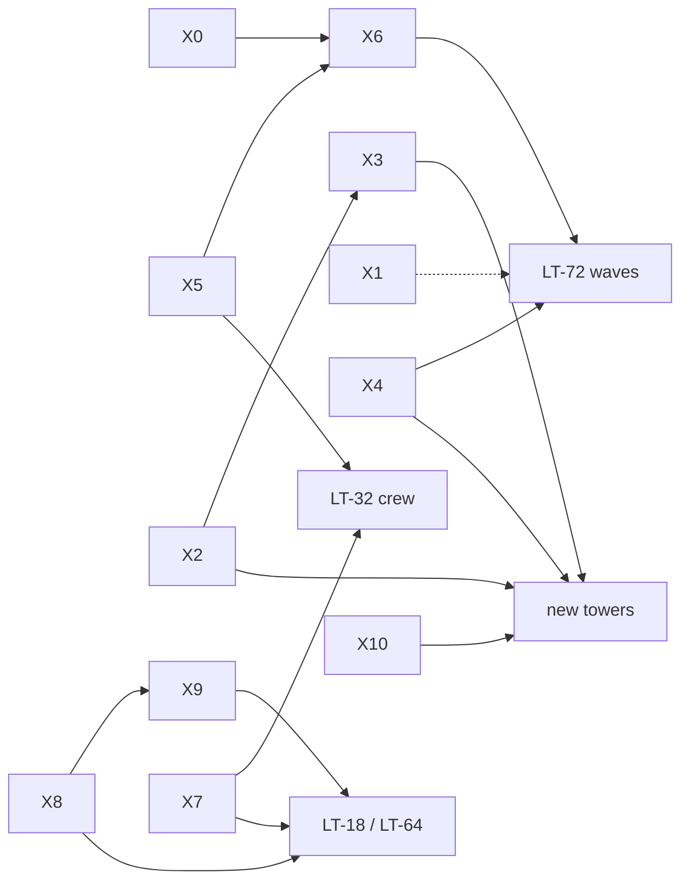

# LT-95: extensibility review after the LT-65 refactor (fable run)

Scope: `release-0.7.0` at `01492e1` (2026-11-20). Design only, no code changed. Builds on
`LT-65-architecture-review.md` (blocks B0-B13, all landed except B12) and `LT-80-sim-split.md`.
Nothing below re-proposes those blocks.

Question: how many places must change, and how risky is it, to change or extend gameplay?

**How to read the evidence.** Every claim is tagged:
- **[M] measured**: I ran a command or read the lines at `01492e1` (grep, `git diff --name-only`,
  a file read). Line numbers are from that commit.
- **[I] inferred**: my reading of what a future change would need. Nothing was implemented, no
  test or game was run, so every "files touched" number for a probe is [I], anchored by [M] facts.

## 1. Verdict

1. **The LT-65 refactor made each change safer, not smaller.** It cut files down and added
   guards, but a new tower with a new effect touches *more* files now than before the split:
   6 production files per tower in 0.3.0 [M], about 9-11 today [I]. The reason is that one
   feature is still declared by hand in every layer (schema, rule, look, FX, text, bot).
2. **Config holds numbers; code holds the catalogue.** Every balance number is in `data/` [M:
   the sim has 2 balance-relevant literals left, §2.2]. What is *not* in data is the list of
   things that exist: effect keys, enemy traits, attack looks, effect texts, commands, bot
   strategies. Those are parallel hand-kept tables and `if` chains.
3. **Three extension points are missing:** per-effect and per-trait hooks in combat, a modifier
   channel for towers (enemies have one), and phase hooks (dawn is a hard-coded call list).
4. **Three enemy traits in the shipped data do nothing** [M]. `tower_harass`, `tower_lift` and
   `regen` are in `data/enemies.json`, pass validation, and no sim code reads them (§2.3).
5. **"More waves" is already a data-only change** for existing enemy types. Its real cost is
   the traits and the boss that the GDD's waves 6-10 need (probe 2, three times over).
6. **Portability:** the sim is clean of scene types and pinned to 17 engine types by a guard
   [M]. It is still 100 % GDScript, uses Godot's RNG and 32-bit `Vector2` math, and the
   presentation reads live sim objects. Recommendation: harden the boundary in GDScript now
   (block X11); a second-language core only on a concrete trigger (§6).

## 2. Current state

### 2.1 Module split and dependencies [M]

| Layer | Files / lines | Depends on | Enforced by |
|---|---|---|---|
| `data/*.json` | 6 files | nothing | `config_valid_test`, `config_reject_test` |
| `sim/defs`, `sim/config*.gd` | 9 files | `ConfigReader`, `SimTime`, `GridTopology` | loader errors |
| `sim/rules` | 4 files, 334 lines | defs | G1, G3 guards |
| `sim/core` facade `simulation.gd` | 738 lines | systems, defs, rules | `sim_boundary_test` |
| `sim/core/systems` | 7 files, 2085 lines | `SimContext`, peers via constructor | G4a, G4b (`G4B_OWNERS`) |
| `scenes/` | 17 files | facade, `SimState` (read), rules, events | G2, G6, G7 |
| `ui/` | 12 files | facade, defs, rules, `SelectionModel` | G1, G9 |
| `tools/bot*` | 3 files | facade, rules | golden replay |

- `sim/` is 37 files, 5458 lines. The engine types it may name are pinned
  (`tests/sim_boundary_test.gd:23-27`): `Array, Callable, Dictionary, FileAccess, JSON, 4 Packed*
  arrays, RandomNumberGenerator, Rect2, RefCounted, RegEx, String, Variant, Vector2, Vector2i`.
- Step order is written once, in `Simulation.step()` (`simulation.gd:65-122`): 18 system calls
  in 9 slots. Systems get peers through constructors (`simulation.gd:43-51`); two back edges
  are `Callable`s (`set_ally_hooks`, `set_ally_compact`).
- `WaveDirector` and `HallucinationSystem` are outside the systems folder and call the facade
  (`wave_director.gd:143-147`, `hallucination_system.gd:26-52`).
- Presentation reads sim objects directly: `SimState` is named in 11 `scenes/`+`ui/` files,
  `Simulation` in 9, `SimEvent` in 9, `SimTower` in 7, `TowerDef` in 6, `GameConfig` in 5.
  There is no read-only snapshot (LT-65 B12 was deferred; 0 matches for `snapshot`).
- Events fan out by a hand-written list of 7 consumers (`scenes/game.gd:191-205`). Panels
  mark dirty groups from `REFRESH_ON` tables (4 files).

### 2.2 What lives in code that should (or should not) live in config

| # | In code today [M] | Where | Verdict [I] |
|---|---|---|---|
| 1 | Effect schema: 29 keys with max values, plus 7 derived lists (`CAST_EFFECTS`, `BANISH_KEYS`, `NOT_WITH_BANISH`, `SUMMON_KEYS`, `SUMMON_REQUIRED`, `NOT_WITH_SUMMON`, `FLAG_EFFECTS`) | `sim/defs/tower_def.gd:140-177` | Keep in code, but as **one table** (X2): the 7 lists are facts about a key, not separate constants |
| 2 | Effect text: display order, short form, long form, three hand-kept places for the same 29 keys | `ui/text/tower_text.gd:28-36`, `:302-345`, `:412-467` | **Move to data or to the same table** (X2). A new key needs 3 edits here today |
| 3 | Attack look, derived from effects by an `if` chain (10 looks) | `scenes/board.gd:145-162` | **Move to data**: an optional `look` per level in `towers.json` (X4) |
| 4 | Look colours and renderers: a `match` of 10 arms, a second `match` of 6, 9 per-look `_draw_*` renderers, 55 timing/colour constants | `scenes/board/entity_layer.gd:108-131`, `fx_layer.gd:181-209`, `:11-67` | Registry in code (X4); timings stay code (visual tuning, not balance) |
| 5 | Enemy look: none. Every enemy is one circle in one colour; `EnemyDef` is named in 0 `scenes/`/`ui/` files | `entity_layer.gd:27`, `:251` | **Move to data**: `look` in `enemies.json` (X4). A boss cannot be told apart today |
| 6 | Enemy trait schema: 4 traits; `pack` has a special-case parser | `sim/defs/enemy_def.gd:23-30`, `:80-94` | Code, next to each trait's rule (X6) |
| 7 | Bot strategies: build orders and branch picks as constants and a 10-arm `match`; 6 arms are the same pattern "every third build is tower X" | `tools/bot/bot_strategies.gd:15-32`, `:47-67`; `tools/bot_runs.gd:76` | **Move to a data table** (X10) |
| 8 | Commands: each declared in 4 places (method pair, `REPLAY_ARGS`, replay `match`, `GameCommands` forwarder), plus a text row | `simulation.gd:455-498`, `scenes/game_commands.gd`, `ui/text/command_text.gd:8-34` | One command table in code (X7) |
| 9 | Dawn sequence: 5 facade calls in fixed order | `sim/core/wave_director.gd:143-149` | Phase hooks in code (X7) |
| 10 | Balance-relevant literals left in the sim: ally contact distance `0.4`; summon leash `range + 1.0` | `ally_system.gd:11`, `combat_system.gd:392` | Move to `towers.json` / `economy.json` with X3 (S) |
| 11 | Rule-shape literals: bleed pulse = 1 s, pierce half-width = `pierce * 0.5`, beam counts `{1,2,4,8}`, `LEVEL_COUNT = 2`, branches `a`/`b`, 3 target priorities, flyers spawn at `S` | `combat_system.gd:277,651,672`, `economy_config.gd:204`, `tower_def.gd:11-12`, `sim_tower.gd`, `spawn_system.gd:103-105` | **Leave in code.** These are rule definitions; a config key would not make them extensible |
| 12 | Tower kind (`"mundane"`/`"occult"`) compared as a string at 39 sites in 11 files | sim 4 files, ui 4, tools 3 | Leave. A third kind is not on the backlog |
| 13 | Live-data counts pinned in tests: 10 towers, 5 enemies, 5 waves | `tests/config_valid_test.gd:16-18,29,245` | Remove the pins (X1) |

### 2.3 Extension points: present and missing

Present [M]:
- **Effects as a key/value bag** per level (`TowerDef.Level.effects`), validated against one
  schema. Adding a number to an existing behaviour is data-only.
- **`Level.PENDING`** (`tower_def.gd:183`): a key may ship in data before its sim code; the UI
  marks it "(coming soon)" and bots skip it. Empty today.
- **Enemy per-tick modifiers** (`SimEnemy.reset_modifiers`, `sim_enemy.gd`): `speed_mult`,
  `damage_taken_mult`, `armor_bonus`, `lit`. Auras, flare and madness all write here.
- **Enemy status timers** (`SimEnemy.status`), ticked in `CombatSystem.tick_statuses` (:658).
- **`SimSpawner`** (5 virtual methods): the wave source is swappable (`WaveDirector`,
  `ScriptedSpawner`).
- **`GridTopology`** (12 abstract methods), `MapDef.grid`, optional `"grid"` key in `map.json`.
- **`SimRng` streams**: a new roll gets its own stream and does not shift the others.
- **`SimContext.day_only()`**: one seam for phase gating.
- **Sync tests**: `tower_text_test.gd:204,452` loop over every `EFFECTS` key; G6 forces every
  `SimEvent.Type` to be consumed or pinned; G9 forces a text per `CommandResult`; G4b forces
  an owner per state field. They make a forgotten layer fail loudly. This is the main thing
  the refactor bought for extensibility.

Missing [M for the code facts, I for the judgement]:
1. **No hook per effect.** `fire_towers` (`combat_system.gd:207-323`) is one function of about 115 lines
   with the shot shapes, miss, crit, astray and fuse inline; `apply_auras` (:143-187) names its
   four keys inline; banish and summon bypass the function (:216-221). A new effect means
   editing that function, where RNG order and float order are replay invariants.
2. **No hook per enemy trait.** Only `pack` is read (`spawn_system.gd:50-52`). Nothing calls a
   trait on spawn, tick, damage, death or leak. `tower_harass`, `tower_lift` and `regen` are in
   `data/enemies.json` and in the GDD §7 table, pass `EnemyDef.TRAITS`, and are read nowhere
   (grep over `sim scenes ui tools`). Traits have no `PENDING` list, so the data promises
   behaviour the game does not have. `HallucinationSystem.BOSS_TRAIT` (:18) checks a trait id
   that the schema would reject.
3. **No modifier channel for towers.** Light is the only tower modifier and is fetched by name
   (`_light.power_mult(t)` at `combat_system.gd:169,246,343,389`, `_light.interval_mult(t)` at :322).
   `SimTower.status` exists (`sim_tower.gd:41`) and is read or written by 0 lines. A second
   source (harass debuff, a weaker "defence post", a disable) has nowhere to plug in, and the
   UI's `TowerRules.effective` would need the same new argument.
4. **No phase hooks.** The director calls five named facade methods at dawn. A system that
   needs dawn or dusk (crew: posts return to reserve; Map v2: next path) must edit the director.
5. **One route for the whole run.** `SpawnSystem._ground_route` is built once in `_init`
   (`spawn_system.gd:27`); `MapDef` enforces exactly one `S`, one `L` and no forks
   (`map_def.gd:62-66`, `:75-113`). `SimEnemy.route` is per enemy, so the sim already walks
   any route; only the source of routes is fixed.
6. **Tiles are still drawn as rectangles.** `BoardView.cell_polygon` exists and has no caller
   outside its own file and one test. Layers call `cell_rect` at 8 sites in 5 files, and
   `fx_layer.gd:327` hard-codes a square with `- Vector2(0.5, 0.5)`. LT-77 Q4 ("tiles from
   `polygon()` in B4") is therefore half done: the API landed, the callers did not move.
7. **Isotropic pixel scale.** `BoardView` is "linear (no offset)" (`board_view.gd:10`); layers
   call `cells_to_px` 54 times and `cell_to_world` 46 times in 4 files. An angled view (LT-64)
   turns every circle into an ellipse, which those calls cannot express.
8. **Tests ride on live data.** 47 of 99 test files name `res://data`, the default loader or
   `GameFixture.make` [M: grep]; `SimTestBase.make_config` copies `res://data` and edits it.
   How many assertions depend on a live *value* was not measured.

### 2.4 What the last six towers and two mechanics actually touched [M]

`git diff --name-only <merge>^1 <merge>`, production files only (no tests, docs, `.uid`):

| Merge | Prod files | Test files | Files |
|---|---|---|---|
| LT-47 Dynamite crew | 10 | 6 | towers.json, board.gd, config.gd, sim_blast.gd, sim_event.gd, sim_state.gd, simulation.gd, tower_def.gd, bot_runs.gd, tower_info.gd |
| LT-48 Coast battery | 6 | 7 | towers.json, board.gd, simulation.gd, tower_def.gd, bot_runs.gd, tower_info.gd |
| LT-49 Searchlight | 5 | 6 | towers.json, board.gd, simulation.gd, tower_def.gd, tower_info.gd |
| LT-50 Resonator | 8 | 7 | the LT-48 six + sim_tower.gd, tower_panel.gd |
| LT-51 Silver Key | 6 | 6 | same six as LT-48 |
| LT-52 Summoning Circle | 10 | 8 | the six + sim_ally.gd, sim_event.gd, sim_state.gd, enemy_def.gd |
| LT-63 pack trait | 8 | 8 | enemies.json, hallucination_system.gd, scripted_spawner.gd, sim_enemy.gd, simulation.gd, wave_director.gd, enemy_def.gd, waves_config.gd |
| LT-70 light vs shadow | 18 | 15 | data 2, sim 6, scenes 1, ui 5, tools 4 |

The recurring six (`towers.json`, `tower_def.gd`, `simulation.gd`, `board.gd`, `tower_info.gd`,
`bot_runs.gd`) are ten files after the refactor [I, mapping by content]: `simulation.gd` ->
`combat_system.gd`; `board.gd` -> `board.gd` + `fx_layer.gd` + `entity_layer.gd`;
`tower_info.gd` -> `tower_text.gd` + `tower_stats_model.gd`; `bot_runs.gd` -> `bot_runs.gd` +
`bot_strategies.gd`.

## 3. Probes: files touched today vs after the proposal

All counts are [I]. "Today" lists the edit sites found by grep; "after" assumes the named
blocks have landed. New test files for the feature itself are needed in both columns and are
not counted; pinned test files that must be edited are counted.

| # | Probe | Today | After | Blocks that buy it |
|---|---|---|---|---|
| 1 | New tower, new effect, new look | 11 existing + 0 new | 3 existing + 2 new | X2, X3, X4, X10, X1 |
| 1b | Same, reusing an existing look | 9 existing | 2 existing + 1 new | X2, X3, X10, X1 |
| 2 | New enemy trait (affects towers) | 9 existing | 2 existing + 1 new | X5, X6, X4 |
| 2b | New enemy trait (enemy-only, e.g. regen) | 4 existing | 1 existing + 1 new | X6 |
| 3 | More waves, existing enemies | 2 existing | 1 existing | X1 |
| 3b | Waves 6-10 as in GDD §8 | about 12 existing | 4 existing + 3 new | X6, X5, X4, X1 |
| 4 | Crew (LT-32) | about 21 existing + 4 new | about 13 existing + 4 new | X7, X5, X10 |
| 5a | Hex cells, same map rules | 9 existing + 1 new | 2 existing + 1 new | X8 |
| 5b | Per-wave path, islands (LT-18) | about 12 existing + 1 new | 5 existing + 2 new | X8, X7 |
| 5c | Angled view (LT-64) | 5 existing | 1 existing | X9 |

### Probe 1: a new tower with a new effect

Assumption: a tower whose shot does something no key does today (e.g. the shot chains to two
more enemies), with its own look and a bot strategy, like each of LT-47..LT-52.

Today (11):
1. `data/towers.json`: the tower.
2. `sim/defs/tower_def.gd`: `EFFECTS`, and each exclusion list it belongs to.
3. `sim/core/systems/combat_system.gd`: a branch inside `fire_towers` or `_on_hit_effects`.
4. `sim/rules/tower_rules.gd`: if the effect scales with power or changes DPS
   (`POWER_SCALED_EFFECTS` :152, `dps` :112).
5. `scenes/board.gd`: `shot_kind` (:145) and a colour constant.
6. `scenes/board/fx_layer.gd`: `_shot_fx` arm, a `_draw_<look>`, the draw dispatch.
7. `scenes/board/entity_layer.gd`: `attack_color` (:108); `enemy_markers` (:81) for a status.
8. `ui/text/tower_text.gd`: `EFFECT_GROUPS`, `special_short`, `_effect_text`.
9. `tools/bot/bot_strategies.gd`: `order` arm, `BRANCH_PICK`.
10. `tools/bot_runs.gd`: `STRATEGIES` (:76) and its description.
11. `tests/config_valid_test.gd`: the `towers.size() == 10` pins (:16, :29).

Plus, only if it adds state or an event: `sim_state.gd` or `sim_enemy.gd`, `sim_event.gd`, and
the pins in `tests/architecture_guard_test.gd` (`G4B_OWNERS` :513, `UNCONSUMED_OK` :337). A new
bot strategy also adds rows to `tests/fixtures/golden_digests.json` (`golden_runs.gd:180` reads
`STRATEGIES`); I did not check whether the regen script does that in one step.

After (3 existing + 2 new): `data/towers.json` (tower, `look`), the effect catalogue row
(X2: schema, exclusions, power scaling, text), the bot strategy table (X10); new
`sim/core/effects/<effect>.gd` (X3) and new `scenes/board/fx/<look>.gd` (X4).

### Probe 2: a new enemy trait

Assumption: `tower_harass` as the GDD describes it (stops at an adjacent tower for 2 s, halves
its fire rate for 5 s). It is the hardest of the three inert traits because it changes towers.

Today (9): `sim/defs/enemy_def.gd` (schema, already there), `sim/core/sim_enemy.gd` (status
keys), `sim/core/sim_tower.gd` (status), `sim/core/systems/spawn_system.gd` (stop in `move`),
`sim/core/systems/combat_system.gd` (fire-rate factor at :322, status tick), `sim/rules/tower_rules.gd`
(`effective`, so the panel shows the slowed rate), `sim/core/simulation.gd` (a step slot and
`tower_mults`), `scenes/board/entity_layer.gd` (marker), `ui/tower_panel.gd` (debuff line).
Plus `sim_event.gd` and the guard pins if it emits an event. `data/enemies.json` already has
the block. LT-63 (`pack`) touched 8 production files [M].

After (2 existing + 1 new): new `sim/core/traits/tower_harass.gd` (schema and hooks, X6),
writing a tower modifier (X5); one row in the marker table (X4); one line in the trait list.
`regen` (2b) today is `combat_system.gd`, `simulation.gd` (slot), `entity_layer.gd`, and
`enemy_def.gd` untouched; after, one new trait file and the trait list.

### Probe 3: more waves (LT-72)

No LT-72 text is in `docs/`. Assumption: waves 6-10 from GDD §8.

3 (same enemy types) today: `data/waves.json` and `tests/config_valid_test.gd` (`waves.size()
== 5` at :18 and :245). The HUD and end screen read `waves_total` (`hud.gd:409`,
`end_screen.gd:34-37`); the bot and the balance lab count waves from events
(`bot_runs.gd:223-227`). After X1: `data/waves.json` only.

3b (GDD scope) needs what the data cannot say today [M: GDD §7-§8 against the schema]:
`tower_lift` "from wave 6", `regen` for wave 7 and 9 shoggoths, and Dagon: a summon every
15 s (an enemy that spawns enemies), a boss exempt from hallucination mimicry, and a look.
"Leaking = instant loss" is data already (`leak_damage` >= lighthouse HP). So 3b is probe 2
three times, plus `data/enemies.json`, `data/waves.json`, `hallucination_system.gd` (the boss
check), `entity_layer.gd` (boss look) and the bot. After: `waves.json`, `enemies.json`
(with `look`), the trait list, the hallucination check, and three new trait files.

`WavesConfig.SpawnGroup` has four fields (`type, count, interval, delay`). Per-group spawn
point or route, per-wave build time and per-wave bonus are not expressible; none is needed
for the GDD table, so I do not propose them. Map v2 will need the route one (X8).

### Probe 4: the crew mechanic (LT-32)

Assumption: the sketch in `LT-27-day-night-relics.md` §7: hire crew by day into a reserve; a
tower needs crew plus its cost; at night crew can be deployed as a weaker "defence post"; at
dawn a post becomes a tower or returns to the reserve. Its eight open questions are undecided,
so the list is a lower bound.

Today (about 21 existing + 4 new):
- data: `economy.json` or new `crew.json`; `towers.json` (crew per tower, post share).
- defs: `sim/config.gd` (load, cross-checks), `tower_def.gd`, new `crew_config.gd`.
- sim: `sim_state.gd` (reserve), `command_result.gd` (new reasons), `sim_event.gd`,
  `simulation.gd` (hire, deploy, their `can_*`, `REPLAY_ARGS`, the replay `match`, the crew
  check in `can_build`, construction, a step slot), `sim_context.gd` (a night-only gate beside
  `day_only`), `wave_director.gd` (dawn: posts resolve), `sim_tower.gd` (post flag),
  `combat_system.gd` (post damage share), `economy_system.gd` (refund), new `crew_system.gd`.
- presentation: `game_commands.gd`, `game.gd` (panel, event fan-out), `command_text.gd` (G9),
  `hud.gd`, `tower_picker.gd` (crew cost, night deploy), `tower_panel.gd`, `tower_text.gd`,
  `entity_layer.gd` (post look), new `ui/crew_panel.gd`.
- tools and pins: `bot_strategies.gd`, `tests/architecture_guard_test.gd` (`G4B_OWNERS`).

After (about 13 existing + 4 new): the four new files stay. Gone from the list:
`wave_director.gd` (phase hooks, X7), `sim_context.gd`, `game_commands.gd` and the two replay
tables (command table, X7), `combat_system.gd` and `sim_tower.gd` (a post is a tower with a
modifier, X5), `entity_layer.gd` (look data, X4). The gain is real but modest: crew is a
cross-cutting mechanic and most of its cost is design, not plumbing.

### Probe 5: Map v2 / hex (LT-64, LT-18)

LT-18 is described in GDD :337-346 and LT-77 §0/§3; LT-64 only as "angled view and the hex
cost" (LT-77 :30). Assumption: three separable changes.

5a hex cells, today (9 + 1 new): new `sim/rules/hex_grid.gd`; `sim/defs/map_def.gd` (grid
switch :28-31, "column" error texts); `data/map.json`; then the rectangle sites:
`scenes/board.gd:235-240`, `scenes/board/phantom_layer.gd:31`, `scenes/lighting.gd:304`,
`scenes/board/entity_layer.gd:165`, `scenes/board/overlay_layer.gd:18-20`,
`scenes/board/fx_layer.gd:327`, and `scenes/board/board_view.gd` (`cell_rect`). Ranges need a
balance retune (LT-77 §3: about 15 % more cells per radius). After X8: `hex_grid.gd`, the
topology factory line, `map.json`.

5b per-wave path and islands, today (about 12 + 1): `map_def.gd` (one `S`/`L`, no forks, one
`path`), a new generator, `spawn_system.gd:27`, `waves_config.gd` and `wave_director.gd`
(which route, telegraph in the build phase), `sim_state.gd`, `sim_event.gd`, `simulation.gd`
(build rules on a future path, free sell on change), `tools/bot/bot_placement.gd` (scores
against `cfg.map.path` and caches per tower id, :14-31), `scenes/board.gd` (map layer redraws
only when the map object changes, :219-222), `overlay_layer.gd` (telegraph), `lighting.gd`,
the guard pins. After X8 + X7: the generator and a `RouteProvider` implementation (new),
`map.json`, `sim_event.gd`, `overlay_layer.gd`, `bot_placement.gd`, `simulation.gd`.

5c angled view, today (5): `board_view.gd` plus the four layer files holding the 100
`cells_to_px` / `cell_to_world` calls. After X9: `board_view.gd`.

## 4. Proposed blocks

Each is a candidate task. Size: S = up to 5 files, M = 6-15, L = more or high-risk logic.
All are behaviour-preserving and proven by the existing golden replay (LT-65 B0) unless noted.

| Block | What | Size, files | Risk | Depends on |
|---|---|---|---|---|
| **X0** | Stop the data lying: put a `PENDING` list on `EnemyDef` for `tower_harass`, `tower_lift`, `regen` (or delete them from `enemies.json`), and accept `boss` in the schema | S, 3-4 | low | none |
| **X1** | Tests off live data: drop the count pins; sim suites load a frozen fixture, live data keeps `config_valid_test`, bot tests and the lab | M, 3 bases + unknown suites | low-med | none |
| **X2** | Effect catalogue: one table row per effect key (max, flag, exclusions, power-scaled, text templates, order) | M, about 6 | low | none |
| **X3** | Combat hook pipeline: shot shape, damage modifier, on-hit, aura and cast become registered handlers called in a pinned order | L, about 8 + 1 file per effect family | **high** | X2 |
| **X4** | Look as data: optional `look` per tower level and per enemy; FX renderers and marker colours in a registry, one file per look | M, about 8 | med (visual) | none |
| **X5** | Tower modifier channel: per-tick `power_mult`, `interval_mult`, `miss_add`, `disabled` on `SimTower`; light becomes its first writer; `TowerRules.effective` reads it | M, about 6 | med (float order) | none |
| **X6** | Enemy trait hooks: one file per trait (schema + `on_spawn/on_tick/on_damaged/on_death/on_leak`), a pinned trait order, `pack` moved in | M, about 7 | med | X0, X5 for tower traits |
| **X7** | Command table and phase hooks: one entry per command (name, arg types, `can`, `apply`, text); systems expose `on_dusk/on_dawn` called from a pinned list | M, about 8 | med | none |
| **X8** | Map seams: topology factory by `grid` kind; `RouteProvider` owned by `SpawnSystem` (today's fixed path is its first implementation); all tiles drawn from `cell_polygon` | M, about 10 | low-med | none |
| **X9** | View transform: layers draw in cell units under one canvas transform held by `BoardView` | M, 5 | med (pixel look) | X8 |
| **X10** | Bot strategies as a data table (build order, branch picks, cap floor), code hooks only for the two that need logic | S-M, 3 | low | none |
| **X11** | Portability boundary (§6 option A) | M, 10-15 | low-med | none |

**X0.** Benefit: the config, the GDD and the game agree; a designer cannot tune a number that
does nothing. Risk: none to behaviour; the UI has no enemy card yet, so the marker is only for
bots, tests and the future LT-66 card. Cost: `enemy_def.gd`, `hallucination_system.gd`,
`config_valid_test.gd`, maybe `enemies.json`.

**X1.** Benefit: probes 1, 3 and every balance tweak stop touching unrelated tests. Risk:
suites that today assert a live value fail when pointed at the fixture and need fixing or a
local override; the number of such suites is unknown (not measured). The frozen
`golden_data` copy may already differ from `data/` after LT-71 tuning. Cost: `sim_test_base.gd`,
`config_test_base.gd`, `tests/support/game_fixture.gd`, then per-suite repairs.

**X2.** Benefit: a new key is one row instead of edits in `tower_def.gd` (up to 4 lists),
`tower_rules.gd:152` and three places in `tower_text.gd`; the catalogue is also the list the
UI and the bot iterate. Risk: low; texts must come out identical, which `tower_text_test`
(613 lines) pins. One plural special case exists (`tower_text.gd:338,451`, "unit"/"units"), so
templates need a formatter with percent, plural and "x of" forms, or a `Callable` fallback.
Cost: new `sim/defs/effect_catalog.gd`, `tower_def.gd`, `tower_rules.gd`, `tower_text.gd`,
`tower_stats_model.gd`, tests.

**X3.** Benefit: a new effect is a new file; `fire_towers` stops being the place every tower
task edits. Risk: high. The function holds the RNG call order (miss before crit, astray on
its own stream) and float order that the golden replay pins; LT-80's invariants 2 and 5
apply to every line moved. The existing families are not uniform (banish and summon skip the
shot path), so the hook set must be designed from the 29 keys, not guessed. Needs its own
design note. Cost: `combat_system.gd` split into a pipeline plus about 6 handler files, the
ally hooks, and a tick-cost check (LT-65 B5 used 5 %).

**X4.** Benefit: a look is chosen in data, so a tower can reuse or swap one without code, and
enemies get distinct looks (needed for Dagon and for readable waves). Risk: the derived look
must stay the default so today's towers render the same; `tower_attack_visuals_test` (653
lines) pins it. Cost: `tower_def.gd`, `enemy_def.gd`, `board.gd`, `fx_layer.gd` split into
`scenes/board/fx/*`, `entity_layer.gd`, both JSON files, tests.

**X5.** Benefit: harass, lift-disable, defence posts and any future buff write one channel;
the UI reads the same numbers through `tower_mults`. Risk: `power_mult` and `interval_mult`
feed damage and cooldown, so the multiplication order must not change (golden). Cost:
`sim_tower.gd`, `light_system.gd`, `combat_system.gd`, `tower_rules.gd`, `simulation.gd`,
guard pins.

**X6.** Benefit: the three inert traits and the boss summon each become one file; the trait
schema sits next to its rule. Risk: hook order across traits and systems must be pinned like
the step order; a hook inside `apply_damage` runs on the hottest path. Cost: new
`sim/core/traits/` (base + `pack`), `enemy_def.gd`, `spawn_system.gd`, `combat_system.gd`,
`simulation.gd`, `sim_enemy.gd`, tests.

**X7.** Benefit: a new command is one entry (today 4 declarations + text); replay, the
forwarder and the reasons table cannot drift. Dawn and dusk become events systems subscribe
to, so crew and Map v2 do not edit the director. Risk: the command log format and the dawn
call order are replay invariants; the order list must reproduce `wave_director.gd:143-149`
exactly. Cost: `simulation.gd`, new `sim/core/sim_commands.gd`, `wave_director.gd`, 3 systems,
`game_commands.gd`, `command_text.gd`.

**X8.** Benefit: hex is one class and one data key; per-wave routes plug in without touching
`SpawnSystem`. Risk: low for the factory and the provider (one implementation, same route);
tile drawing from polygons may shift grid lines by a pixel on the square grid. Cost:
`map_def.gd`, `spawn_system.gd`, new `sim/rules/route_provider.gd`, 5 layer files,
`board_view.gd`, a guard that `cell_rect` is not called from layers.

**X9.** Benefit: the angled view is one matrix. Risk: 100 call sites change from pixels to
cell units; line widths and text must stay in pixels, so each site needs a look check.
Should not start before LT-64 decides the projection. Cost: `board_view.gd` and 4 layers.

**X10.** Benefit: a tower's bot strategy is a row; the lab can vary strategies without code.
Risk: bot RUN lines must be identical (LT-65 B13 used the same proof). Cost:
`bot_strategies.gd`, `bot_runs.gd`, a new table (JSON under `tools/bot/` or a const).

**Dependencies and order.**

Suggested order by what the backlog needs first [I]: X0 and X1 now (cheap, unblock data work);
then X5 -> X6 and X4 before LT-72; X7 before LT-32; X8 before LT-18; X9 only after LT-64 is
decided. X2 and X10 any time. X3 is the only high-risk block and pays off only if several
more towers with new effects are planned; with X2 alone probe 1 drops from 11 files to about 8.

## 5. What I would not do

- **No generic "everything is a component" rewrite.** The systems split is recent and guarded;
  the missing pieces are hooks inside two systems, not a new architecture.
- **No config keys for rule shapes** (§2.2 row 11). A key for "bleed pulse seconds" adds a
  number to tune and no extensibility.
- **No scripting in data** (expressions or formulas in JSON). The owner's balance rule already
  rejects a full math model; a formula language would be one.
- **No new wave schema fields** until a wave needs one.

## 6. Engine portability

### 6.1 What is engine-bound today [M]

| Binding | Size | Where |
|---|---|---|
| Language: GDScript, incl. `@abstract`, typed `Dictionary[K, V]`, inner classes | 37 files, 5458 lines | all of `sim/` |
| RNG: Godot `RandomNumberGenerator`, 7 streams seeded `seed * 16 + i` | 8 draw sites (4 `randf`, 4 `randi_range`) | `sim_rng.gd`; combat, economy, spawn, hallucination |
| Math types: `Vector2` (32-bit floats) and `Vector2i` next to 64-bit scalars | 44 and 52 code lines, 14 and 9 files | routes, ranges, beams; the beam direction is kept as two 64-bit floats on purpose (`sim_state.gd:52-53`) |
| Rounding helpers (`roundi`, `clampi`, `maxf`, ...) | 55 lines, 16 files | everywhere; trivial to map |
| File and text I/O: `FileAccess`, `JSON`, `RegEx` | 5 lines, 2 files | `sim/config.gd`, `sim/config_reader.gd` |
| `push_error` | 4 sites | `simulation.gd`, `spawn_system.gd`, `economy_system.gd` |
| Events: `SimEvent.data` is an untyped `Dictionary` holding `Vector2`, arrays, strings | 27 event types | payload shapes are comments in `sim_event.gd` |
| Presentation reads live objects: `SimState` in 11 files, `SimTower` 7, `TowerDef` 6, `GameConfig` 5; rule modules called statically from UI (`TowerRules` 3 files, `GridTopology` 4) | no snapshot layer | `scenes/`, `ui/` |
| Tests: GdUnit4, GDScript | 99 files, 1462 test functions; 33 files name a node or the game fixture | `tests/` |
| Bot and balance lab run inside headless Godot | `tools/bot_runs.gd`, `balance.py` spawns Godot | `tools/` |
| Web export exists | `export_presets.cfg` (one preset, `Web`); engine feature tag `4.7` | project root |

Not engine-bound: no `Node`, scene tree, signals, `Engine`, `OS` or `Time` in `sim/` (the
guard's allowlist enforces it); time is integer ticks; distance is integer units; the sim runs
without a tree (`tests/sim_no_tree_loop.gd`).

### 6.2 Options

**A. Keep GDScript, make the boundary hard (block X11).**
1. Move file I/O out of `sim/`: parsers take a `Dictionary`; a loader outside reads files.
   Drop `FileAccess`, `JSON`, `RegEx` from the allowlist.
2. Hide the RNG: `SimRng` exposes `chance(stream)` and `pick(stream, n)`; no system names
   `RandomNumberGenerator`. Optionally own the generator (a 20-line PCG32), which makes the
   algorithm part of the project instead of the engine version.
3. Give events a schema: a table of event type -> payload keys and types, checked by a test.
4. Presentation reads through a read API or snapshot (LT-65 B12), not `sim.state.*`.
5. Write the float contract down: which values are 32-bit (`Vector2`) and which 64-bit.

Cost: M, about 10-15 files, no gameplay change, provable by golden replay. Risk: low-med;
item 4 is the largest and can be a separate task. Result: the sim becomes a specification
with an executable acceptance test (the golden digests), which is what any later port needs.

**B. Portable core in another language.**

| Variant | What it means | Cost [I] | Main risks [I] |
|---|---|---|---|
| B1: C# inside Godot | sim as a plain .NET library, Godot C# glue | L: 5.5k lines + binding layer + tests | Web export: Godot 4's C# builds did not support web export when I last knew; **not verified for 4.7** and it is the project's only export preset. Two languages in one project |
| B2: native (Rust/C++) via GDExtension | sim as a native library with a C API | L-XL: port + bindings + per-platform builds incl. a web build of the extension | Build and CI complexity; debugging across the boundary; web GDExtension builds are more fragile (not verified) |
| B3: engine-neutral core, thin clients | core in a language that also runs outside Godot (headless bot, another client) | XL: B2 plus a snapshot/command protocol and a new bot harness | Everything in B2, and presentation can no longer read sim objects at all |

Common to all B variants:
- About 66 sim-level test suites (99 minus the 33 that name a node or the fixture; a grep
  heuristic) are written against the GDScript API. They are either
  ported or replaced by the golden digests plus new tests in the new language.
- Byte-identical golden replay needs a bit-exact RNG and the same mix of 32-bit and 64-bit
  arithmetic; otherwise the digests are re-pinned once and old command logs stop replaying.
- The UI's static calls into `TowerRules` and defs (LT-65 decision Q5) need bindings or a
  second copy, which is exactly the duplication LT-65 removed.
- Possible gain: bot runs and the balance lab without Godot. I did not measure how long a lab
  run takes today or how much of it is GDScript time, so no speed-up is claimed.

**Recommendation.** Do A (X11) and stop there until one of these is true: a second client or
engine is planned; the sim must run on a server; lab run time is measured and limits balance
work. Every step of A is also a prerequisite of B, so nothing is wasted.

## 7. Notes on the task brief

- The brief expected tracker text for LT-72, LT-32, LT-64 and LT-18 in `docs/`. Only LT-18
  (GDD :337-346, LT-77) and a design sketch for LT-32 (LT-27 §7) are there. LT-72 and LT-64
  have no description in `docs/`; the assumptions are stated per probe and should be checked
  against the tracker.
- "More waves" as a probe for refactoring is misleading: plain waves are already data-only.
- "After the LT-65 refactor ... fewer code edits": the refactor did not reduce edits per
  feature and for a new tower raised the file count (§2.4). It reduced risk per edit.

## 8. Open questions for the owner

1. **Inert traits (X0).** Mark `tower_harass`, `tower_lift`, `regen` as pending in the schema,
   or remove them from `data/enemies.json` until implemented?
2. **How many more towers with new effects are planned?** One or two: do X2 only. Five or
   more: X3 pays for its risk.
3. **Player-facing text in data?** Effect texts (X2) can live in the code catalogue or in a
   `data/` text file. A data file is the first step to localisation; a code table is simpler.
4. **Presentation data in sim configs.** `towers.json` already carries `name`, `short`, `role`
   and `glyph`. Is `look` for towers and enemies (X4) acceptable there, or should looks get
   their own file that the sim never loads?
5. **Tests on a frozen fixture (X1).** Accept that most suites stop exercising live numbers
   (live data stays covered by `config_valid_test`, the bot tests and the lab)?
6. **Crew scope (LT-32).** Is a defence post "a tower with a modifier" (cheap with X5), or a
   unit that fights on the path (then it belongs next to `AllySystem`, per LT-46 P10)?
7. **Map v2 order.** Hex first on the fixed path (X8, small), or per-wave paths first on the
   square grid? They are independent after X8.
8. **Portability trigger.** Is there a concrete reason for another engine or language
   (another client, a server, lab speed)? Without one, X11 is the whole portability work.

## 9. Not verified

- No test, bot run or game launch was done; no block was prototyped.
- All probe file counts are estimates from reading edit sites.
- The number of test suites that depend on live data *values* (X1's real cost).
- Whether `scripts/golden-regen.sh` covers a new bot strategy in one step.
- Godot 4.7 C# and GDExtension web-export status (B1, B2): from memory, not checked.
- Lab run time and where it is spent (the only quantitative argument for option B).
