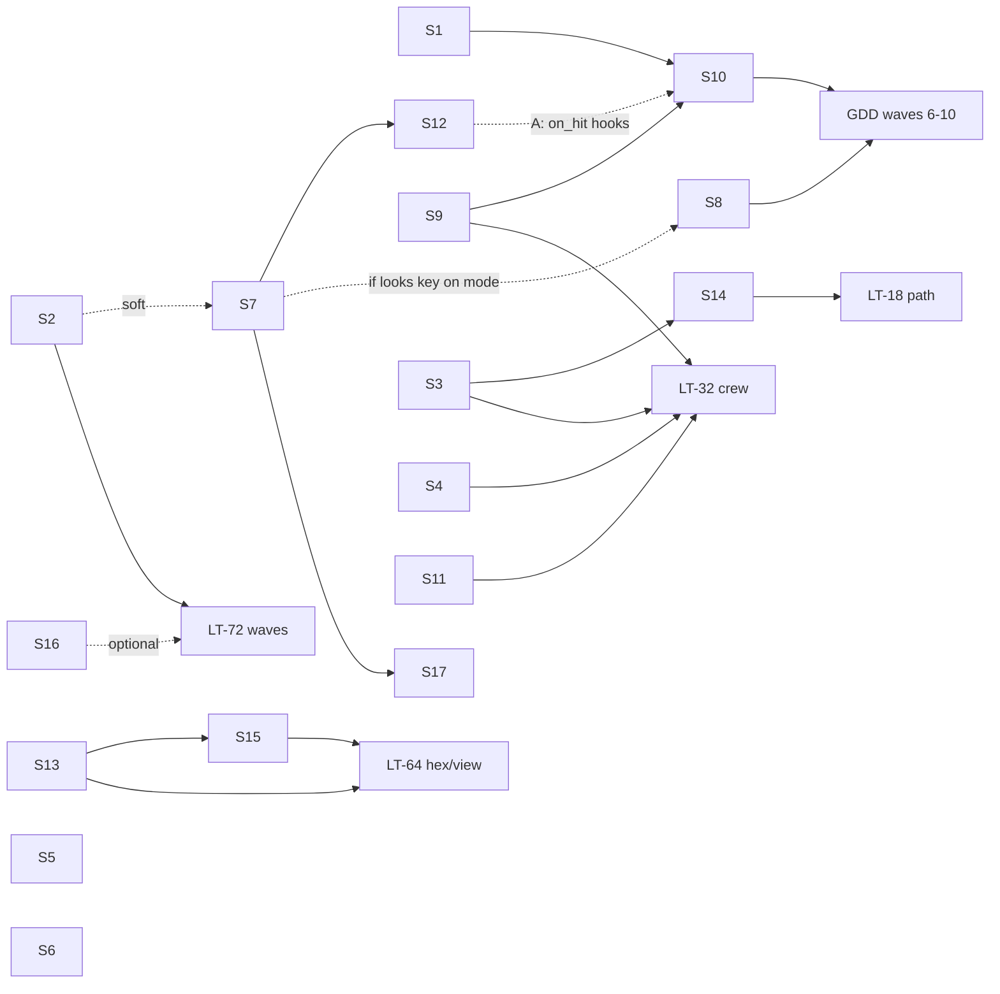

# LT-96: extensibility synthesis (LT-94 + LT-95)

Scope: `release-0.7.0` at `4603926`. No file under `sim/`, `scenes/`, `ui/`, `tools/`, `tests/` or
`data/` changed since `01492e1`, the commit both reviews read, so their line numbers still hold.
Docs only, no code changed, no test or game run.

Inputs:
- **Review A**: `docs/design/LT-94-extensibility-review-opus.md` (blocks A-X1..A-X14, questions A-Q1..Q8).
- **Review B**: `docs/design/LT-95-extensibility-review-fable.md` (blocks B-X0..B-X11, questions B-Q1..Q8).

The two reviews number their blocks independently: A-X2 and B-X2 happen to be the same idea, but
A-X4 and B-X4 are not. This note uses new ids **S1..S17** for the merged blocks (§4) and **D1..D11**
for owner decisions (§6).

Spot-check legend: **confirmed** = grep or `sed -n` at `4603926` shows it; **not confirmed** = the
code shows otherwise; **partly** = the core claim holds but a detail differs (stated).

## 0. Summary

Both reviews reach the same verdict on their own. LT-65 made each edit *safer* (guards, systems,
rule queries), but not *smaller*: a new tower with a new effect still touches about 11 production
files, because the list of things that exist (effect keys, looks, texts, traits, strategies,
commands) is hand-kept in parallel tables and `if` ladders in every layer. Waves are already
data-only. Three of the four enemy traits in the data do nothing. Portability: harden the GDScript
boundary now and pick a second-language core only on a concrete trigger.

They differ mainly on **block shape**: where looks and effect text live, how tests leave live
data, and whether tower debuffs get their own modifier channel (B) or ride on a status table (A).
They also differ on **how wide the portability work is** (A: IO, RNG wrapper, trace; B: plus
event schema, read-only snapshot, an owned PCG32).

## 1. Agreements (found independently by both)

| # | Finding | A | B | Spot-check |
|---|---|---|---|---|
| G1 | `tower_harass`, `tower_lift`, `regen` are in `data/enemies.json`, pass the schema, and no sim code reads them; there is no `PENDING` marker for traits | C4, A-X4a | §2.3 #2, B-X0 | **confirmed.** `data/enemies.json:8,30,39`; schema `sim/defs/enemy_def.gd:27-29`. A grep over `sim scenes ui tools` for the three names finds only the schema and a comment (`sim/core/sim_tower.gd:40` "added by later tasks"). Every other `regen` hit is sanity regen. Only `pack` is read (`spawn_system.gd:50-54`) |
| G2 | `HallucinationSystem.BOSS_TRAIT := "boss"` is a trait id the parser rejects | C4 | §2.3 #2 | **confirmed.** `sim/core/hallucination_system.gd:18`, used at `:56`; `enemy_def.gd:65-67` rejects any key not in `TRAITS` (`:23-30`, no `boss`). The comment at `hallucination_system.gd:16` says this is a deliberate hook for the boss task, so the check is dead, not wrong |
| G3 | A new tower with a new effect touches about 11 production files; LT-65 did not reduce it (pre-split 6, now ~10-11) | §2.4, probe 1 | §2.4, probe 1 | **confirmed as edit sites** (the count is an estimate in both). Each named site exists: `tower_def.gd:140` `EFFECTS` plus 7 derived lists (`:155-183`), `tower_rules.gd:152` `POWER_SCALED_EFFECTS`, `board.gd:145` `shot_kind`, `entity_layer.gd:108` `attack_color`, `fx_layer.gd:146` `_shot_fx` and `:300` `_draw_effects`, `tower_text.gd:28` `EFFECT_GROUPS`, `:302` `special_short`, `:412` `_effect_text`, `bot_strategies.gd:22` `BRANCH_PICK` and `:46` `order` match, `bot_runs.gd:76` `STRATEGIES`. Both reviews' merge tables agree on LT-47 (10 prod files) and LT-51 (6) |
| G4 | Effect metadata (bounds, flags, exclusions, power scaling, display group, text) is one concept split over 4 files; make it one catalog | C1, A-X2 | §2.2 #1-2, B-X2 | **confirmed** (sites as in G3) |
| G5 | `fire_towers` is one long function holding shot shapes, miss, crit, astray and fuse between RNG draws whose order golden replay pins; a hook pipeline is the only high-risk block and pays only if several new-effect towers come | A-X3 | B-X3 | **confirmed.** `combat_system.gd:207-337`; draws at `:262` (astray pick), `:686` miss, `:693` crit, `:699` astray roll. Length: A's "130 lines" is right; B's range `:207-323` ends early (the function ends at `:337`) |
| G6 | Enemy behaviour has no hook (spawn/tick/hit/death); `pack` is special-cased in `SpawnSystem` | A-X4b | B-X6 | **confirmed** (`spawn_system.gd:50-54`) |
| G7 | Attack looks are an `if` ladder plus several `match` ladders in presentation; make looks a catalog/registry | C3, A-X5 | §2.2 #3-4, B-X4 | **confirmed** (`board.gd:145-164`, `entity_layer.gd:108`, `fx_layer.gd:146`, `:300`) |
| G8 | The dawn sequence is a hard-coded call list in `WaveDirector`; crew (dawn post rule) and LT-18 (path switch) need a dawn hook | C9, A-X8 | §2.3 #4, B-X7 | **confirmed.** `wave_director.gd:138-153` `_clear_wave`: dissolve fakes, settle tokens, bonus, sanity, auto-restore, `WAVE_CLEARED`, `night_luck` reset |
| G9 | Commands are declared in 4-5 places (facade pair, `REPLAY_ARGS`, replay `match`, `GameCommands`, `CommandText`); one command table | A-X10 | B-X7 | not re-checked (both cite `simulation.gd:455-498`; no code changed since) |
| G10 | Bot strategies are code (`match` per tower, constants); `balance.py` regexes `STRATEGIES` out of `bot_runs.gd`; move to data | C5, A-X11 | §2.2 #7, B-X10 | **confirmed.** `tools/balance/balance.py:49-53`; `bot_runs.gd:76`. Extra coupling neither block lists: `tests/golden_runs.gd:180` also reads `STRATEGIES` via `get_script_constant_map()`, so S5 must keep that const or change the golden harness |
| G11 | Tests pin roster counts of live data (10 towers, 5 enemies, 5 waves) and break on unrelated content changes | A-X1 | §2.2 #13, B-X1 | **confirmed.** `tests/config_valid_test.gd:16-18`, `:29`, `:245` |
| G12 | Tiles are still drawn as rectangles; `cell_polygon` exists but layers do not use it; `fx_layer.gd:327` hard-codes a square | §2.3, A-X6 | §2.3 #6, B-X8 | **confirmed.** `cell_polygon` has no caller outside `board_view.gd` and `tests/board_view_test.gd:176`. `cell_rect(` outside `board_view.gd`: 8 sites in 5 files (`board.gd:235,238,240`, `lighting.gd:304`, `phantom_layer.gd:31`, `overlay_layer.gd:18,20`, `entity_layer.gd:165`), plus `fx_layer.gd:327`. A's "6 sites" counts files (6 with `fx_layer`), B's "8 sites in 5 files" counts calls; both right |
| G13 | One ground route built once; `MapDef` enforces one `S`, one `L`; LT-18 needs a route source per wave | C11, A-X7 | §2.3 #5, B-X8 | not re-checked (same lines cited by both) |
| G14 | Grid kind is hard-wired; add a topology factory | C12, A-X6 | B-X8 | not re-checked |
| G15 | Two balance-relevant literals remain in the sim | C8 (one) | §2.2 #10 (two) | **confirmed:** `ally_system.gd:11` `ALLY_CONTACT := 0.4`; `combat_system.gd:392` leash `s.range_cells + 1.0`. A lists only the first |
| G16 | "More waves" with existing enemies is already data-only (2 files today: `waves.json` and the count pin) | probe 3 | probe 3 | **confirmed** via G11 |
| G17 | Do not build: a generic ECS/component rewrite, scripting/formulas in JSON, config keys for rule shapes | §4 end | §5 | n/a (design stance) |
| G18 | Portability: the sim is free of nodes, signals, `Engine`/`OS`/`Time`; it is bound by GDScript, Godot's RNG, 32-bit `Vector2` next to 64-bit floats, and JSON/file IO in `sim/config.gd`. Do the boundary in GDScript now; a C# or native core only on a concrete trigger. Neither verified Godot 4.7 C#/GDExtension web export | §5 | §6 | **confirmed:** RNG drawn at 8 sites, 4 `randf` + 4 `randi_range` (`combat_system.gd:262,360,686,693,699`, `economy_system.gd:142`, `spawn_system.gd:54`, `hallucination_system.gd:42`); IO at `sim/config.gd:138-162`; only export preset is `Web` (`export_presets.cfg:3-4`), features `4.7`, `GL Compatibility` (`project.godot:9`) |

## 2. Disagreements

Both sides as written. Where a spot-check settles a fact, the code result is given; design
choices are left to the owner (§6).

### 2.1 Facts and counts

| Topic | A says | B says | Code shows |
|---|---|---|---|
| Attack-mode precedence | The three ladders disagree: `board.gd` `shot_kind` checks pierce before fuse and `min_range` before aoe; `fire_towers` checks fuse before pierce. A unified `mode` must keep each caller's current outcome (A-X2 risk) | Not mentioned | **confirmed (A).** `board.gd:153-162`: beam > pierce > fuse > `min_range` > aoe. `combat_system.gd:266-279`: fuse > pierce > aoe. No shipped level is known to combine both keys, so outcomes agree today; the order difference matters only for a future level that does |
| Is there a sim engine-type guard? | Proposes a *new* guard G12 that lists the allowed engine types (option A, item 1) | A guard already pins 17 engine types | **B is right.** `tests/sim_boundary_test.gd:21-27` `ENGINE_ALLOWLIST` (LT-34) includes `FileAccess`, `JSON`, `RegEx`, `Callable`. A's G12 is a *tightening* of that list, not a new guard |
| `SimTower.status` | Not mentioned (A-X4b plans tower debuffs through a status table) | Exists and is used by 0 lines | **confirmed (B)** for production: `sim_tower.gd:41`; the only reader is the golden digest (`tests/golden_runs.gd:153`) |
| Live-data test files | 46 load `res://data` | 47 of 99 name `res://data`, the default loader or `GameFixture.make` | Heuristic either way: 49 of 99 `tests/*.gd` contain `res://data`; 61 match that or `GameFixture.make`/`make_config`/`load_default`. Neither review measured how many *assert a live value* (B says so; A estimates ~10 by grep of literals). That number is S2's real cost |
| Frozen fixture already drifted? | n/a | "`golden_data` may already differ from `data/` after LT-71 tuning" (B-X1 risk) | **not confirmed** at `4603926`: all 6 files in `tests/fixtures/golden_data/` are byte-identical to `data/`. LT-71 variants exist only as untracked lab files in the main checkout |
| Kind (`mundane`/`occult`) sites | 24 under `sim/`, 66 `kind` references total | 39 string sites in 11 files | Counting differs: 41 lines with the literal `"mundane"`/`"occult"` in 11 files (`sim` 20 of them). Both agree it is spread; they disagree on what to do (§2.2) |
| Pixel calls for an angled view | Not counted (A treats LT-64 view as BoardView-only) | 100 `cells_to_px`/`cell_to_world` calls in 4 layers | 97 such lines under `scenes/` (B's count is close). A's assumption "angled view is BoardView-only" does not hold while layers compute pixels themselves |
| `fire_towers` length | `:207-335`, 130 lines | `:207-323`, ~115 lines | `:207-337` (A) |

### 2.2 Design, block shape and order

| Topic | A | B |
|---|---|---|
| **Tests off live data** (S2) | Keep live data; replace count/id pins with invariants over every def; a rule that tests read numbers from config or a fixture; one `roster_snapshot_test.gd` a content task updates on purpose. ~10 files + 1 | Sim suites load a frozen fixture via the 3 test bases; live data stays covered by `config_valid_test`, bot tests and the lab. Suite count to repair unknown |
| **Effect text location** (S7) | Display strings stay in presentation (`ui/text/effect_text.gd`, bodies moved verbatim); catalog in `sim/defs` holds only metadata; guard G13 ties them | Text templates in the same catalog row (or in a `data/` file, first step to localisation); needs a formatter for percent/plural/"x of", or a `Callable` fallback |
| **`Level.mode`** (S7) | One enum computed at parse, precedence written once; combat, board and text switch on it | Not proposed; looks become data instead (B-X4) |
| **Look location** (S8) | Presentation table keyed by `mode`; optional override in a presentation-only `data/looks.json` the sim never loads; depends on A-X2 | Optional `look` key per tower level and per enemy in `towers.json`/`enemies.json`; one file per look under `scenes/board/fx/`; no dependency |
| **Enemy looks** | Not raised (only status markers) | Every enemy is one circle; `EnemyDef` named in 0 presentation files; a boss cannot be told apart. **Confirmed**: `entity_layer.gd:26-27` one `COLOR_ENEMY`, `grep EnemyDef scenes ui` = 0 |
| **Tower debuffs** (S9/S10) | Statuses get a `StatusRules` table (key, tick, immunity, marker); tower-side harass/lift timers "get the same table"; `SimEnemy.markers()` replaces presentation key reads | A separate tower modifier channel on `SimTower` (`power_mult`, `interval_mult`, `miss_add`, `disabled`), light as its first writer, `TowerRules.effective` reads it (B-X5); crew posts reuse it |
| **Trait hooks shape** (S10) | One `trait_catalog.gd` (params + hooks per entry); depends on X4a and X3 (for `on_hit`) | One file per trait under `sim/core/traits/`; depends on X0 and X5 (for tower traits) |
| **Command table vs phase hooks** | Separate: dawn hook (A-X8) now; command table (A-X10) as the first slice of LT-32 | One block B-X7 (command table + `on_dusk/on_dawn` from a pinned list), before LT-32 |
| **Map seams** | Split: A-X6 (cell drawing + factory, with LT-64) and A-X7 (RouteSet + mutable map state in `SimState`, with LT-18 design; depends on A-X8) | One block B-X8 (factory + `RouteProvider` + polygon drawing), before LT-18; plus B-X9 view transform after LT-64 picks a projection |
| **Config section registry** | A-X9: `GameConfig` loads from a list; rule "a new mechanic's config is optional, absent = off" | Not proposed |
| **Wave modifiers** | A-X14 optional `hp_mult`/`speed_mult` per wave, only if LT-72 wants scaling | "No new wave schema fields until a wave needs one" |
| **Tower kind table** | A-X12, only if a 3rd kind (crew posts) appears | Leave; no 3rd kind on the backlog |
| **Order "now"** | X1, X4a, X8, X9, X11, X13; then X2 -> X5, then X3 before content | X0, X1 now; X5 -> X6 and X4 before LT-72; X7 before LT-32; X8 before LT-18; X9 after LT-64; X2, X10 any time; X3 only for many towers |
| **Size scale** | S = <1 day task, M = 1-2 tasks, L = sliced, several days | S = <=5 files, M = 6-15, L = more or high-risk logic |
| **Waves probe** | LT-72 = 5 -> 10 hand-authored waves with existing enemies (owner quote "волн стоит делать побольше"); Dagon separate | Probe 3b = GDD §8 waves 6-10 including traits and Dagon, so "more waves" is really probe 2 three times |

## 3. Single findings

| Found by | Finding | Holds? |
|---|---|---|
| A | Two back edges (`Combat -> Ally`, `Spawn -> Ally`) are `Callable` hooks; each new cross-system effect will be tempted to add one | **holds** (`simulation.gd:49-50`, `combat_system.gd:41`, `spawn_system.gd:31`) |
| A | Attack-mode precedence differs between combat and board ladders | **holds** (§2.1) |
| A | Enemy `status` keys are spelled in combat and again in presentation (`entity_layer.gd` reads `"bleed_ticks"`, `"banish_immune_ticks"`), no guard | **holds** (`entity_layer.gd:86-89`) |
| A | `GameConfig.load_from_dir` hand-wires each file; optional `oil`/`flare` blocks are the pattern for crew | holds by reading (`sim/config.gd:25`); not re-checked in detail |
| A | Bot run cap `MAX_TICKS := 30*60*30` may be hit by 10 waves | **holds** as a fact (`bot_runs.gd:85`, `:198`); whether 10 waves reach 30 min sim time is not measured |
| A | Wave HP scaling is impossible in data today (needs cloned enemy ids) | holds by schema (B: `SpawnGroup` has 4 fields) |
| A | Engine-neutral trace (JSON Lines, `%.17g`) as conformance oracle for a port | design proposal; cheap, no runtime cost |
| A | `dynamite_config_test.gd` pins every glyph; churn for every tower | plausible, not re-checked |
| B | No modifier channel for towers; `SimTower.status` is dead | **holds** (§2.1) |
| B | Enemies have no look; a boss cannot be told apart | **holds** (§2.2) |
| B | Summon leash `range + 1.0` is a balance literal | **holds** (`combat_system.gd:392`) |
| B | Isotropic `BoardView`; ~100 pixel calls block an angled view | **holds** (97 lines) |
| B | Presentation reads live sim objects (`SimState` in 11 files, ...); no snapshot (LT-65 B12 deferred) | holds (A agrees B12 is deferred to LT-64) |
| B | Event payloads are untyped dictionaries, schema only in comments | plausible, not re-checked |
| B | A new bot strategy also adds golden digest rows (`golden_runs.gd:180`); unclear if `golden-regen.sh` does it in one step | first half **holds** (`golden_runs.gd:180` reads `STRATEGIES`); second half open |
| B | LT-72 and LT-64 have no description in `docs/`; probe assumptions should be checked against the tracker | holds as a process note; the orchestrator should check the tracker text |

## 4. Ordered refactor blocks

All blocks are behaviour-preserving and proven by byte-identical golden replay plus the named
suites with one revert control each (LT-65 §5), unless marked. Size: S = one task under a day,
<=5 files; M = one task of 1-2 days, 6-15 files; L = a sliced task over several days or high-risk
logic. Probe abbreviations: **P1** new tower + effect, **P2** new enemy trait, **P3** more waves
(LT-72), **P4** crew (LT-32), **P5a** hex (LT-64), **P5b** per-wave path (LT-18), **P5c** angled
view (LT-64). Probe file counts are production files and are estimates from both reviews (A / B
where they differ); "after" assumes the block plus its listed dependencies.

### Tier 1: now, low risk, unblock content work

**S1. Trait honesty** (A-X4a, B-X0). S, ~3 files: `sim/defs/enemy_def.gd`, `hallucination_system.gd`
(comment only), `tests/config_valid_test.gd` or a new test, maybe `data/enemies.json`.
What: `EnemyDef.PENDING_TRAITS` for `tower_harass`, `tower_lift`, `regen` (mirror of
`Level.PENDING`) or delete them from the data (D2); accept `boss` as a flag trait; a test that every
trait is read by the sim or pending. Benefit: data, GDD and game agree; designers stop tuning dead
numbers; the boss check becomes reachable. Risk: low; may change config acceptance (reject or flag).
Probes: none directly; prerequisite of S10. Depends: none.

**S2. Tests off live content** (A-X1, B-X1). S/M (A) to M with unknown repairs (B); ~10 test
files + 1 new (A) or 3 test bases + suites (B). What: remove roster count/id pins
(`config_valid_test.gd:16-18,29,245`, glyph pins); then either invariants over every def + one
roster snapshot test (A) or a frozen fixture for sim suites (B); shape is D3. Benefit: content and
balance tasks stop editing unrelated tests. Risk: an accidental deletion in `data/` no longer
caught by a count (A keeps a snapshot); suites asserting live values fail when moved (B; count
unmeasured, so do a measuring slice first). Probes: P1 -1 to -3 test files, P3 2 -> 1, P2 -1.
Depends: none. Do first.

**S3. Dawn/dusk phase hooks** (A-X8, B-X7 phase part). S, ~3 files: `simulation.gd`,
`wave_director.gd`, guard owners. What: `Simulation.on_dawn(n)` runs today's `_clear_wave` body
in the same order (`wave_director.gd:141-147`); the director keeps wave flow only. A: one ordered
facade method; B: systems expose `on_dawn/on_dusk`, called from a pinned list (D10 decides the
shape). Benefit: crew and LT-18 add a line, not a director edit. Risk: low; `WAVE_CLEARED` emit
and `night_luck` write must stay put (golden). Probes: P4 -1 (`wave_director.gd`), P5b -1.
Depends: none.

**S4. Config section registry and optional-block rule** (A-X9; B has no counterpart). S, 1-2
files: `sim/config.gd`. What: load sections from a `[file, parser, required]` list; cross-checks
after all sections; header rule "a new mechanic's config is an optional block, absent = off"
(the `oil`/`flare` pattern). Benefit: crew plugs in without touching fixtures, so the ~29 suites
that build towers stay green. Risk: low; `config_reject_test.gd` pins error order. Probes: P4 -1
(`config.gd`) and avoids test breakage. Depends: none.

**S5. Bot strategies as data** (A-X11, B-X10). S/M, ~5 files: new `tools/bot/strategies.json` (or a
const table), `bot_strategies.gd`, `bot_runs.gd`, `tools/balance/balance.py`,
`tools/balance/README.md`; also `tests/golden_runs.gd:180` (reads `STRATEGIES`). What: order
cycles, branch picks, cap floor, flags as rows; one interpreter; named code policies for the
arms with logic (`occult` cap guard). Optionally derive `MAX_TICKS` from `waves.json` (A C10).
Benefit: a tower enters the lab by a data edit; lab variants can vary strategies. Risk: low; bot
RUN lines identical on 20 seeds; golden digests must not change. Probes: P1 -2
(`bot_strategies.gd`, `bot_runs.gd` -> 1 data file), P3 -1 if `MAX_TICKS` is derived. Depends: none.

**S6. Portability boundary, core** (A-X13, B-X11 items 1, 2, 5). S/M, ~9 files: `sim/core/sim_rng.gd`,
4 RNG call-site files, `sim/config.gd`, new loader outside `sim/`, `tests/sim_boundary_test.gd`
(tighten `ENGINE_ALLOWLIST`: drop `FileAccess`, `JSON`, `RegEx`), `sim_time.gd` header. What: IO
and `JSON.parse` move out of `sim/` (`GameConfig.from_dicts`); the 8 draw sites call a `SimRng` API
(A: `randf`/`randi_range` per stream; B: `chance`/`pick`); write down the float32/float64 contract.
Optional add-ons, each a decision in D8: engine-neutral trace next to golden digests (A), event
payload schema test (B), owned PCG32 (B). Benefit: a later port becomes mechanical; nothing is
lost if no port happens. Risk: low; the RNG wrapper must not add or reorder a draw (golden).
Probes: none (portability). Depends: none.

### Tier 2: before the next tower/enemy content batch

**S7. EffectCatalog** (A-X2, B-X2; folds in G15 literals). M, ~8 files: new `sim/defs/effect_catalog.gd`,
`tower_def.gd`, `tower_rules.gd`, `tower_stats_model.gd`, `tower_text.gd` (+ new
`ui/text/effect_text.gd` if text stays in presentation), `board.gd`, `combat_system.gd` (if
`mode` is in), guard. What: one row per effect key: max, flag, family, excludes, requires,
power-scaled, neutral, row key, display group; replaces the 8 lists in `tower_def.gd:140-183`,
`POWER_SCALED_EFFECTS`, `EFFECT_GROUPS`/`ROW_EFFECT_KEYS`. Open shape (D4, D5): whether `Level.mode`
(one precedence) is in, and where text lives. Optionally move `ALLY_CONTACT` and the summon leash
into effect keys. Benefit: a new key is 1 row (+1 text entry) + its behaviour; ladders cannot
drift; the catalog is the list UI and bots iterate. Risk: A medium, B low. Strings must stay
identical (`tower_text_test`, `stats_rows_test`); if `mode` is in, a test pins `mode` against each
old ladder for every shipped and golden level before deletion (the ladders disagree, §2.1).
Probes: P1 11 -> ~7-8 alone (both reviews). Depends: S2 (soft).

**S8. Look catalog** (A-X5, B-X4). M, ~4 (A) to ~8 (B) files: new `scenes/board/look_catalog.gd` or
`scenes/board/fx/*`, `board.gd`, `entity_layer.gd`, `fx_layer.gd`; with B's shape also
`tower_def.gd`, `enemy_def.gd`, `towers.json`, `enemies.json`. What: per look: colour, fx builder,
renderer, cap, marker style; default look derived as today; optional data override (D4); enemy
looks if D4 takes B's shape. Benefit: reusing a look is 0 code; a new look is 1 entry + 1 draw
function; enemies and a boss become readable. Risk: low-medium (visual); `tower_attack_visuals_test`,
`render_isolation_test`, `board_layers_test`; frame time median/p90 not worse (window with
`-- --mute`). Probes: P1 -2 (`board.gd`, `entity_layer.gd` drop out; `fx_layer` -> 1 look file),
P2 -1 (marker row), P3b boss look. Depends: S7 if looks key on `mode` (A); none otherwise (B).

**S9. Tower modifier channel** (B-X5; A covers part of it inside A-X4b). M, ~6 files:
`sim_tower.gd`, `light_system.gd`, `combat_system.gd`, `tower_rules.gd`, `simulation.gd`, guard.
What: per-tick `power_mult`, `interval_mult`, `miss_add`, `disabled` on `SimTower` (replaces the
dead `status`); light is the first writer; `TowerRules.effective` reads it. Benefit: harass,
lift-disable, crew posts and future buffs write one channel; the UI shows the same numbers.
Risk: medium; multiplication order into damage and cooldown must not change (golden; light reads
at `combat_system.gd:169,246,343,389`, interval `:322`). Probes: P2 (tower-affecting trait) 9 -> ~5
with S10; P4 -2 (`combat_system.gd`, `sim_tower.gd`). Depends: none. Whether it exists as a
separate block is D6.

**S10. Enemy trait hooks and status registry** (A-X4b, B-X6). M, ~7 files: new `sim/core/traits/`
(catalog or one file per trait, D6), `enemy_def.gd`, `spawn_system.gd` (`pack` moves in),
`combat_system.gd` (`tick_statuses`), `simulation.gd`, `sim_enemy.gd`, `entity_layer.gd`, guard.
What: per trait its param schema and hooks (`on_spawn`, `on_tick`, `on_hit`/`on_damaged`,
`on_death`, `on_leak`, `near_tower`), called at fixed points in enemy-id then catalog order;
statuses in a table with marker names; `SimEnemy.markers()` replaces presentation key reads
(A). Benefit: each inert trait and Dagon's summon become one entry/file. Risk: medium; moving
`pack` moves an RNG draw (`spawn_system.gd:54`, call order must hold); a hook in `apply_damage` is
on the hot path (tick cost within 5 %). Probes: P2 regen 4-6 -> 2-3; harass 9 -> 3 (with S9); P3b
~12 -> ~7. Depends: S1; S9 for tower-affecting traits (B) or S12 for `on_hit` (A).

### Tier 3: inside or just before their features

**S11. Command table** (A-X10, B-X7 command part). S (A, 1 file) to M (B, ~5 files:
`simulation.gd`, new `sim/core/sim_commands.gd`, `game_commands.gd`, `command_text.gd`). What:
one entry per command (name, arg types, `can`, `apply`, text key) replaces `REPLAY_ARGS`
(`simulation.gd:455-468`) and the replay `match` (`:476-498`). Benefit: a command is one entry;
replay, forwarder and reason texts cannot drift. Risk: low; `command_log` format unchanged
(`sim_boundary_api_test`). Probes: P4 -2..-3. Depends: none. Timing (first slice of LT-32 vs
before it, bundled with S3) is D10.

**S12. Combat shot pipeline** (A-X3, B-X3). L, high risk, ~4 (A) to ~8+ (B) files:
`combat_system.gd` split into a driver + `shot_shapes.gd`/`on_hit.gd` (A) or one file per effect
family (B), guard (no `rng(` under `systems/combat/`). What: fixed stages pick target -> madness
and astray -> shape -> miss -> crit -> emit SHOT -> damage -> on-hit; RNG draws stay in the
driver. Banish and summon bypass the shot path today, so the hook set must be designed from the 29
keys: B asks for its own design note first. Benefit: a new shape/on-hit effect is one function +
one catalog row, no edit between RNG draws. Risk: high; RNG order, emit order and float order
byte-identical; tick cost within 5 % with `uptime` and `time -p`. Probes: P1 ~7-8 -> ~5 (with S7,
S8, S5, S2). Depends: S7. Only if D1 says several new-effect towers are coming.

**S13. Grid factory and polygon tile drawing** (A-X6, B-X8 part). S/M, ~9 files: `board_view.gd`
(`fill_cell`/`outline_cell` from `cell_polygon`), `board.gd`, `lighting.gd`, `entity_layer.gd`,
`phantom_layer.gd`, `overlay_layer.gd`, `fx_layer.gd`, `map_def.gd` (factory instead of
`SquareGrid.new`), guard (`cell_rect(` only in `board_view.gd`). Benefit: hex becomes one sim class
+ map data + a factory line. Risk: low-medium; grid lines may shift a pixel on the square grid;
tower plate letter/pips need a centred layout on hex; screenshots at 1200x675 and 1920x1080
(`-- --mute`). Probes: P5a 9-10 -> 3-4. Depends: none; first slice of LT-64 (A) or before LT-18 (B).

**S14. Route source and mutable map state** (A-X7, B-X8 route part). M, ~9 files: `map_def.gd`
(`routes` by id or a `RouteProvider`), `spawn_system.gd` (route cache by id instead of
`_ground_route`), `waves_config.gd` (`"route"`), `sim_state.gd` (buildable mask, current/next
route), new generator in `sim/rules/`, `sim_rng.gd` (new stream appended last), `simulation.gd`,
`bot_placement.gd`, guard. Benefit: LT-18 lands in map, spawn and dawn code, not across the board.
Risk: medium; `state.map` is the config object today, so every `is_buildable` reader changes; a
new RNG stream must be appended last. Probes: P5b ~12-14 -> 7-9. Depends: S3; LT-18 design
decisions (D9).

**S15. View transform** (B-X9 only). M, 5 files: `board_view.gd` + 4 layers. What: layers draw
in cell units under one canvas transform held by `BoardView`. Benefit: an angled view is one
matrix. Risk: medium (pixel look); ~97 call sites; line widths and text must stay in pixels. Probes:
P5c 5 -> 1. Depends: S13; start only after LT-64 picks a projection.

**S16. Wave modifiers** (A-X14 only; B advises against new wave fields until needed). S, 3 files:
`waves_config.gd`, `spawn_system.gd`, 1 test. What: optional per-wave `hp_mult`/`speed_mult`;
fakes use the same multiplier (LT-12). Changes behaviour only when data uses it. Risk:
`units_per_tick` rounding; whether `pull_max_hp`/`banish_max_hp` caps compare base or scaled HP.
Probes: P3 with scaling: avoids cloned enemy ids. Depends: none. Only if D11 wants scaling.

**S17. Tower kind table** (A-X12 only; B says leave). M, ~10 files. What: a `kinds` config block
(misses, kill regen, reserves sanity, light/shadow multipliers) instead of ~41 string sites.
Risk: medium; touches LT-70-tuned light rules and float order. Probes: P4 only if a crew post is
a third kind. Depends: S7. Only if D6 makes posts a kind.

### Combined probe table (production files; tests excluded)

| Probe | Today (A / B) | After Tier 1 | After Tier 1+2 | After all relevant | Blocks |
|---|---|---|---|---|---|
| P1 new tower + new effect + new look | 11 / 11 | ~9 (S5) | ~6 | ~5 | S2, S5, S7, S8, S12 |
| P1b same, reusing a look | ~9 (B) | ~7 | ~4 | ~3 | S2, S5, S7, S12 |
| P2 enemy-only trait (regen) | 6 / 4 | same | 2-3 | 2-3 | S1, S8, S10 |
| P2 tower-affecting trait (harass) | n/a / 9 | same | ~3 | ~3 | S1, S9, S10, S8 |
| P3 more waves, existing enemies | 2 / 2 | 1 | 1 | 1 | S2 (S5 if `MAX_TICKS`) |
| P3b GDD waves 6-10 with traits + Dagon | n/a / ~12 | ~12 | ~7 | ~7 | S1, S8, S9, S10 |
| P4 crew (LT-32) | ~20 / ~25 | ~18 | ~16 | ~13-15 | S3, S4, S9, S11 (+S17) |
| P5a hex | 9 / 10 | same | same | 3-4 | S13 |
| P5b per-wave path | ~14 / ~13 | ~13 | ~13 | 7-9 | S3, S14 |
| P5c angled view | n/a / 5 | same | same | 1 | S15 |

Crew stays expensive after every block: both reviews say most of it is feature and design work,
not plumbing. The main gain there is S4 keeping the existing suites green.

### Dependency graph

Suggested cut (both reviews agree on tier 1 being first; the rest follows D1):
- **Next release:** S1, S2, S3, S4, S5, S6. All S or S/M, low risk, independent; 6 tasks.
- **Before new content:** S7 -> S8, S9 -> S10. S12 only on D1 = many new-effect towers.
- **Inside features:** S11 with LT-32; S13 (+S15) with LT-64; S14 with LT-18; S16 with LT-72 if
  scaling; S17 only if a third kind.

## 5. Engine portability

**Combined view.** Both reviews measure the same bindings and reach the same recommendation:
option A (hard boundary in GDScript) now, a second-language core only on a concrete trigger.
Every step of A is a prerequisite of any B, so nothing is wasted.

| Binding | Both agree | Port cost |
|---|---|---|
| GDScript, `class_name`, `@abstract`, typed dicts | yes | the rewrite itself |
| Godot RNG (PCG32 + `randf`/`randi_range` mapping), 8 draw sites | yes (confirmed §1 G18) | medium; trivial once behind one `SimRng` API |
| `Vector2` float32 next to 64-bit `float` (beam kept as two float64 on purpose) | yes | high: a port must emulate float32 exactly or re-pin digests |
| JSON/file IO in `sim/config.gd` | yes | low: move out |
| Golden digests are Godot text | A | medium: not comparable across engines (A's trace fixes it) |
| Presentation reads live sim objects, no snapshot | B | high for B3, irrelevant for B1/B2 |
| Tests are GDScript against the sim API (99 files) | both | high for any B |
| Only export preset is Web, features `4.7` | both, confirmed | decides B1 viability |

**Options and cost.**

| Option | Contents | Cost | Note |
|---|---|---|---|
| A-min (S6 core) | IO out of `sim/`; RNG behind `SimRng`; tighten the existing `ENGINE_ALLOWLIST`; float contract doc | S/M, ~9 files, 1 task | Common ground of both reviews |
| A + trace (A) | engine-neutral JSON Lines trace next to golden digests, `%.17g` floats | +S | Conformance oracle for a port; no runtime cost |
| A + B's extras (B) | event payload schema test; read-only snapshot / read API for presentation (= LT-65 B12); owned 20-line PCG32 | M, 10-15 files | Snapshot is the largest item; A defers it to LT-64. Owning PCG32 must reproduce Godot's stream bit-exactly or golden is re-pinned once |
| B1 C# in Godot | port 5.5k lines + binding + tests | A: ~1 release; B: L | Web export of C# in Godot 4.x not verified for 4.7 by either review, and Web is the only preset |
| B2 Rust/C++ via GDExtension | port + bindings + per-platform builds incl. wasm | A: 1-2 releases (XL); B: L-XL | Web GDExtension builds possible but fragile; not verified |
| B3 engine-neutral core, thin clients | B2 + snapshot/command protocol + new bot harness | B: XL | B only |

**Kept visible:**
- *Scope of A:* A says 1-2 tasks, ~9 files, including a trace; B says M, 10-15 files, including
  an event schema and a snapshot, and drops the trace. The snapshot is the real difference in
  cost.
- *Guard:* A frames its allowlist as a new guard G12; the code already has one
  (`tests/sim_boundary_test.gd:21-27`). Only the tightening is new.
- *Triggers for B:* A: a platform Godot cannot export, or lab speed becoming the bottleneck. B: a
  second client/engine, a server-side sim, or a measured lab time that limits balance work.
  Neither measured lab run time.

## 6. Owner decisions needed

Most blocking first. Each is phrased to be asked as one multiple-choice question.

**D1. Which content comes next, and how many towers with new effects are planned?** (A-Q1, B-Q2)
Decides whether tier 2 runs before features, and whether S12 runs at all.
- **New towers/enemies within 1-2 releases, 1-2 new-effect towers: S7, S8, S9, S10, no S12 (Recommended).** Benefit: probe 1 drops to ~6 files without the high-risk block. Risk: if many towers follow, each still edits `fire_towers`.
- New towers/enemies, 5+ new-effect towers: tier 2 plus S12. Benefit: P1 ~5 files and no edit between RNG draws. Risk: high-risk L block with its own design note before any content.
- Crew and Map v2 first: skip tier 2 for now, do S3, S4, S11, S13, S14. Benefit: features sooner. Risk: content later pays today's ~11 files per tower.

**D2. Inert enemy traits** (`tower_harass`, `tower_lift`, `regen`) (A-Q2, B-Q1; S1)
- **Mark pending in the schema (`PENDING_TRAITS`), keep the data, accept `boss` (Recommended).** Benefit: GDD numbers stay in data; bots/tests/UI can see "coming soon". Risk: data still carries numbers nobody plays.
- Remove the three from `data/enemies.json` until built, accept `boss`. Benefit: data shows only what the game does. Risk: the GDD numbers move back to the GDD; re-adding them is a separate edit.
- Leave as is. Benefit: no work. Risk: designers tune numbers that do nothing.

**D3. How tests leave live data** (A-Q8, B-Q5; S2)
- **Invariants over every def + one roster snapshot test, live data stays (A shape) (Recommended).** Benefit: ~10 files, scope measured by grep; suites keep exercising shipped numbers. Risk: a test asserting a live value still breaks on balance tuning until migrated.
- Frozen fixture for sim suites; live data only in `config_valid_test`, bot tests, the lab (B shape). Benefit: balance tuning cannot break sim suites. Risk: number of suites to repair is unknown; suites stop exercising shipped numbers.
- A first, B later only for suites that break on tuning. Benefit: cheap now, targeted later. Risk: two conventions for a while.

**D4. Where a tower's (and enemy's) look is chosen** (A-Q5, B-Q4; S7, S8)
- **Derived from attack mode by default; optional override in a presentation-only `data/looks.json`, also covering enemy looks (Recommended).** Benefit: sim configs stay free of presentation; reuse without code. Risk: one more data file to keep in sync with tower ids.
- `look` key per level in `towers.json` and per enemy in `enemies.json` (B). Benefit: one place per tower; follows the existing `name`/`glyph` precedent. Risk: the sim loads and validates presentation data.
- Always derived from attack mode, no override (A without Q5). Benefit: simplest. Risk: a new look needs code; enemies stay undistinguished.

**D5. Where effect display text lives** (B-Q3; S7)
- **In presentation, `ui/text/effect_text.gd`, one entry per catalog key, guard ties them (A) (Recommended).** Benefit: bodies move verbatim, strings stay identical, no formatter needed. Risk: two entries per key (catalog + text).
- In the sim catalog row as templates (B). Benefit: one row per key. Risk: needs a formatter (percent, plural, "x of") or `Callable` fallback; sim holds player text.
- In a `data/` text file. Benefit: first step to localisation. Risk: largest change; formatter needed; text drifts from keys without a guard.

**D6. Crew post model and tower debuffs** (A-Q3, B-Q6; S9, S10, S17)
- **A post is a tower with a modifier; add the tower modifier channel S9 and use it for harass/lift too (Recommended).** Benefit: one channel for posts, debuffs and light; cheap crew. Risk: medium block on damage/cooldown float order.
- A post is a third tower kind (S17 kind table). Benefit: posts get their own rules in config. Risk: ~10 files touching LT-70 light rules.
- A post is a unit on the path next to `AllySystem` (LT-46 P10); tower debuffs go into A's `StatusRules` table, no S9. Benefit: no new tower channel. Risk: crew becomes a new entity type; debuffs and light stay separate paths.

**D7. Crew config as an optional block** (A-Q4; S4)
- **Yes: crew is off when its config block is absent (Recommended).** Benefit: existing suites and golden data stay unchanged. Risk: two modes to test (with and without crew).
- No: crew is always on once shipped. Benefit: one game mode. Risk: ~29 suites that build towers break and need crew setup.

**D8. Portability scope** (A-Q7, B-Q8; S6)
- **A-min plus A's trace, no snapshot now; B only on a concrete trigger (Recommended).** Benefit: 1-2 tasks; a port becomes mechanical and testable. Risk: presentation still reads live objects (snapshot left to LT-64).
- B's full A: add event schema, read-only snapshot, owned PCG32. Benefit: cleanest boundary. Risk: M, 10-15 files; snapshot is a large presentation change.
- A-min only. Benefit: cheapest. Risk: no cross-engine conformance oracle.
- Nothing now. Benefit: zero cost. Risk: IO and RNG coupling grow with content.

**D9. Map v2 order** (B-Q7; S13, S14)
- **Hex first on the fixed path (S13), then per-wave paths (S14) (Recommended).** Benefit: S13 is small and low risk. Risk: hex needs a range retune (~15 % more cells per radius) before paths add their own balance change.
- Per-wave paths first on the square grid. Benefit: the gameplay change (LT-18) lands earlier. Risk: S14 is medium and needs LT-18 design decisions first.
- Both inside one Map v2 release. Benefit: one balance pass. Risk: a large release with two moving parts.

**D10. Command table and phase hooks: bundle or split** (A vs B; S3, S11)
- **Split: phase hook S3 now; command table S11 as the first slice of LT-32 (A) (Recommended).** Benefit: S3 is S-sized and helps LT-18 too; S11 lands when its first user exists. Risk: S11 waits.
- One block before LT-32 with systems subscribing to `on_dawn/on_dusk` (B). Benefit: one task, both seams ready. Risk: M-sized; subscription order must reproduce `wave_director.gd:141-147` exactly.

**D11. LT-72 waves: scaling** (A-Q6; S16)
- **Hand-authored only for now; no new wave fields (B stance) (Recommended).** Benefit: no new balance dimension. Risk: 10+ waves may need cloned enemy ids for difficulty.
- Add per-wave `hp_mult`/`speed_mult` (S16). Benefit: cheap difficulty curve. Risk: a new lab dimension; HP cap semantics to decide.

### Owner decisions (2026-11-20)

The owner's chosen option labels, quoted verbatim (the questions were asked in Russian):

| # | Owner answer (verbatim) | Effect on the blocks |
|---|---|---|
| D1 | "1-2 башни, S7-S10 без S12 (Recommended)" | Tier 2 (S7-S10) runs before new content; S12 is dropped. |
| D2 | "Пометить pending, принять boss (Recommended)" | S1: `PENDING_TRAITS`, data kept, `boss` accepted. |
| D3 | "Инварианты + снимок состава (A) (Recommended)" | S2 takes A's shape: invariants plus one roster snapshot test. |
| D4 | "По режиму атаки + data/looks.json (Recommended)" | S8: look derived from attack mode, optional override in presentation-only `data/looks.json`, enemies included. |
| D5 | "В файле в data/" | S7: effect display text lives in a `data/` text file (not A's or B's shape); S7 needs a formatter (percent, plural, "x of") and a guard that ties every catalog key to a text entry. S7 grows toward L. |
| D6 | "Башня с модификатором, канал S9 (Recommended)" | S9 is its own block; harass/lift use it; a crew post is a tower with a modifier. S17 is dropped. |
| D7 | "Да, без блока экипаж выключен (Recommended)" | S4: optional-block rule, absent = off. |
| D8 | "Минимум A + трасса, B по поводу (Recommended)" | S6: IO out of `sim/`, `SimRng` API, float contract, plus A's engine-neutral trace; B's event schema, snapshot and PCG32 only on a concrete trigger. |
| D9 | "Сначала гексы, потом пути (Recommended)" | S13 (hex on the fixed path) before S14 (per-wave paths). |
| D10 | "Раздельно: S3 сейчас, S11 в LT-32 (Recommended)" | S3 in tier 1; S11 is the first slice of LT-32. |
| D11 | "Множители hp_mult/speed_mult на волну (S16)" | S16 is in, ahead of LT-72; the HP-cap semantics (base vs scaled for `pull_max_hp`/`banish_max_hp`) are decided in its design. |

Dropped by these decisions: S12 (D1), S17 (D6).

## 7. Not verified

- No test, bot run or game launch; no block prototyped. All probe counts are estimates from both reviews.
- How many test suites assert a live data *value* (S2's real cost).
- Whether `scripts/golden-regen.sh` adds rows for a new strategy in one step.
- Godot 4.7 C# and GDExtension web export status.
- Lab run time and where it is spent.
- LT-72 and LT-64 tracker text (B notes neither is in `docs/`).

## 8. Follow-up tasks

Created from the owner decisions in §6, in the backlog (no release yet):
LT-97 (S1), LT-98 (S2), LT-99 (S3), LT-100 (S4), LT-101 (S5), LT-102 (S6), LT-103 (S7),
LT-104 (S8), LT-105 (S9), LT-106 (S10), LT-107 (S11), LT-108 (S13), LT-109 (S14), LT-110 (S15),
LT-111 (S16). S12 and S17 are dropped.
Dependencies: LT-106 <- LT-97, LT-105; LT-104 <- LT-103; LT-109 <- LT-99, LT-108, LT-18;
LT-110 <- LT-108, LT-64; LT-32 <- LT-99, LT-100, LT-105, LT-107; LT-72 <- LT-98, LT-111.
LT-108 overlaps LT-91 (cell_polygon drawing); the two are reconciled when LT-108 is sliced.
